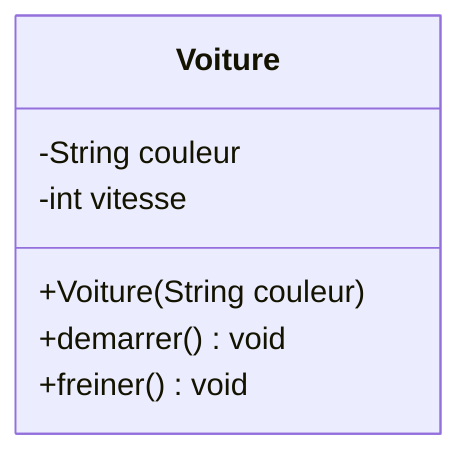
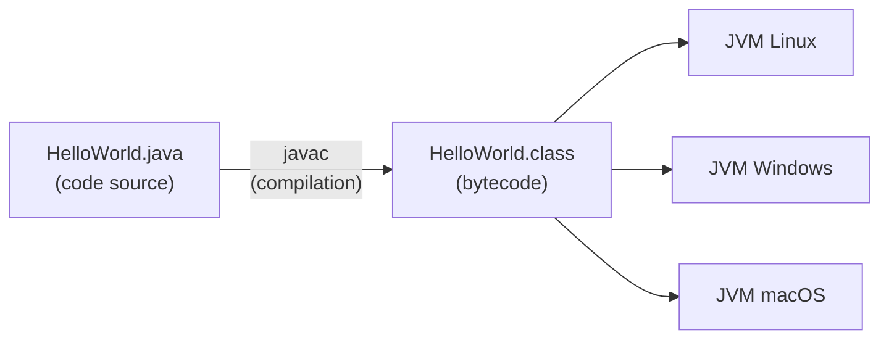

# Chapitre 1 — Introduction à la POO et à Java

← [[PG220_00_Sommaire|Sommaire]] · Suivant → [[Fiche_PG220_02_Classes_Objets|Classes et objets]]

> [!abstract] Ce que tu dois retenir
> - La POO organise un programme autour d'**objets** qui regroupent des **données** (attributs) et des **comportements** (méthodes).
> - Une **classe** est un plan, un **objet** est une chose construite à partir de ce plan.
> - Java compile vers du **bytecode** exécuté par la **JVM**, d'où « Write Once, Run Anywhere ».
> - En Java, **tout le code vit dans une classe**, même le `main`.

---

## 1. Programme et paradigmes

Un programme, c'est une suite d'instructions exécutées par une machine. La façon d'**organiser** ces instructions s'appelle un **paradigme**.

| Paradigme | Idée | Unité de base | Exemples |
|---|---|---|---|
| **Procédural** | Une suite d'instructions et de fonctions qui manipulent des données séparées | la fonction | C, Pascal |
| **Orienté objet** | Des objets qui portent leurs données *et* les opérations qui s'y appliquent | l'objet | Java, C++, Python |

L'objectif de la POO : un code **modulaire**, **réutilisable** et **maintenable**.

### Même problème, deux approches

On veut gérer un compte bancaire (solde + dépôt + retrait).

**En procédural (C)** : les données et les fonctions sont séparées. Rien n'empêche quelqu'un d'écrire `c.solde = -1000000;` directement.

```c
struct Compte { double solde; };

void deposer(struct Compte *c, double montant) { c->solde += montant; }
void retirer(struct Compte *c, double montant) { c->solde -= montant; }

// n'importe qui peut faire : c.solde = -1000000;  😬
```

**En orienté objet (Java)** : les données et les opérations sont regroupées dans une classe, et l'objet **protège** son solde.

```java
public class Compte {
    private double solde;              // caché : personne ne peut y toucher directement

    public void deposer(double montant) {
        if (montant > 0) solde += montant;
    }

    public boolean retirer(double montant) {
        if (montant <= 0 || montant > solde) return false;  // règle métier garantie
        solde -= montant;
        return true;
    }

    public double getSolde() { return solde; }
}
```

> [!tip] L'idée clé
> En POO, c'est **l'objet lui-même** qui garantit qu'il reste dans un état cohérent. On ne lui « fait » pas des choses de l'extérieur, on lui **demande** de faire des choses.

---

## 2. Les 4 concepts fondamentaux

| Concept | Définition | Analogie |
|---|---|---|
| **Classe** | Modèle (plan) qui définit les caractéristiques d'un objet | Le plan d'architecte d'une maison |
| **Objet** | Instance d'une classe, entité concrète en mémoire | Une maison construite avec ce plan |
| **Attribut** | Variable qui décrit l'**état** de l'objet | La couleur des murs, le nombre de pièces |
| **Méthode** | Fonction qui définit le **comportement** de l'objet | Ouvrir la porte, allumer le chauffage |

Avec un seul plan, on peut construire autant de maisons qu'on veut, et chacune a **ses propres valeurs** (une maison bleue, une rouge…).

### L'exemple du cours : `Voiture`

```java
public class Voiture {
    // Attributs = état
    private String couleur;
    private int vitesse;

    public Voiture(String couleur) {
        this.couleur = couleur;
        this.vitesse = 0;
    }

    // Méthodes = comportement
    public void demarrer() { vitesse = 10; }
    public void freiner()  { vitesse = 0; }
}
```

```java
Voiture maVoiture  = new Voiture("rouge");   // un objet
Voiture taVoiture  = new Voiture("bleue");   // un autre objet, indépendant
maVoiture.demarrer();                         // seule maVoiture roule
```



---

## 3. Pourquoi Java ?

| Atout | Ce que ça veut dire concrètement |
|---|---|
| **Multiplateforme** (« Write Once, Run Anywhere ») | Le même `.class` tourne sur Linux, Windows, macOS, Android… |
| **Sécurisé** | Pas de pointeurs bruts ni d'arithmétique de pointeurs, mémoire libérée automatiquement (*garbage collector*), erreurs gérées par exceptions, bac à sable (*sandbox*) |
| **Orienté objet** | Tout est organisé en classes et objets |
| **Bibliothèque standard riche** | Collections, fichiers, réseau, threads… déjà fournis |
| **Très utilisé** | Web (backends), Android, serveurs, IoT |

### Comment marche le « Run Anywhere » ?



Le compilateur `javac` ne produit **pas** du code machine, mais du **bytecode**, un langage intermédiaire. C'est la **JVM** (Java Virtual Machine), installée sur chaque système, qui l'exécute. Le bytecode est donc le même partout ; seule la JVM change.

> [!note] Vocabulaire
> - **JVM** : la machine virtuelle qui exécute le bytecode.
> - **JRE** : JVM + bibliothèques standard → suffisant pour *exécuter*.
> - **JDK** : JRE + outils de développement (`javac`, `jar`…) → nécessaire pour *développer*.

---

## 4. Premier programme décortiqué

```java
public class HelloWorld {
    public static void main(String[] args) {
        System.out.println("Bonjour, bienvenue en Java !");
    }
}
```

| Élément | Signification |
|---|---|
| `public class HelloWorld` | Déclare une classe publique. **Le fichier doit s'appeler `HelloWorld.java`.** |
| `public` | La méthode est appelable depuis l'extérieur (ici par la JVM) |
| `static` | La méthode appartient à la **classe**, pas à un objet → la JVM peut l'appeler sans créer d'objet (voir [[Fiche_PG220_03_Static_Final_Relations]]) |
| `void` | La méthode ne renvoie rien |
| `main` | Nom imposé : c'est le **point d'entrée** du programme |
| `String[] args` | Les arguments passés en ligne de commande |
| `System.out.println(...)` | `System` est une classe, `out` un attribut statique (le flux de sortie), `println` une méthode qui affiche puis saute une ligne |

### Compiler et exécuter

```bash
javac HelloWorld.java    # produit HelloWorld.class
java HelloWorld          # lance la JVM sur la classe (sans .class !)

# Depuis Java 11 : compiler + exécuter en une commande pour un fichier unique
java HelloWorld.java
```

Pour avoir `javac` il faut un **JDK**. Sur Fedora, c'est le paquet `java-<version>-openjdk-devel` (par exemple `sudo dnf install java-21-openjdk-devel`) ; le paquet sans `-devel` ne contient que de quoi exécuter.

> [!warning] Piège classique
> `java HelloWorld.class` → erreur. On donne le **nom de la classe**, pas le nom du fichier compilé.

---

## 5. Rappel express : types primitifs vs références

Ce n'est pas détaillé dans les slides, mais **tout le reste du cours** repose dessus.

Java a **8 types primitifs** (des valeurs brutes, stockées directement) :

| Type | Contenu | Taille | Valeur par défaut (attribut) |
|---|---|---|---|
| `byte` | entier | 8 bits | `0` |
| `short` | entier | 16 bits | `0` |
| `int` | entier | 32 bits | `0` |
| `long` | entier | 64 bits | `0L` |
| `float` | réel | 32 bits | `0.0f` |
| `double` | réel | 64 bits | `0.0` |
| `char` | caractère Unicode | 16 bits | `'\u0000'` |
| `boolean` | vrai/faux | — | `false` |

**Tout le reste est une référence** vers un objet : `String`, les tableaux, `Voiture`, `ArrayList`… Une variable de type référence contient une sorte d'« adresse » vers l'objet, ou `null` si elle ne pointe vers rien.

```java
int x = 5;                       // x CONTIENT 5
Voiture v = new Voiture("rouge"); // v contient une RÉFÉRENCE vers un objet Voiture
Voiture w = null;                 // w ne pointe vers rien
```

> [!tip] À garder en tête
> `String` n'est **pas** un type primitif, c'est une classe. D'où la majuscule. D'où aussi le fait qu'on compare deux `String` avec `.equals()` et non `==` (voir [[Fiche_PG220_05_Interfaces_Abstraites_Tri#9. equals, hashCode et compareTo|la fiche 05]]).

---

## 6. Question du cours (slide 9)

> [!question]- Quels avantages à organiser un programme en objets plutôt qu'en suite d'instructions ?
> - **Modularité** : chaque classe est une brique indépendante qu'on peut comprendre, tester et modifier seule.
> - **Encapsulation** : un objet protège ses données et garantit sa cohérence (le `Compte` ne peut pas devenir négatif).
> - **Réutilisation** : une classe écrite une fois sert partout ; l'héritage permet de réutiliser et spécialiser.
> - **Maintenabilité** : on peut changer l'implémentation interne d'une classe sans casser le code qui l'utilise.
> - **Proximité avec le réel** : on modélise des entités du domaine (Étudiant, Cours, Voiture), le code est plus lisible.
> - **Extensibilité** : grâce au polymorphisme, on ajoute de nouveaux types sans modifier le code existant.

---

## 🔁 Teste-toi

> [!question]- Quelle est la différence entre une classe et un objet ?
> La classe est le **modèle** (le type), l'objet est une **instance** concrète créée en mémoire avec `new`. Une classe → autant d'objets qu'on veut, chacun avec ses propres valeurs d'attributs.

> [!question]- Que produit `javac` ? Qui l'exécute ?
> Du **bytecode** (fichiers `.class`), exécuté par la **JVM**. C'est ce qui rend Java portable.

> [!question]- Pourquoi `main` est-il `static` ?
> Parce qu'au lancement il n'existe encore aucun objet. Une méthode `static` appartient à la classe et peut donc être appelée par la JVM sans instancier la classe.

> [!question]- Le fichier contient `public class Robot`. Comment doit-il s'appeler ?
> `Robot.java`. Une classe `public` doit être dans un fichier du même nom (majuscules comprises).

> [!question]- `String` est-il un type primitif ?
> Non. C'est une **classe** de `java.lang`. Les 8 primitifs sont `byte short int long float double char boolean`.
