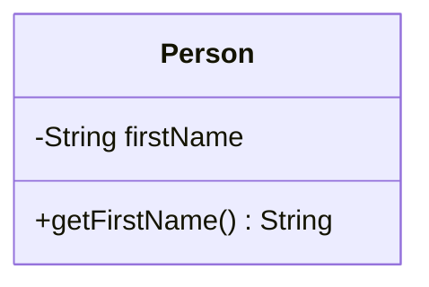
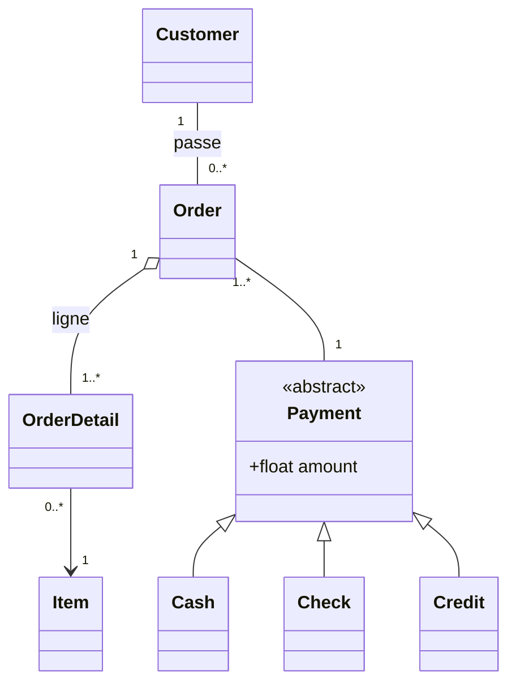

# Chapitre 2 — Classes et objets

← [[Fiche_PG220_01_Intro_POO_Java|Chapitre 1]] · [[PG220_00_Sommaire|Sommaire]] · Suivant → [[Fiche_PG220_03_Static_Final_Relations|static, final et relations]]

> [!abstract] Ce que tu dois retenir
> - Une classe = **attributs** + **constructeurs** + **méthodes**.
> - **Encapsulation** : attributs `private`, accès contrôlé par des getters/setters.
> - Un constructeur porte le **nom de la classe** et n'a **pas de type de retour**. Si tu n'en écris aucun, Java en génère un vide ; dès que tu en écris un, il ne le fait plus.
> - Les objets vivent sur le **tas** (créés par `new`), les variables locales sur la **pile**.
> - Java passe **toujours par valeur**. Pour un objet, c'est la *référence* qui est copiée.
> - `this` = l'objet courant.

---

## 1. Anatomie d'une classe

Une classe est un **type défini par l'utilisateur**. Elle regroupe :
- des **données** (attributs) : ce que l'objet *est* ;
- des **comportements** (méthodes) : ce que l'objet *fait* ;
- des **constructeurs** : comment l'objet *naît*.

```text
<modificateur>* class <NomClasse> {
    <déclaration d'attributs>*
    <déclaration de constructeurs>*
    <déclaration de méthodes>*
}
```

```java
public class Compteur {
    private int valeur;          // attribut

    public void inc() {          // méthode
        ++valeur;
    }

    public int getValue() {      // méthode
        return valeur;
    }
}
```

### Attributs

```text
<modificateur>* <type> <nom> [= <valeur_initiale>];
```

```java
public class Test {
    private int x;                    // vaudra 0 par défaut
    private float f = 0.0f;           // initialisation explicite
    private String nom = "Anonyme";   // initialisation explicite
}
```

> [!important] Valeurs par défaut
> Les **attributs** sont initialisés automatiquement : `0` pour les nombres, `false` pour les booléens, `null` pour les références. Ce n'est **pas** le cas des variables locales (voir §9).

### Méthodes

```text
<modificateur>* <type_retour> <nom>(<paramètres>*) { <instructions>* }
```

```java
public class Compteur {
    public static final int MAX = 100;   // constante de classe
    private int valeur;

    public void inc() {
        if (valeur < MAX) {
            ++valeur;
        }
    }

    public int getValue() {
        return valeur;
    }
}
```

La **signature** d'une méthode = son **nom** + la **liste des types de ses paramètres** (le type de retour n'en fait pas partie). Cette notion revient au [[Fiche_PG220_04_Heritage_Polymorphisme|chapitre 3]] pour la surcharge.

### Accéder aux membres : `objet.membre`

```java
Compteur c = new Compteur();
c.inc();                 // appel de méthode
int i = c.getValue();    // i vaut 1
```

---

## 2. Encapsulation et masquage d'information

### Le problème (en C)

```c
struct Date { int year, month, day; };

struct Date d;
d.day = 32;                  // jour impossible, aucune vérification
d.month = 2; d.day = 30;     // 30 février ?!
d.day = d.day + 1;           // pas de passage au mois suivant
```

Le code client touche **directement** aux données internes : rien ne garantit leur cohérence.

### La solution (en Java)

On rend les attributs `private` et on force le passage par des méthodes qui **vérifient**.

```java
public class Date {
    private int year, month, day;

    public void setDay(int d) {
        if (d >= 1 && d <= joursDansLeMois()) {
            day = d;
        }   // sinon : on refuse silencieusement (ou on lève une exception, cf. chapitre 4)
    }

    public void setMonth(int m) {
        if (m >= 1 && m <= 12) month = m;
    }

    public int getDay()   { return day; }
    public int getMonth() { return month; }

    private int joursDansLeMois() {
        // logique interne, invisible de l'extérieur
        return switch (month) {
            case 2 -> 28;
            case 4, 6, 9, 11 -> 30;
            default -> 31;
        };
    }
}
```

```java
Date d = new Date();
d.setDay(32);    // refusé par la vérification
d.setMonth(2);   // accepté
d.day = 30;      // ❌ ERREUR DE COMPILATION
```

> [!warning] Précision sur la slide 17
> La slide commente `d.day = 30;` par « no assignment ». En réalité ce code **ne compile pas du tout** : `error: day has private access in Date`. C'est le compilateur qui protège l'attribut, pas l'exécution.

### Ce que l'encapsulation apporte

- **Regroupe** les données et les méthodes qui opèrent dessus.
- **Masque** les détails d'implémentation : on pourrait stocker la date en nombre de jours depuis 1970 sans que le code client ne le voie.
- **Force** l'utilisateur à passer par une **interface publique** contrôlée.
- Rend le code **plus maintenable** : on modifie l'intérieur sans casser l'extérieur.

> [!tip] Règle pratique
> Par défaut : **attributs `private`**, méthodes utiles à l'extérieur `public`, méthodes d'aide internes `private`.

---

## 3. UML : dessiner ses classes

UML (Unified Modeling Language) est un langage graphique pour modéliser un système.

### Deux familles de diagrammes

| Structurels (statique) | Comportementaux (dynamique) |
|---|---|
| Représentent la **structure** du système | Montrent son **comportement dans le temps** |
| Diagramme de classes, d'objets, de composants | Diagramme de séquence, d'activités, d'états-transitions |

### Le diagramme de classes

Une classe = une boîte en 3 compartiments : **nom**, **attributs** (l'état), **méthodes** (le comportement).



| Symbole | Visibilité |
|---|---|
| `+` | public |
| `-` | private |
| `#` | protected |
| `~` | package (défaut) |

Conventions supplémentaires : un membre **statique** est **souligné**, une classe ou méthode **abstraite** est en *italique*.

### Les relations (slide 21)

| Relation | Notation | Sens | Exemple |
|---|---|---|---|
| Association | trait simple | « utilise / connaît » | Client — Commande |
| Agrégation | losange **vide** côté conteneur | « a un », la partie peut vivre seule | Commande ◇— LigneCommande |
| Composition | losange **plein** côté conteneur | « est composé de », la partie meurt avec le tout | Personne ◆— Cerveau |
| Généralisation (héritage) | flèche à triangle vide | « est un » | Paiement ◁— Chèque |
| Réalisation (interface) | pointillés + triangle vide | « implémente » | Driveable ◁┈ Voiture |

Les **multiplicités** (`1`, `0..*`, `1..*`) indiquent combien d'objets participent à la relation.



---

## 4. Les constructeurs

```text
[<modificateur>] <NomClasse>(<paramètres>*) { <instructions>* }
```

```java
public class Date {
    private int year, month, day;

    public Date(int y, int m, int d) {
        if (verify(y, m, d)) {
            year = y;
            month = m;
            day = d;
        }
    }

    private boolean verify(int y, int m, int d) {
        // ...
        return true;
    }
}
```

### Les règles à connaître par cœur

| Règle | Détail |
|---|---|
| Rôle | **Initialiser** l'objet |
| Nom | **Identique** au nom de la classe |
| Type de retour | **Aucun**, même pas `void` |
| Au moins un | Toute classe a au moins un constructeur |
| Constructeur par défaut | Si tu n'en écris **aucun**, le compilateur génère `public NomClasse() {}` (sans paramètre, corps vide) |
| Visibilité | Généralement `public` ; `private` → inutilisable hors de la classe (utile pour le [[Fiche_PG220_03_Static_Final_Relations#2. Le design pattern Singleton\|Singleton]]) |
| Surcharge | Une classe peut avoir **plusieurs** constructeurs avec des paramètres différents |

> [!danger] Le piège n°1 du QCM
> Le constructeur par défaut n'est généré **que si tu n'écris aucun constructeur**.
> ```java
> public class Date {
>     private int year, month, day;
>     public Date(int y, int m, int d) { ... }
> }
>
> Date d = new Date();   // ❌ ne compile pas : il n'existe plus de Date()
> ```
> Si tu veux garder les deux, tu dois écrire `public Date() {}` toi-même.

> [!warning] Un « faux » constructeur
> ```java
> public void Date() { ... }   // ← c'est une MÉTHODE nommée Date, pas un constructeur !
> ```
> Dès qu'il y a un type de retour (même `void`), ce n'est plus un constructeur.

### Surcharge de constructeurs et `this(...)`

Un constructeur peut en appeler un autre de la même classe avec `this(...)`, **obligatoirement en première instruction**. Ça évite de dupliquer le code.

```java
public class Point {
    private int x, y;

    public Point(int x, int y) {
        this.x = x;
        this.y = y;
    }

    public Point() {
        this(0, 0);          // délègue au constructeur principal
    }

    public Point(Point autre) {
        this(autre.x, autre.y);   // constructeur de copie
    }
}
```

---

## 5. Créer des objets : ce qui se passe en mémoire

Les objets sont **alloués sur le tas** (*heap*), une zone de mémoire dynamique, grâce à l'opérateur `new`. Le constructeur est appelé automatiquement sur le nouvel objet.

```java
Counter c   = new Counter();
Date d1     = new Date(2050, 9, 23);
Person p    = new Person("John", "Smith");
```

> [!note] Pile vs tas
> - **Pile** (*stack*) : variables locales et paramètres. Libérée automatiquement à la sortie de la méthode.
> - **Tas** (*heap*) : tous les objets créés par `new`. Libérés par le **ramasse-miettes** (*garbage collector*) quand plus aucune référence ne pointe vers eux. Il n'y a pas de `free` ni de `delete` en Java.

### Les 5 étapes de `MyDate date1 = new MyDate(20, 6, 2016);`

```java
public class MyDate {
    private int day = 26;
    private int month = 9;
    private int year = 2016;

    public MyDate(int day, int month, int year) {
        this.day = day; this.month = month; this.year = year;
    }
}
```

| Étape | Ce qui se passe | État de l'objet |
|---|---|---|
| 1. Allocation | La mémoire est réservée sur le tas, attributs à leur **valeur par défaut** | `day=0, month=0, year=0` |
| 2. Initialisation explicite | Les `= 26`, `= 9`, `= 2016` des déclarations s'appliquent | `day=26, month=9, year=2016` |
| 3. Constructeur | Le corps du constructeur s'exécute | `day=20, month=6, year=2016` |
| 4. Retour de `new` | `new` renvoie la **référence** de l'objet | — |
| 5. Affectation | La référence est rangée dans `date1` | `date1` → objet |

```text
   PILE                          TAS
┌──────────────┐          ┌─────────────────┐
│ date1  ●─────┼─────────►│ MyDate          │
└──────────────┘          │  day   = 20     │
                          │  month = 6      │
                          │  year  = 2016   │
                          └─────────────────┘
```

> [!note] Avec l'héritage (chapitre 3)
> Juste avant l'étape 2, le constructeur de la **classe parente** s'exécute (appel `super(...)`). L'ordre complet est donc : allocation → constructeur parent → initialisations explicites → corps du constructeur.

### Affecter une référence ne copie pas l'objet

```java
MyDate date1 = new MyDate(20, 6, 2000);
MyDate date2 = date1;      // copie de la RÉFÉRENCE, pas de l'objet
```

```text
   PILE                          TAS
┌──────────────┐          ┌─────────────────┐
│ date1  ●─────┼─────────►│ MyDate          │
│ date2  ●─────┼─────────►│  20 / 6 / 2000  │
└──────────────┘          └─────────────────┘
```

Deux variables, **un seul objet**. Si tu fais `date2.setDay(1)`, alors `date1.getDay()` renvoie aussi `1`. De même, `date1 == date2` vaut `true` car `==` compare les **références**.

---

## 6. Passage de paramètres : toujours par valeur

> [!important] La règle unique
> Java copie **toujours** la valeur de l'argument dans le paramètre.
> - Pour un **primitif**, on copie le nombre → la méthode ne peut pas modifier la variable de l'appelant.
> - Pour un **objet**, on copie la **référence** → la méthode peut modifier **l'objet pointé**, mais pas faire pointer la variable de l'appelant ailleurs.

```java
public class PassTest {
    public void changePrimitive(int value) {
        ++value;
    }
    public void changeReference(MyDate from, MyDate to) {
        from = to;
    }
    public void changeObjectDay(MyDate date, int day) {
        date.setDay(day);
    }
}
```

```java
PassTest pt = new PassTest();

int x = 100;
pt.changePrimitive(x);
System.out.println(x);                   // ?

MyDate oneDate     = new MyDate(3, 10, 2050);
MyDate anotherDate = new MyDate(3, 10, 2020);
pt.changeReference(oneDate, anotherDate);
System.out.println(oneDate.getYear());   // ?

pt.changeObjectDay(oneDate, 12);
System.out.println(oneDate.getDay());    // ?
```

> [!question]- Prédis les 3 affichages avant d'ouvrir
> ```text
> 100
> 2050
> 12
> ```
> 1. `value` est une **copie** de `x` ; incrémenter la copie ne change pas `x`.
> 2. `from` est une **copie** de la référence `oneDate`. `from = to` fait pointer la copie ailleurs, mais `oneDate` pointe toujours vers l'objet 2050.
> 3. `date` est une copie de la référence, mais elle pointe vers **le même objet** que `oneDate` : `setDay` modifie cet objet partagé.

```text
Pendant changeReference, juste après  from = to :

   PILE (main)                  TAS
┌──────────────────┐     ┌────────────────┐
│ oneDate     ●────┼────►│ 3/10/2050      │   ← personne n'a touché à ce lien
│ anotherDate ●────┼──┐  └────────────────┘
└──────────────────┘  │  ┌────────────────┐
                      ├─►│ 3/10/2020      │
   PILE (changeRef.)  │  └────────────────┘
┌──────────────────┐  │
│ from        ●────┼──┤   ← seule la COPIE a été redirigée
│ to          ●────┼──┘
└──────────────────┘
```

---

## 7. La référence `this`

`this` désigne **l'objet courant**, celui sur lequel la méthode a été appelée. Trois usages :

| Usage | Exemple |
|---|---|
| Lever l'ambiguïté attribut / paramètre | `this.day = day;` |
| Passer l'objet courant en argument | `new MyDate(this)` ou `print(this)` |
| Appeler un autre constructeur | `this(0, 0);` |

```java
public class MyDate {
    private int day = 26, month = 9, year = 2050;

    public MyDate(int day, int month, int year) {
        this.day = day; this.month = month; this.year = year;
    }

    public MyDate(MyDate date) {                 // constructeur de copie
        this.day = date.day; this.month = date.month; this.year = date.year;
    }

    public MyDate createNextDate(int moreDays) {
        MyDate newDate = new MyDate(this);       // copie de l'objet courant
        // ... ajouter moreDays
        return newDate;
    }
}
```

> [!tip] Pourquoi `date.day` marche alors que `day` est `private` ?
> `private` restreint l'accès **à la classe**, pas à l'objet. Tout code écrit dans `MyDate` peut lire les attributs privés de **n'importe quel** objet `MyDate`.

### Questions du cours (slide 37)

```java
class Point {
    int x, y;
    Point(int x, int y) {
        this.x = x;
        this.y = y;
    }
}
```

> [!question]- Que fait `this.x = x;` ? Et si on écrivait `x = x;` ?
> `this.x = x;` copie le **paramètre** `x` dans l'**attribut** `x` de l'objet.
>
> Avec `x = x;`, le paramètre `x` *masque* l'attribut (c'est la variable la plus proche qui gagne). On affecte donc le paramètre à lui-même : ça compile, mais **l'attribut reste à 0**. Bug silencieux classique.

```java
class Demo {
    void print(Demo d) { System.out.println(d); }
    void call() { print(this); }
}
```

> [!question]- Que représente `this` dans `call()` ? Qu'est-ce qui s'affiche ?
> `this` est l'objet `Demo` sur lequel on a appelé `call()`. Comme `Demo` ne redéfinit pas `toString()`, on obtient la version héritée d'`Object` : `NomDeClasse@hashcodeEnHexa`, par exemple `Demo@1b6d3586`. La valeur après `@` change d'une exécution à l'autre.

---

## 8. Packages (aperçu)

Un package regroupe des classes (et des sous-packages) pour organiser les grands projets.

```java
package java.lang;      // 1re instruction du fichier, une seule par fichier

public class String {
    // ...
}
```

Sans déclaration `package`, la classe va dans le **package par défaut**. La suite (import, arborescence, compilation) est dans [[Fiche_PG220_07_Imbriquees_Packages_Utilitaires#2. Packages et organisation du code|la fiche 07]].

---

## 9. Variables locales et portée

Une variable **locale** :
- est définie **dans une méthode** (ou un bloc) ;
- est créée quand la méthode s'exécute et **détruite** quand elle se termine ;
- **n'est pas initialisée automatiquement** ;
- vit sur la **pile d'exécution**.

```java
void g() {
    int x;
    System.out.println(x);   // ❌ ERREUR : variable x might not have been initialized
}
```

| | Attribut d'instance | Attribut `static` | Variable locale |
|---|---|---|---|
| Déclaré | dans la classe | dans la classe, avec `static` | dans une méthode |
| Stocké | dans l'objet (tas) | une seule fois pour la classe | sur la pile |
| Durée de vie | celle de l'objet | celle du programme (dès le chargement de la classe) | l'exécution de la méthode |
| Valeur par défaut | oui (0, false, null) | oui | **non** → erreur si lue avant affectation |

---

## 10. Les tableaux

Un tableau = un groupe de données **du même type**. En Java, **un tableau est un objet** : il est créé avec `new` et vit sur le tas.

```java
// Déclaration (deux syntaxes équivalentes)
int t[];
int[] t;          // ← préférée

Point p[];
Point[] p;        // tableau de RÉFÉRENCES vers des Point
```

### Création et parcours

```java
int[] t;               // déclaration : t vaut null
t = new int[10];       // création : 10 cases initialisées à 0

int[] u = {3, 1, 4};   // création + initialisation directe

// Parcours classique
for (int i = 0; i < t.length; ++i) {     // length est un attribut, pas une méthode
    System.out.println(t[i]);
}

// Boucle for-each (lecture seule, sans indice)
for (int v : t) {
    System.out.println(v);
}
```

> [!warning] Deux pièges fréquents
> - `t.length` (attribut, sans parenthèses) pour un tableau, mais `s.length()` (méthode) pour une `String` et `list.size()` pour une `ArrayList`.
> - Accès hors limites → `ArrayIndexOutOfBoundsException` à l'exécution. Indices valides : `0` à `length - 1`.

> [!danger] Tableau d'objets = tableau de `null`
> ```java
> Point[] pts = new Point[3];   // 3 références... toutes à null !
> pts[0].getX();                // ❌ NullPointerException
> pts[0] = new Point(1, 2);     // il faut créer chaque objet
> ```

### Tableaux multidimensionnels

Un tableau 2D est un **tableau de tableaux**.

```java
// Rectangulaire : 3 lignes de 4 colonnes
int[][] tableau = new int[3][4];

// Non rectangulaire (« en escalier ») : on crée d'abord les lignes, puis chaque ligne
int[][] escalier = new int[3][];
escalier[0] = new int[2];
escalier[1] = new int[3];
escalier[2] = new int[1];
```

```text
escalier ──► [ ● , ● , ● ]
               │   │   └──► [0]
               │   └──────► [0, 0, 0]
               └──────────► [0, 0]
```

> [!warning] Erreur dans la slide 41
> La slide écrit `tableau = new int[2][];` puis remplit `tableau[0]`, `tableau[1]` **et `tableau[2]`**. Avec seulement 2 lignes, `tableau[2]` lève une `ArrayIndexOutOfBoundsException: Index 2 out of bounds for length 2`. Il faut `new int[3][]`.

---

## 🔁 Teste-toi

> [!question]- Une classe n'a qu'un constructeur `public A(int x)`. `new A()` compile-t-il ?
> **Non.** Le constructeur par défaut n'est généré que si la classe n'a **aucun** constructeur.

> [!question]- Quelles sont les valeurs initiales de `int`, `boolean`, `String` pour un attribut ? Et pour une variable locale ?
> Attribut : `0`, `false`, `null`. Variable locale : **aucune**, la lire avant de l'affecter est une erreur de compilation.

> [!question]- `MyDate a = new MyDate(1,1,2000); MyDate b = a; b.setDay(15);` Que vaut `a.getDay()` ?
> `15` : `a` et `b` référencent **le même objet**.

> [!question]- Java passe-t-il les objets par référence ?
> Non, **toujours par valeur**. Mais pour un objet, la valeur copiée est la **référence** : on peut donc modifier l'objet pointé, pas la variable de l'appelant.

> [!question]- Dans quel ordre se font l'initialisation explicite des attributs et l'exécution du constructeur ?
> Valeurs par défaut → initialisations explicites (`= 26`) → corps du constructeur. Le constructeur a donc « le dernier mot ».

> [!question]- Combien d'objets sont créés par `Point[] p = new Point[5];` ?
> **Un seul** : le tableau. Ses 5 cases contiennent `null`.

> [!question]- Pourquoi rendre les attributs `private` ?
> Pour l'**encapsulation** : empêcher les états incohérents, cacher l'implémentation, pouvoir la modifier sans casser le code client.
