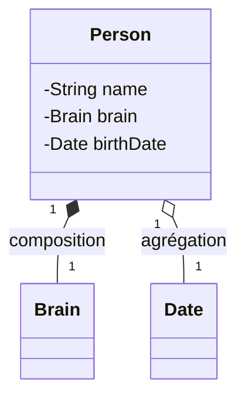
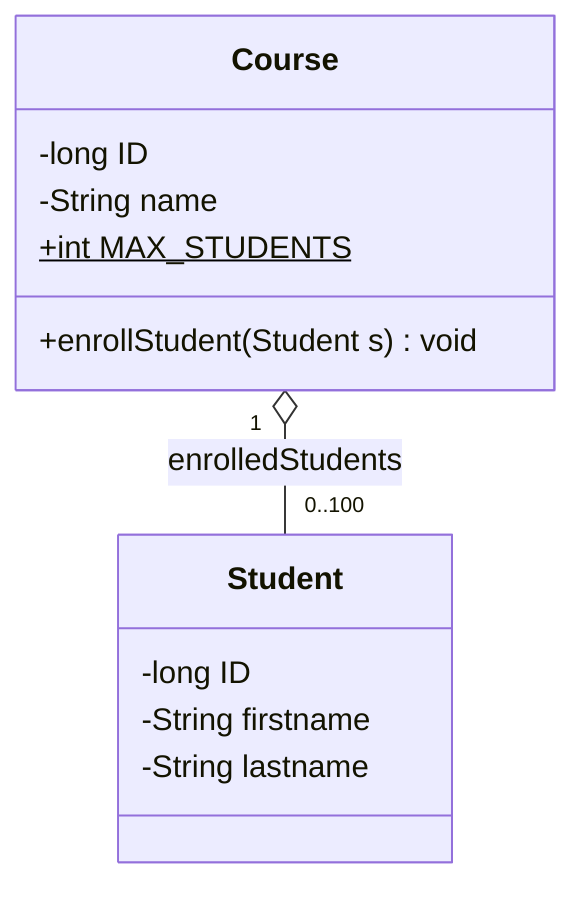

# Chapitre 2 (suite) — `static`, `final` et relations entre classes

← [[Fiche_PG220_02_Classes_Objets|Classes et objets]] · [[PG220_00_Sommaire|Sommaire]] · Suivant → [[Fiche_PG220_04_Heritage_Polymorphisme|Héritage et polymorphisme]]

> [!abstract] Ce que tu dois retenir
> - `static` = appartient à la **classe**, partagé par tous les objets, existe **sans** instance.
> - Une méthode `static` **n'a pas de `this`** : elle ne peut pas utiliser directement les attributs d'instance.
> - `final` : classe → pas d'héritage ; méthode → pas de redéfinition ; variable → affectée **une seule fois**.
> - **Composition** (◆) : la partie meurt avec le tout. **Agrégation** (◇) : la partie vit indépendamment.

---

## 1. Les membres statiques

### Instance vs classe

Un attribut normal (d'**instance**) existe **en un exemplaire par objet**. Un attribut `static` existe **en un seul exemplaire pour toute la classe**.

```java
public class Etudiant {
    private String nom;                 // un par étudiant
    private static int nbEtudiants = 0; // un seul, partagé

    public Etudiant(String nom) {
        this.nom = nom;
        nbEtudiants++;
    }
}
```

```text
          Classe Etudiant (chargée une fois)
          ┌──────────────────────┐
          │ nbEtudiants = 3      │◄──── partagé par tous
          └──────────────────────┘
   ┌──────────┐   ┌──────────┐   ┌──────────┐
   │ nom=Coco │   │ nom=Lina │   │ nom=Tom  │   ← un nom par objet
   └──────────┘   └──────────┘   └──────────┘
```

### Les règles

- Données statiques + méthodes statiques = **membres statiques**.
- Les données statiques sont allouées au **chargement de la classe** → utilisables **sans créer d'objet**.
- Une méthode d'**instance** peut utiliser les données **statiques**. ✅
- Une méthode **statique** ne peut **pas** utiliser les données d'**instance** (il n'y a pas d'objet courant, donc pas de `this`). ❌

```java
public class Exemple {
    private int v;
    private static int compteur;

    public void methodeInstance() {
        v++;          // ✅
        compteur++;   // ✅ une instance peut voir le partagé
    }

    public static void methodeStatique() {
        compteur++;   // ✅
        v++;          // ❌ non-static variable v cannot be referenced from a static context
        this.v++;     // ❌ pas de this dans un contexte statique
    }
}
```

> [!tip] L'astuce pour ne jamais se tromper
> Demande-toi : « **de quel objet** parle-t-on ? » Dans une méthode statique, il n'y en a aucun. Si tu as besoin d'un attribut d'instance, il faut un objet explicite : `Exemple e = new Exemple(); e.v++;`.

### Comment y accéder

```java
System.out.println(Exemple.staticValue);   // ✅ recommandé : NomClasse.membre
Math.sqrt(2);                               // exemple de méthode statique de la bibliothèque
Integer.parseInt("42");                     // idem

Exemple e = new Exemple();
System.out.println(e.staticValue);          // ⚠️ compile, mais trompeur : on croirait que c'est lié à e
```

L'écriture `NomClasse.membre` montre explicitement que le membre appartient à la classe et non à un objet.

### Question du cours (slide 45)

```java
public class InstanceCounter {
    private static int counter = 0;

    public InstanceCounter() {
        ++counter;
    }

    public static int getCounter() {
        return counter;
    }
}
```

```java
System.out.println(InstanceCounter.getCounter());
InstanceCounter ic = new InstanceCounter();
System.out.println(InstanceCounter.getCounter());
```

> [!question]- Qu'affiche ce programme ?
> ```text
> 0
> 1
> ```
> `counter` existe dès le chargement de la classe (valeur 0), avant tout objet. Chaque appel au constructeur l'incrémente. On peut appeler `getCounter()` sans instance car elle est `static`.

---

## 2. Le design pattern Singleton

**Objectif** : garantir qu'une classe n'a **qu'une seule instance** et fournir un **point d'accès global** à cette instance. Exemples d'usage : une connexion à une base de données, un gestionnaire de configuration, un journal (*logger*).

```java
public class Singleton {
    private static Singleton instance;      // ① l'unique instance, partagée

    private Singleton() {                   // ② constructeur PRIVÉ : new Singleton() interdit dehors
    }

    public static Singleton getInstance() { // ③ point d'accès statique
        if (instance == null) {             // ④ création paresseuse (au 1er appel)
            instance = new Singleton();
        }
        return instance;
    }
}
```

```java
Singleton a = Singleton.getInstance();
Singleton b = Singleton.getInstance();
System.out.println(a == b);    // true : même objet
Singleton c = new Singleton(); // ❌ Singleton() has private access
```

Les trois ingrédients à reconnaître : **attribut `static`** de son propre type, **constructeur `private`**, **méthode `static`** d'accès.

> [!warning] Pas thread-safe !
> Si deux threads appellent `getInstance()` en même temps alors que `instance == null`, ils peuvent **tous les deux** passer le test et créer deux objets. Solutions dans [[Fiche_PG220_08_Threads#9. Retour sur le Singleton|la fiche Threads]]. La plus simple : créer l'instance directement à la déclaration.
> ```java
> private static final Singleton INSTANCE = new Singleton();
> public static Singleton getInstance() { return INSTANCE; }
> ```

---

## 3. Le mot-clé `final`

| Appliqué à | Effet |
|---|---|
| **Classe** | On ne peut pas en **hériter** (ex. `String`, `Integer` sont `final`) |
| **Méthode** | On ne peut pas la **redéfinir** dans une sous-classe |
| **Variable** | C'est une **constante** : on ne peut l'affecter **qu'une seule fois** |

```java
public final class Constantes { }                  // class X extends Constantes → ❌

public class Base {
    public final void securite() { }               // redéfinition interdite
}

public class Compteur {
    public static final int MAX = 100;             // constante de classe, en MAJUSCULES
    private final long id;                         // « final vide » (blank final)

    public Compteur(long id) {
        this.id = id;                              // ✅ affectée une fois, dans le constructeur
    }

    public void reset() {
        id = 0;                                    // ❌ cannot assign a value to final variable id
    }
}
```

**Variable finale vide** (*blank final*) : déclarée sans valeur, elle doit être initialisée **avant utilisation** (typiquement dans **chaque** constructeur), puis ne change plus.

> [!danger] `final` sur une référence ≠ objet immuable
> ```java
> final int[] t = {1, 2};
> t[0] = 5;          // ✅ on modifie l'OBJET pointé → t vaut [5, 2]
> t = new int[3];    // ❌ on ne peut pas changer la RÉFÉRENCE
> ```
> `final` bloque la **flèche**, pas le **contenu** de ce qu'elle pointe.

---

## 4. Relations entre classes : composition et agrégation

Les deux sont des relations « **a un** » (*has-a*) : un objet conteneur contient d'autres objets. La différence porte sur la **durée de vie** de la partie.

| | **Composition** ◆ | **Agrégation** ◇ |
|---|---|---|
| Force du lien | Association **forte** | Association **faible** |
| La partie peut-elle exister seule ? | **Non**, elle fait partie intégrante du tout | **Oui**, elle est seulement liée |
| Responsabilité de la durée de vie | **Totale** : si le tout disparaît, la partie aussi | **Partielle** : la partie peut survivre |
| Exemple | Personne ◆ Cerveau, Maison ◆ Pièce | Personne ◇ Date de naissance, Équipe ◇ Joueur |



### Comment ça se traduit en code

La différence se voit surtout dans **qui crée l'objet** et **qui d'autre y a accès**.

```java
// COMPOSITION : Person crée son Brain elle-même et ne le partage pas
public class Person {
    private final Brain brain;

    public Person() {
        this.brain = new Brain();   // né avec la personne, personne d'autre ne le référence
    }
}
```

```java
// AGRÉGATION : la Date vient de l'extérieur et peut être référencée ailleurs
public class Person {
    private String name;
    private Date birthDate;

    public Person(String name, Date birthDate) {
        this.name = name;
        this.birthDate = birthDate; // on stocke une référence vers un objet qui existe déjà
    }
}
```

```java
Date d = new Date(12, 3, 2004);
Person p = new Person("Coco", d);
p = null;          // l'objet Person devient inaccessible...
// ... mais d existe toujours et reste utilisable
```

> [!note] « Détruit » en Java
> Il n'y a pas de destructeur. Un objet est « détruit » quand **plus aucune référence** ne pointe vers lui : le *garbage collector* le récupère alors. En composition, comme seule la `Person` référence le `Brain`, les deux deviennent inaccessibles en même temps.

---

## 5. Relation un-à-plusieurs (*one-to-many*)

Un cours a **plusieurs** étudiants. On stocke donc une **collection** de références.



### Version 1 : avec un tableau

```java
public class Course {
    private final long ID;
    private String name;
    public static final int MAX_STUDENTS = 100;
    private Student[] enrolledStudents;
    private int numStudents;                         // nombre de cases réellement remplies

    public Course(long ID, String name) {
        this.ID = ID;
        this.name = name;
        enrolledStudents = new Student[MAX_STUDENTS]; // 100 cases à null
    }

    public void enrollStudent(Student student) {
        enrolledStudents[numStudents] = student;
        ++numStudents;
    }
}
```

> [!warning] Limite de cette version
> Taille **fixe**, et aucune vérification : le 101e étudiant provoque une `ArrayIndexOutOfBoundsException`. Version plus robuste :
> ```java
> public boolean enrollStudent(Student student) {
>     if (numStudents >= MAX_STUDENTS) return false;
>     enrolledStudents[numStudents++] = student;
>     return true;
> }
> ```

### Version 2 : avec une `ArrayList` (recommandée)

```java
import java.util.ArrayList;

public class Course {
    private final long ID;
    private String name;
    private ArrayList<Student> enrolledStudents;

    public Course(long ID, String name) {
        this.ID = ID;
        this.name = name;
        enrolledStudents = new ArrayList<Student>();   // ou new ArrayList<>() (diamant)
    }

    public void enrollStudent(Student student) {
        enrolledStudents.add(student);                 // la liste grandit toute seule
    }
}
```

`ArrayList<Student>` est un tableau **redimensionnable**. Le `<Student>` est un **paramètre de type** (générique) : la liste n'accepte que des `Student`, et le compilateur le vérifie.

| Opération | Tableau | `ArrayList` |
|---|---|---|
| Taille | fixe | dynamique |
| Ajouter | gérer l'indice soi-même | `list.add(x)` |
| Lire | `t[i]` | `list.get(i)` |
| Modifier | `t[i] = x` | `list.set(i, x)` |
| Taille actuelle | compteur à gérer | `list.size()` |
| Supprimer | décaler à la main | `list.remove(i)` ou `list.remove(x)` |
| Chercher | boucle | `list.contains(x)` |
| Types primitifs | `int[]` ✅ | `ArrayList<int>` ❌ → `ArrayList<Integer>` |

---

## 🔁 Teste-toi

> [!question]- Une méthode `static` peut-elle appeler une méthode d'instance de la même classe sans objet ?
> Non. Sans objet, il n'y a pas de `this`. Il faut créer ou recevoir un objet et appeler la méthode dessus.

> [!question]- Quels sont les 3 ingrédients d'un Singleton ?
> Un attribut `private static` du type de la classe, un constructeur `private`, une méthode `public static getInstance()`.

> [!question]- `final` devant une classe, une méthode, une variable : que signifie chaque cas ?
> Classe : non héritable. Méthode : non redéfinissable. Variable : affectable une seule fois (constante).

> [!question]- `final ArrayList<String> l = new ArrayList<>(); l.add("x");` compile-t-il ?
> Oui. `final` empêche de réaffecter `l`, pas de modifier la liste.

> [!question]- Voiture et Moteur (créé dans le constructeur de Voiture), Voiture et Conducteur (passé en paramètre). Quelle relation pour chacun ?
> Voiture ◆ Moteur : **composition**. Voiture ◇ Conducteur : **agrégation** (le conducteur existe sans la voiture).

> [!question]- Pourquoi `ArrayList<int>` ne compile pas ?
> Les génériques n'acceptent que des **types référence**. On utilise la classe enveloppe `Integer` : `ArrayList<Integer>`.
