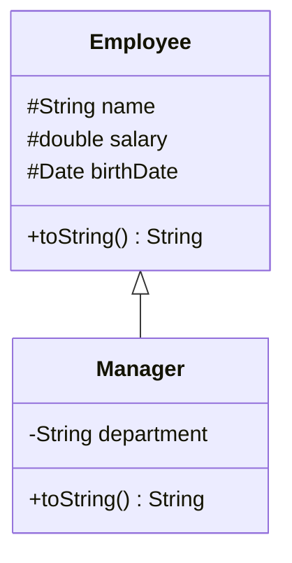
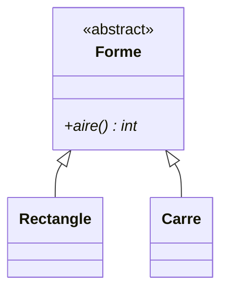

# Chapitre 3 — Héritage et polymorphisme

← [[Fiche_PG220_03_Static_Final_Relations|static, final, relations]] · [[PG220_00_Sommaire|Sommaire]] · Suivant → [[Fiche_PG220_05_Interfaces_Abstraites_Tri|Interfaces, classes abstraites, tri]]

> [!abstract] Ce que tu dois retenir
> - `class B extends A` : B **hérite** des attributs et méthodes de A, **pas de ses constructeurs**. Héritage **simple** uniquement.
> - `super(...)` appelle le constructeur parent, **en première ligne**. Si tu ne l'écris pas, Java insère `super()`.
> - **Surcharge** (*overloading*) = même nom, paramètres **différents** → résolue **à la compilation** (polymorphisme statique).
> - **Redéfinition** (*overriding*) = même nom, **mêmes** paramètres → résolue **à l'exécution** (polymorphisme dynamique).
> - Le **type statique** décide de ce qui **compile**, le **type dynamique** décide de **quelle méthode s'exécute**.
> - **Liskov** : une sous-classe doit pouvoir remplacer sa classe mère sans surprise.

---

## 1. Le problème : la duplication

```java
public class Employee {
    private String name;
    private double salary;
    private Date birthDate;
    public String toString() { /* ... */ }
}

public class Manager {
    private String name;          // copié-collé
    private double salary;        // copié-collé
    private Date birthDate;       // copié-collé
    private String department;    // seule vraie nouveauté
    public String toString() { /* ... */ }
}
```

Un `Manager` **est un** `Employee` avec un département en plus. Copier-coller le code, c'est devoir corriger chaque bug deux fois.

## 2. La solution : `extends`

```text
<modificateur> class <Nom> extends <SuperClasse> { <déclarations>* }
```

```java
public class Employee {
    protected String name;
    protected double salary;
    protected Date birthDate;

    public Employee(String name, double salary, Date birthDate) { /* ... */ }
    public String toString() { /* ... */ }
}

public class Manager extends Employee {
    private String department;     // seulement ce qui est nouveau

    public Manager(/* ... */) { /* ... */ }
    public String toString() { /* ... */ }
}
```



### Ce que la sous-classe reçoit et peut faire

- Elle **hérite** des données et des méthodes du parent.
- Elle **n'hérite pas** des constructeurs.
- Elle peut :
  1. **ajouter** de nouvelles données ;
  2. **ajouter** de nouvelles méthodes ;
  3. **redéfinir** les méthodes héritées (→ polymorphisme).

> [!note] Précisions utiles
> - Java n'a que l'**héritage simple** : une classe a **une seule** classe mère (`extends A, B` ❌). Les interfaces compensent (chapitre suivant).
> - Les attributs `private` du parent **existent** dans l'objet fille, mais la fille ne peut pas les nommer directement : elle passe par les méthodes du parent. D'où le `protected` utilisé dans les slides.
> - Toute classe hérite, directement ou non, de **`Object`**. C'est de là que viennent `toString()`, `equals()` et `hashCode()`.

---

## 3. Appeler le constructeur parent : `super(...)`

Comme les constructeurs ne sont pas hérités, la sous-classe doit demander au parent d'initialiser **sa** partie de l'objet.

```java
public class Employee {
    protected String name;
    protected double salary;
    protected Date birthDate;

    public Employee(String name, double salary, Date birthDate) {
        this.name = name;
        this.salary = salary;
        this.birthDate = birthDate;
    }
}

public class Manager extends Employee {
    private String department;

    public Manager(String name, double salary, Date birthDate, String department) {
        super(name, salary, birthDate);   // ① le parent initialise sa partie
        this.department = department;     // ② on initialise la nôtre
    }
}
```

> [!danger] Deux règles qui tombent au QCM
> 1. `super(...)` doit être la **première instruction** du constructeur.
> 2. Si tu n'écris pas `super(...)`, Java insère **`super()` sans argument**. Si le parent n'a **pas** de constructeur sans argument → **erreur de compilation**.
> ```java
> class Parent { Parent(String s) { } }
> class Child extends Parent {
>     Child() { }   // ❌ constructor Parent cannot be applied to given types
> }
> ```

### Ordre de construction

Le parent est **toujours** construit avant l'enfant.

```java
class A { A() { System.out.println("A()"); } }
class B extends A { B() { System.out.println("B()"); } }

new B();
```

> [!question]- Qu'affiche `new B()` ?
> ```text
> A()
> B()
> ```
> Le `super()` implicite du constructeur de B s'exécute en premier.

---

## 4. Contrôle d'accès

| Modificateur | Même classe | Même package | Sous-classe (autre package) | Partout |
|---|:-:|:-:|:-:|:-:|
| `private` | ✅ | ❌ | ❌ | ❌ |
| *(rien)* = défaut / package | ✅ | ✅ | ❌ | ❌ |
| `protected` | ✅ | ✅ | ✅ | ❌ |
| `public` | ✅ | ✅ | ✅ | ✅ |

> [!tip] Moyen mnémotechnique
> Du plus fermé au plus ouvert : **private < défaut < protected < public**. Chaque niveau ajoute une colonne. Note que `protected` donne **aussi** l'accès au package (piège fréquent : on croit qu'il ne concerne que les sous-classes).

---

## 5. Redéfinition de méthodes (*override*)

Une sous-classe peut **modifier** un comportement hérité en réécrivant une méthode avec :
- le **même nom** ;
- la **même liste de paramètres** ;
- le **même type de retour**, ou un **sous-type** de celui-ci (c'est le « presque le même type de retour » de la slide, appelé *type de retour covariant*).

```java
public class Employee {
    // ...
    public String toString() {
        return "Name: " + name + " Salary: " + salary + " B. Date: " + birthDate;
    }
}

public class Manager extends Employee {
    private String department;
    // ...
    @Override
    public String toString() {
        return super.toString() + " department: " + department;   // réutilise la version parente
    }
}
```

`super.methode()` appelle la version **du parent**. Ça évite de recopier son code.

### `@Override` : ton filet de sécurité

L'annotation n'est pas obligatoire, mais elle demande au compilateur de **vérifier** que tu redéfinis bien quelque chose.

```java
@Override
public String tostring() { ... }   // ❌ method does not override : faute de frappe détectée !
```

Sans `@Override`, ce code compilerait et créerait une **nouvelle** méthode `tostring` que personne n'appelle.

### Les interdits de la redéfinition

| Interdit | Pourquoi |
|---|---|
| **Réduire la visibilité** (`public` → `private`) | Le code qui voit un `Parent` doit pouvoir appeler la méthode sur n'importe quel enfant |
| Redéfinir une méthode **`final`** | C'est le rôle de `final` |
| Redéfinir une méthode **`private`** | Elle n'est pas héritée : on crée juste une autre méthode |
| Redéfinir une méthode **`static`** | Une méthode statique se *masque*, elle ne se redéfinit pas (pas de liaison dynamique) |

```java
public class Parent { public void foo() { } }
public class Child extends Parent {
    private void foo() { }   // ❌ attempting to assign weaker access privileges; was public
}
```

> [!warning] Vocabulaire de la slide 60
> La slide dit « une méthode **surchargée** ne peut pas avoir une visibilité plus restreinte que la méthode qu'elle **remplace** ». Il s'agit en fait d'une méthode **redéfinie** (*overridden*). Au QCM, ne mélange pas : **surcharge = paramètres différents**, **redéfinition = mêmes paramètres**.

---

## 6. Surcharge de méthodes (*overload*)

Même **nom**, liste de paramètres **différente** (nombre, types ou ordre). Le type de retour peut changer, mais **il ne suffit pas** à distinguer deux méthodes.

```java
public void println(int i)
public void println(float f)
public void println(String s)

int  calcul(int a)
long calcul(int a)   // ❌ même signature : seul le retour diffère → refusé
```

L'exemple typique : plusieurs constructeurs qui s'appellent entre eux avec `this(...)`.

```java
public class Employee {
    protected String name; protected double salary; protected Date birthDate;

    public Employee(String name, double salary, Date birthDate) {
        this.name = name;
        this.salary = salary;
        this.birthDate = birthDate;
    }
    public Employee(String name, double salary) {
        this(name, salary, null);            // délègue
    }
    public Employee(String name, Date birthDate) {
        this(name, 1000, birthDate);         // salaire par défaut
    }
}
```

### Le tableau à connaître

| | **Surcharge** (overloading) | **Redéfinition** (overriding) |
|---|---|---|
| Nom | identique | identique |
| Paramètres | **différents** | **identiques** |
| Type de retour | libre | identique ou sous-type |
| Où ? | même classe (ou héritée) | dans une **sous-classe** |
| Résolu quand ? | **compilation** | **exécution** |
| Nom savant | polymorphisme **statique** | polymorphisme **dynamique** |
| Exemple | plusieurs constructeurs, `println(...)` | `toString()` |

---

## 7. Type statique et type dynamique

```java
Employee e;              // type STATIQUE (déclaré, connu à la compilation) : Employee
e = new Employee();      // type DYNAMIQUE (réel, à l'exécution) : Employee
e = new Manager();       // type DYNAMIQUE : Manager
```

Une variable de type `Employee` peut référencer un `Manager` car un Manager **est un** Employee (*upcasting*, automatique).

> [!important] La règle d'or
> - Le **compilateur** ne connaît que le **type statique** : il n'accepte que les méthodes déclarées dans `Employee`.
> - La **JVM** regarde le **type dynamique** : elle exécute la version la plus spécifique (celle de `Manager` si elle est redéfinie). C'est la **liaison dynamique**.

```java
Employee e = new Manager("Johann", 3000, new Date(10, 9, 1988), "sales");

System.out.println(e.toString());        // ✅ compile (toString existe dans Employee)
                                         //    et exécute Manager.toString() → avec le département

System.out.println(e.getDepartment());   // ❌ ERREUR : Employee n'a pas getDepartment()

System.out.println(((Manager) e).getDepartment());   // ✅ cast (downcasting) explicite

if (e instanceof Manager) {                           // ✅✅ cast sécurisé
    System.out.println(((Manager) e).getDepartment());
}
```

> [!danger] Cast raté = exception
> Si le type dynamique n'est pas compatible, le cast compile mais plante à l'exécution :
> ```java
> Employee e = new Employee();
> Manager m = (Manager) e;   // 💥 ClassCastException
> ```
> D'où le test `instanceof` avant de caster.

> [!tip] Bonus Java 16+ : *pattern matching*
> ```java
> if (e instanceof Manager m) {        // teste ET déclare m déjà casté
>     System.out.println(m.getDepartment());
> }
> ```

---

## 8. L'opérateur `instanceof`

Teste si un objet est une instance d'une classe **ou de l'une de ses sous-classes** (ou d'une classe qui implémente une interface). Renvoie un `boolean`.

```java
// Hiérarchie : Animal ◁── Mammal ◁── Bear
Animal a = new Bear();

a instanceof Animal   // true
a instanceof Mammal   // true
a instanceof Bear     // true
a instanceof Date     // false
null instanceof Bear  // false (toujours false pour null)
```

> [!note] Nuance sur la slide 67
> `a instanceof Date` vaut `false` et compile ici parce qu'`Animal` est une **interface** (un objet pourrait en théorie être à la fois un `Date` et un `Animal`). Si le type statique était une **classe** sans lien avec `Date`, le compilateur refuserait : `incompatible types: Mammal cannot be converted to Date`.

---

## 9. Tableaux hétérogènes

Un tableau de type parent peut contenir des objets de toutes ses sous-classes.

```java
Employee[] emps = new Employee[100];
emps[0] = new Employee();
emps[1] = new Manager();
emps[2] = new Employee();

// Afficher tout le monde : chaque objet utilise SON toString (liaison dynamique)
for (Employee e : emps) {
    System.out.println(e.toString());
}

// Compter les managers
int counter = 0;
for (Employee e : emps) {
    if (e instanceof Manager) {
        ++counter;
    }
}
```

> [!warning] Bug caché dans la slide 65
> Le tableau a **100 cases** mais seules 3 sont remplies : les 97 autres valent `null`. `e.toString()` sur `emps[3]` lève une **`NullPointerException`**. Corrections possibles : `System.out.println(e)` (qui affiche `null` sans planter), tester `if (e != null)`, ou utiliser une `ArrayList<Employee>`.
>
> Le comptage, lui, fonctionne : `null instanceof Manager` vaut `false`.

---

## 10. Le principe de substitution de Liskov (LSP)

> [!important] Énoncé
> Une instance d'une classe **dérivée** doit pouvoir **remplacer** une instance de sa classe **de base** sans altérer le bon fonctionnement du programme. La sous-classe doit respecter les **règles et invariants** promis par la classe mère.

### Le contre-exemple classique : Carré extends Rectangle

En maths, un carré **est** un rectangle. Voyons en code.

```java
class Rectangle {
    protected int largeur, hauteur;
    public void setLargeur(int l) { this.largeur = l; }
    public void setHauteur(int h) { this.hauteur = h; }
    public int aire() { return largeur * hauteur; }
}

class Carre extends Rectangle {
    @Override
    public void setLargeur(int l) { this.largeur = l; this.hauteur = l; }  // reste carré
    @Override
    public void setHauteur(int h) { this.largeur = h; this.hauteur = h; }  // reste carré
}

public class Main {
    public static void agrandir(Rectangle r) {
        r.setLargeur(5);
        r.setHauteur(10);
        System.out.println("Aire = " + r.aire());
    }

    public static void main(String[] args) {
        agrandir(new Rectangle());
        agrandir(new Carre());
    }
}
```

> [!question]- Questions de la slide 64 : que donne `agrandir` avec un Rectangle ? avec un Carré ? LSP respecté ?
> 1. **Rectangle** : largeur 5, hauteur 10 → `Aire = 50`. ✅ Ce qu'on attend.
> 2. **Carré** : `setLargeur(5)` met tout à 5, puis `setHauteur(10)` met **tout à 10** → `Aire = 100`. ❌
> 3. **LSP violé.** La méthode `agrandir` compte sur un contrat implicite de `Rectangle` : *« largeur et hauteur se règlent indépendamment »*. `Carre` casse cette promesse. Le code client qui marchait avec `Rectangle` donne un résultat faux avec `Carre`, alors qu'il n'a rien fait d'illégal.

### La correction : une abstraction commune

On arrête de faire hériter `Carre` de `Rectangle`. Les deux héritent d'une abstraction `Forme` qui ne promet que ce que **toutes** les formes garantissent : avoir une aire.

```java
abstract class Forme {
    public abstract int aire();
}

class Rectangle extends Forme {
    private final int largeur, hauteur;
    public Rectangle(int largeur, int hauteur) { this.largeur = largeur; this.hauteur = hauteur; }
    @Override public int aire() { return largeur * hauteur; }
}

class Carre extends Forme {
    private final int cote;
    public Carre(int cote) { this.cote = cote; }
    @Override public int aire() { return cote * cote; }
}

public class Main {
    public static void afficherAire(Forme f) {
        System.out.println("Aire = " + f.aire());
    }
    public static void main(String[] args) {
        afficherAire(new Rectangle(5, 10));   // Aire = 50
        afficherAire(new Carre(4));           // Aire = 16
    }
}
```



> [!tip] Test rapide pour détecter une violation de LSP
> Si tu dois écrire `if (x instanceof SousClasse)` pour contourner un comportement bizarre, ou si une sous-classe **désactive** ou **détourne** une méthode héritée, c'est souvent que l'héritage est mal choisi. « Est un » en langage courant ne suffit pas : il faut « **se comporte comme** un ».

---

## 🔁 Teste-toi

> [!question]- Surcharge ou redéfinition : `public String toString()` dans une sous-classe ?
> **Redéfinition** : même nom, mêmes paramètres (aucun), dans une sous-classe. Polymorphisme dynamique.

> [!question]- Deux méthodes `int f(int x)` et `double f(int x)` dans la même classe ?
> **Refusé** : même signature (nom + paramètres), le type de retour ne suffit pas.

> [!question]- `Employee e = new Manager(...); e.toString();` quelle version s'exécute ?
> Celle de **`Manager`** (type dynamique), grâce à la liaison dynamique.

> [!question]- `Employee e = new Manager(...); e.getDepartment();` compile ?
> **Non** : le compilateur ne connaît que le type statique `Employee`, qui n'a pas cette méthode. Il faut caster : `((Manager) e).getDepartment()`.

> [!question]- Le constructeur de `Manager` n'appelle pas `super(...)` et `Employee` n'a qu'un constructeur à 3 paramètres. Que se passe-t-il ?
> **Erreur de compilation** : Java insère `super()` qui n'existe pas.

> [!question]- Une méthode `public` du parent peut-elle devenir `protected` dans l'enfant ?
> **Non**, on ne peut pas réduire la visibilité lors d'une redéfinition. L'inverse (`protected` → `public`) est autorisé.

> [!question]- Quel modificateur rend un attribut visible dans le package **et** dans les sous-classes d'autres packages, mais pas ailleurs ?
> `protected`.

> [!question]- Pourquoi `Carre extends Rectangle` (mutable) viole-t-il Liskov ?
> Parce que `Rectangle` promet que largeur et hauteur sont indépendantes ; `Carre` ne peut pas tenir cette promesse, donc du code correct pour un `Rectangle` devient faux pour un `Carre`.
