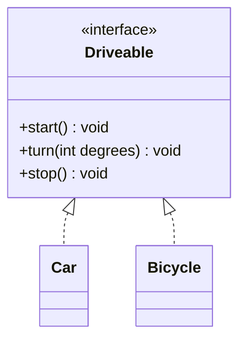

# Chapitre 3 (suite) — Classes abstraites, interfaces et tri

← [[Fiche_PG220_04_Heritage_Polymorphisme|Héritage et polymorphisme]] · [[PG220_00_Sommaire|Sommaire]] · Suivant → [[Fiche_PG220_06_Exceptions|Exceptions]]

> [!abstract] Ce que tu dois retenir
> - **Classe abstraite** : peut mélanger méthodes abstraites et concrètes, peut avoir des attributs, **ne s'instancie pas**, faite pour être héritée.
> - **Interface** : un **contrat** (liste de méthodes), pas d'état. Une classe `extends` **une** classe mais `implements` **autant** d'interfaces qu'elle veut.
> - Méthodes d'interface = implicitement **`public`** → l'implémentation doit être `public`.
> - **`Comparable<T>`** = l'ordre **naturel** (un seul, dans la classe). **`Comparator<T>`** = des ordres **à la demande** (autant qu'on veut, hors de la classe).
> - `==` compare des **références**, `equals` compare des **contenus**, `compareTo` donne un **ordre**.

---

## 1. Les classes abstraites

Parfois, une classe mère représente un concept trop général pour être instancié. « Une forme », ça n'existe pas : il existe des carrés, des cercles… Mais toutes les formes savent se dessiner.

```java
public abstract class Shape {
    protected double area;          // ✅ une classe abstraite peut avoir des attributs

    public abstract void draw();    // méthode abstraite : pas de corps, juste « ;  »

    public double getArea() {       // ✅ et des méthodes concrètes
        return area;
    }
}

public class Square extends Shape {
    private double size;

    public Square(double size) {
        this.size = size;
        this.area = size * size;
    }

    @Override
    public void draw() {            // obligatoire : sinon Square devrait être abstraite aussi
        System.out.println("I am a square");
    }
}
```

```java
Shape s = new Square(3);   // ✅ type statique abstrait, objet concret
s.draw();                  // I am a square
Shape t = new Shape();     // ❌ Shape is abstract; cannot be instantiated
```

### Les règles

- Une classe **abstraite** peut contenir des méthodes **abstraites** et **implémentées**, ainsi que des **données**.
- Elle **ne peut pas être instanciée**.
- Elle est **conçue pour être sous-classée**.
- Une classe qui contient **au moins une** méthode abstraite **doit** être déclarée `abstract`.
- Une sous-classe **concrète** doit implémenter **toutes** les méthodes abstraites héritées.
- Elle peut avoir un **constructeur** (appelé par les sous-classes via `super(...)`).

> [!note] Exercice de la slide 82
> « Adapter le programme de la slide 62 avec une classe abstraite `Shape` pour respecter Liskov » : la correction complète est dans [[Fiche_PG220_04_Heritage_Polymorphisme#10. Le principe de substitution de Liskov (LSP)|la fiche Héritage, section LSP]]. L'idée : `Rectangle` et `Square` héritent **tous les deux** de `Shape` (qui déclare `area()`), au lieu que `Square` hérite de `Rectangle`. La slide 83 garde une méthode `resize(Rectangle)` et ajoute une méthode séparée `resizeSquare(Square, int)`.

---

## 2. Les interfaces

Une interface **définit un type** en déclarant un ensemble de méthodes **sans implémentation**. C'est un **TAD** (Type Abstrait de Données) : elle dit **ce que** l'objet sait faire, pas **comment**.

```java
public interface Driveable {
    int VITESSE_MAX = 130;       // constante : implicitement public static final

    void start();                // implicitement public abstract
    void turn(int degrees);
    void stop();
}

public class Car implements Driveable {
    @Override public void start()          { System.out.println("Vroum"); }
    @Override public void turn(int degrees){ System.out.println("Volant " + degrees + "°"); }
    @Override public void stop()           { System.out.println("Frein"); }
}

public class Bicycle implements Driveable {
    @Override public void start()          { System.out.println("Je pédale"); }
    @Override public void turn(int degrees){ System.out.println("Guidon " + degrees + "°"); }
    @Override public void stop()           { System.out.println("Pieds par terre"); }
}
```



### Les règles

- Contient des **déclarations de méthodes** et peut contenir des **constantes**.
- Toutes ses méthodes sont **publiques**.
- C'est une « classe purement abstraite » → **ne peut pas être instanciée**.
- Une classe qui l'implémente doit implémenter **toutes** ses méthodes (sinon elle doit être `abstract`).
- **Une classe peut étendre une seule classe mais implémenter autant d'interfaces qu'elle veut** :
  ```java
  public class Amphibie extends Vehicule implements Driveable, Floatable { ... }
  ```
- Une interface peut hériter d'**autres interfaces** (`interface A extends B, C`), mais **jamais d'une classe**.

### Méthodes par défaut (Java 8+)

Une interface peut fournir une implémentation par défaut avec `default`. Les classes qui l'implémentent en héritent sans être obligées de la réécrire. Pratique pour **ajouter** une méthode à une interface sans casser toutes les classes existantes.

```java
public interface Animal {
    void eat();                              // abstraite → obligatoire

    default void log(String str) {           // implémentée → facultative
        System.out.println("Animal log: " + str);
    }
}

public class Bear implements Animal {
    @Override
    public void eat() {                      // ⚠️ public obligatoire !
        System.out.println("Bear eats");
    }
    // log() est hérité tel quel
}
```

> [!danger] Erreur dans la slide 77
> La slide écrit `void eat() { ... }` **sans `public`** dans `Bear`. Ça **ne compile pas** : `eat() in Bear cannot implement eat() in Animal; attempting to assign weaker access privileges; was public`. Les méthodes d'interface sont implicitement `public`, et on ne peut pas réduire la visibilité en implémentant. C'est un piège de QCM idéal.

> [!note] Pour être complet
> Depuis Java 8, une interface peut aussi avoir des méthodes **`static`**, et depuis Java 9 des méthodes **`private`** (pour factoriser le code des méthodes `default`). La règle « tout est public » vaut pour les méthodes abstraites et `default`.

---

## 3. Classe vs classe abstraite vs interface

| | **Interface** | **Classe abstraite** | **Classe** |
|---|:-:|:-:|:-:|
| Méthodes abstraites | ✅ | ✅ | ❌ |
| Méthodes implémentées | ❌ (✅ `default` depuis Java 8) | ✅ | ✅ |
| Attributs (état) | ❌ | ✅ | ✅ |
| Constantes (`final`) | ✅ | ✅ | ✅ |
| Instanciable | ❌ | ❌ | ✅ |
| Constructeur | ❌ | ✅ | ✅ |
| Héritage multiple | ✅ une classe peut en implémenter plusieurs | ❌ une seule | ❌ une seule |

> [!tip] Laquelle choisir ?
> - Des classes **sans lien de parenté** doivent offrir un **même service** (un vélo et une voiture se conduisent) → **interface**.
> - Des classes **d'une même famille** partagent du **code et des attributs** mais une partie reste à définir → **classe abstraite**.
> - Un concept complet et concret → **classe**.
>
> Formule : interface = « **peut faire** » (*can-do*), héritage = « **est un** » (*is-a*).

### Questions du cours (slide 73)

On suppose `Driveable` une interface et `Voiture` une classe qui l'implémente. Quelles lignes sont correctes ?

> [!question]- a) `Driveable a;`
> ✅ Déclarer une **variable** de type interface est permis (elle vaut `null` pour l'instant).

> [!question]- b) `Driveable a = new Driveable();`
> ❌ Une interface **ne s'instancie pas**.

> [!question]- c) `Driveable t[] = new Driveable[3];`
> ✅ On crée un **tableau** de 3 références (toutes `null`), pas des objets `Driveable`.

> [!question]- d) `public void conduire(Driveable d);`
> ✅ Paramètre de type interface : c'est l'**argument polymorphe** (voir §4). *(Comme déclaration seule, il faut être dans une interface ou une classe abstraite avec `abstract`, sinon il faut un corps.)*

> [!question]- e) `Driveable a = new Voiture();`
> ✅ Si `Voiture implements Driveable` : l'objet est une Voiture, vue à travers le type Driveable.

> [!question]- f) `interface Driveable extends Voiture {}`
> ❌ Une interface ne peut étendre **que des interfaces**, jamais une classe.

> [!question]- g) `public class Test implements Driveable { public void drive() {} }`
> ✅ **si** `Driveable` ne déclare que `drive()`. Sinon ❌ : `Test` n'implémente pas toutes les méthodes et n'est pas `abstract`. Note le `public` : indispensable.

---

## 4. L'argument polymorphe

Une méthode qui prend un **type interface** (ou une classe mère) en paramètre accepte **tous** les objets qui respectent ce contrat. On peut ajouter de nouveaux types **sans toucher** à la méthode.

```java
public class Utils {
    public static void moveMe(Driveable v) {
        v.start();
        for (int i = 0; i < 12; ++i) {
            v.turn(15);
        }
        v.stop();
    }
}

Utils.moveMe(new Bicycle());
Utils.moveMe(new Car());
Utils.moveMe(new Trottinette());   // demain : aucune modification de moveMe nécessaire
```

Même principe avec les collections : `List` est une interface, `ArrayList` et `LinkedList` deux implémentations.

```java
public static void printIt(List<String> list) {
    for (String s : list) {
        System.out.println(s);
    }
}

List<String> l1 = new ArrayList<>();
List<String> l2 = new LinkedList<>();
printIt(l1);   // ✅
printIt(l2);   // ✅
```

> [!tip] Bonne pratique : « programmer vers l'interface »
> Écris `List<String> l = new ArrayList<>();` plutôt que `ArrayList<String> l = ...`. Si tu changes d'implémentation plus tard, une seule ligne change.

---

## 5. L'interface `Iterator`

Elle permet de **parcourir séquentiellement** une collection, quelle que soit sa structure interne (tableau, liste chaînée, arbre…).

| Méthode | Rôle |
|---|---|
| `hasNext()` | Y a-t-il un élément suivant ? |
| `next()` | Renvoie l'élément suivant et avance |
| `remove()` *(optionnelle)* | Supprime le dernier élément renvoyé par `next()` |

```java
List<String> l1 = new ArrayList<>();
l1.add("Welcome");
l1.add("to");
l1.add("Java");

Iterator<String> it = l1.iterator();
while (it.hasNext()) {
    System.out.print(it.next() + " ");
}

// La boucle for-each fait EXACTEMENT la même chose en coulisse :
for (String str : l1) {
    System.out.print(str + " ");
}
```

Utilisée par toutes les collections : `ArrayList`, `LinkedList`, `HashSet`, etc.

> [!warning] Supprimer pendant un parcours
> Modifier une liste **pendant un for-each** provoque en général une `ConcurrentModificationException`. Pour supprimer en parcourant, utilise l'itérateur :
> ```java
> Iterator<String> it = l1.iterator();
> while (it.hasNext()) {
>     if (it.next().startsWith("t")) it.remove();   // ✅
> }
> // ou, plus court : l1.removeIf(s -> s.startsWith("t"));
> ```

---

## 6. Trier : le problème

Pour les types « simples », Java sait déjà trier :

```java
int[] t = {5, 2, 9};
Arrays.sort(t);                         // [2, 5, 9]

List<String> noms = new ArrayList<>(List.of("Zoé", "Adam", "Lina"));
Collections.sort(noms);                 // [Adam, Lina, Zoé] (ordre alphabétique)
```

Mais pour **tes** classes, Java ne peut pas deviner : un `Point` est-il plus petit qu'un autre selon x ? selon y ? selon sa distance à l'origine ? Deux outils :

| | `Comparable<T>` | `Comparator<T>` |
|---|---|---|
| Définit | l'ordre **naturel** | un ordre **supplémentaire** |
| Combien ? | **un seul** par classe | **autant** qu'on veut |
| Où ? | **dans** la classe (`implements`) | **à l'extérieur** (classe, classe anonyme, lambda) |
| Méthode | `int compareTo(T o)` | `int compare(T a, T b)` |
| Package | `java.lang` | `java.util` |

---

## 7. `Comparable<T>` : l'ordre naturel

```java
public interface Comparable<T> {
    int compareTo(T o);
}
```

`x.compareTo(y)` renvoie :

| Résultat | Signification |
|---|---|
| **négatif** | x est **avant** (plus petit que) y |
| **0** | x et y sont **équivalents** dans cet ordre |
| **positif** | x est **après** (plus grand que) y |

> [!tip] Mnémotechnique
> `x.compareTo(y)` se lit comme « **x − y** » : négatif si x < y, positif si x > y.

La version **générique** `Comparable<T>` fait vérifier les types **à la compilation** : comparer un `Point` avec une `String` est refusé avant même l'exécution. L'ancienne version non générique (`compareTo(Object o)`) obligeait à caster et ne détectait l'erreur qu'à l'exécution.

### Exemple : `Point` trié par x, puis par y

```java
public class Point implements Comparable<Point> {
    private final int x, y;

    public Point(int x, int y) { this.x = x; this.y = y; }

    @Override
    public int compareTo(Point o) {
        if (o == null) throw new NullPointerException();
        if (this.x == o.x && this.y == o.y) return 0;
        if (this.x == o.x) return Integer.compare(this.y, o.y);   // départage par y
        return Integer.compare(this.x, o.x);                      // critère principal : x
    }

    @Override
    public String toString() { return "(" + x + "," + y + ")"; }
}
```

```java
List<Point> pts = new ArrayList<>(List.of(new Point(2, 1), new Point(1, 5), new Point(1, 2)));
Collections.sort(pts);          // utilise compareTo
System.out.println(pts);        // [(1,2), (1,5), (2,1)]
```

> [!warning] Ne fais pas `return this.x - o.x;`
> Ça marche souvent, mais peut **déborder** (*overflow*) avec de grands entiers de signes opposés et renvoyer un signe faux. `Integer.compare(a, b)` est toujours correct.

> [!note] Condition pour `Collections.sort(liste)`
> Les éléments doivent implémenter `Comparable`. Sinon, soit ça ne compile pas, soit il faut passer un `Comparator` : `Collections.sort(liste, comparateur)`.

---

## 8. `Comparator<T>` : des ordres à la carte

Que faire si on veut trier des `Point` tantôt par x, tantôt par y, tantôt par distance à l'origine ? `Comparable` n'offre **qu'un** ordre naturel. `Comparator` permet d'en définir **autant qu'on veut**, sans toucher à la classe.

```java
public interface Comparator<T> {
    int compare(T x, T y);   // même convention de signe que compareTo
}
```

### Trois façons d'écrire un comparateur (même résultat)

On trie des `Person(name, age)` par âge.

**① Classe anonyme** (slide 93) : on crée à la volée un objet d'une classe sans nom qui implémente `Comparator`.

```java
Collections.sort(people, new Comparator<Person>() {
    @Override
    public int compare(Person p1, Person p2) {
        return Integer.compare(p1.getAge(), p2.getAge());
    }
});
```

**② Lambda** (slide 94) : `Comparator` n'a qu'une méthode abstraite (c'est une *interface fonctionnelle*), on peut donc n'écrire que ses paramètres et son corps.

```java
people.sort((p1, p2) -> Integer.compare(p1.getAge(), p2.getAge()));
```

**③ Méthodes utilitaires de `Comparator`** (bonus, le plus lisible)

```java
people.sort(Comparator.comparing(Person::getAge));
```

### Composer des comparateurs

| Méthode | Rôle |
|---|---|
| `compare(o1, o2)` | la comparaison elle-même |
| `reversed()` | inverse l'ordre |
| `thenComparing(autre)` | critère secondaire en cas d'égalité |
| `Comparator.naturalOrder()` | l'ordre de `Comparable` |

```java
// Par âge décroissant
people.sort(Comparator.comparing(Person::getAge).reversed());

// Par nom, puis par âge pour les homonymes
people.sort(Comparator.comparing(Person::getName).thenComparing(Person::getAge));

// Points par distance à l'origine
pts.sort(Comparator.comparingDouble(p -> Math.hypot(p.getX(), p.getY())));
```

> [!tip] Lire une lambda
> `(p1, p2) -> Integer.compare(p1.getAge(), p2.getAge())` se lit : « une fonction qui prend `p1` et `p2` et renvoie `Integer.compare(...)` ». `Person::getAge` se lit : « la méthode `getAge` appliquée à une `Person` ».

---

## 9. equals, hashCode et compareTo

### `==` vs `equals`

```java
String s1 = new String("Bonjour");
String s2 = new String("Bonjour");
System.out.println(s1.equals(s2));  // true  : même CONTENU
System.out.println(s1 == s2);       // false : deux OBJETS différents en mémoire
```

| Outil | Question posée | Utilisé par |
|---|---|---|
| `==` | Est-ce **le même objet** (même référence) ? | — |
| `equals()` | Ces objets **représentent-ils la même valeur** ? | `HashSet`, `HashMap`, `list.contains` |
| `compareTo()` | **Lequel vient avant** l'autre ? | `TreeSet`, `TreeMap`, `Collections.sort` |

> [!important] Contrat equals / hashCode
> Si tu redéfinis `equals`, tu **dois** redéfinir `hashCode` pour que deux objets égaux aient le même hash. Sinon les collections `Hash...` se comportent mal.
> ```java
> @Override
> public boolean equals(Object o) {
>     if (this == o) return true;
>     if (o == null || getClass() != o.getClass()) return false;
>     Person person = (Person) o;
>     return id == person.id;
> }
>
> @Override
> public int hashCode() {
>     return Objects.hash(id);
> }
> ```

### Cohérence equals / compareTo

Il est **conseillé** (pas obligatoire) que `a.equals(b)` soit vrai **exactement quand** `a.compareTo(b) == 0`. Sinon, les collections triées et les collections hachées ne sont pas d'accord entre elles.

**L'exemple de la slide 90** : `equals` compare les `id`, mais `compareTo` compare les `name`.

```java
Person p1 = new Person(1, "Alice");
Person p2 = new Person(1, "Bob");
Person p3 = new Person(2, "Charlie");

Set<Person> hashSet = new HashSet<>();   // se base sur equals/hashCode
hashSet.add(p1); hashSet.add(p2); hashSet.add(p3);

Set<Person> treeSet = new TreeSet<>();   // se base sur compareTo
treeSet.add(p1); treeSet.add(p2); treeSet.add(p3);
```

> [!question]- Que contient chaque ensemble ? (prédis avant d'ouvrir)
> ```text
> HashSet: [Person{id=1, name='Alice'}, Person{id=2, name='Charlie'}]
> TreeSet: [Person{id=1, name='Alice'}, Person{id=1, name='Bob'}, Person{id=2, name='Charlie'}]
> ```
> - `HashSet` : `p1.equals(p2)` est vrai (même id 1) → Bob est vu comme un **doublon** d'Alice et n'est pas ajouté.
> - `TreeSet` : `p1.compareTo(p2)` compare "Alice" et "Bob" → ≠ 0 → ce sont deux éléments **différents**, les trois sont gardés.
>
> Même données, deux ensembles différents : c'est le danger d'un `equals` incohérent avec `compareTo`.

---

## 🔁 Teste-toi

> [!question]- Peut-on écrire `new` sur une classe abstraite ? Une classe abstraite peut-elle avoir un constructeur ?
> On ne peut pas l'instancier directement, mais **oui**, elle peut avoir un constructeur : il est appelé par les sous-classes via `super(...)`.

> [!question]- Combien de classes peut étendre une classe ? Combien d'interfaces implémenter ?
> **Une** classe, **autant** d'interfaces qu'on veut.

> [!question]- Une interface peut-elle avoir des attributs d'instance ?
> Non. Seulement des constantes (`public static final` implicites).

> [!question]- `interface I { void f(); }  class C implements I { void f() {} }` compile ?
> **Non** : `f()` est implicitement `public` dans `I`, l'implémentation sans `public` réduit la visibilité.

> [!question]- `a.compareTo(b)` renvoie -3. Que peut-on dire ?
> `a` vient **avant** `b` dans l'ordre naturel. Seul le **signe** compte, pas la valeur.

> [!question]- Je veux trier des étudiants tantôt par nom, tantôt par moyenne. Comparable ou Comparator ?
> **Comparator** (au moins pour l'un des deux) : Comparable ne permet qu'un seul ordre naturel.

> [!question]- Que faut-il redéfinir en même temps qu'`equals` ?
> `hashCode`.

> [!question]- `"abc" == new String("abc")` ?
> `false` : deux objets distincts. Pour comparer le texte : `.equals()`.
