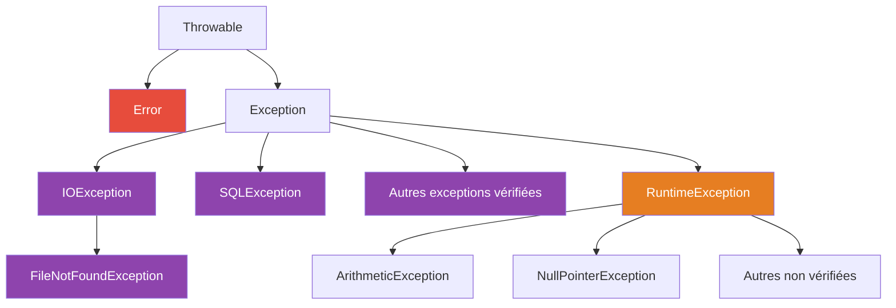

# Chapitre 4 — Les exceptions

← [[Fiche_PG220_05_Interfaces_Abstraites_Tri|Interfaces et tri]] · [[PG220_00_Sommaire|Sommaire]] · Suivant → [[Fiche_PG220_07_Imbriquees_Packages_Utilitaires|Classes imbriquées, packages, utilitaires]]

> [!abstract] Ce que tu dois retenir
> - Une exception est un **objet** qui signale une erreur et **remonte la pile d'appels** jusqu'à trouver un `catch` adapté (ou arrêter le programme).
> - `try` = code à risque, `catch` = traitement, `finally` = **toujours** exécuté.
> - **Vérifiées** (*checked*, héritent d'`Exception` mais pas de `RuntimeException`) : le compilateur **oblige** à les gérer ou les déclarer.
> - **Non vérifiées** (*unchecked*, héritent de `RuntimeException`) : pas d'obligation.
> - `throw` **lance** une exception (dans le corps), `throws` **déclare** qu'une méthode peut en lancer (dans la signature).
> - Les `catch` vont du **plus spécifique** au **plus général**.

---

## 1. Qu'est-ce qu'une exception ?

```java
public class AddArguments {
    public static void main(String[] args) {
        int sum = 0;
        for (String arg : args) {
            sum += Integer.parseInt(arg);   // "foo" n'est pas un nombre...
        }
        System.out.println("Sum: " + sum);
    }
}
```

```text
$ java AddArguments 1 2 3
Sum: 6

$ java AddArguments 1 foo 2 3
Exception in thread "main" java.lang.NumberFormatException: For input string: "foo"
    at java.lang.NumberFormatException.forInputString(NumberFormatException.java:65)
    at java.lang.Integer.parseInt(Integer.java:580)
    at java.lang.Integer.parseInt(Integer.java:615)
    at AddArguments.main(AddArguments.java:5)
```

### Lire une trace de pile (*stack trace*)

| Ligne | Ce qu'elle dit |
|---|---|
| `Exception in thread "main"` | Dans quel thread c'est arrivé |
| `java.lang.NumberFormatException` | **Le type** de l'exception (sa classe) |
| `For input string: "foo"` | **Le message** |
| `at ...` (de haut en bas) | La **pile d'appels**, de l'endroit où l'exception est née jusqu'au `main` |

> [!tip] Où chercher le bug ?
> Parcours les lignes `at` de haut en bas et arrête-toi à la **première ligne qui concerne ton code** (ici `AddArguments.java:5`). Les lignes au-dessus sont dans la bibliothèque Java.

---

## 2. Attraper une exception : `try` / `catch`

```java
try {
    // code qui peut lever une exception
} catch (TypeDException e) {
    // code exécuté SI une exception de ce type est levée dans le try
}
```

Quand une exception survient dans le `try`, **le reste du `try` est sauté** et on saute directement dans le `catch` correspondant. Après le `catch`, le programme continue normalement.

### L'emplacement du `try` change tout

Compare ces deux versions, lancées avec `1 foo 2 3`.

```java
// VERSION A : le try englobe toute la boucle
public class AddArguments2 {
    public static void main(String[] args) {
        try {
            int sum = 0;
            for (String arg : args) {
                sum += Integer.parseInt(arg);
            }
            System.out.println("Sum: " + sum);
        } catch (NumberFormatException e) {
            System.err.println("Non-numeric argument");
        }
    }
}
```

```java
// VERSION B : le try est DANS la boucle
public class AddArguments3 {
    public static void main(String[] args) {
        int sum = 0;
        for (String arg : args) {
            try {
                sum += Integer.parseInt(arg);
            } catch (NumberFormatException e) {
                System.err.println(arg + " is not an integer");
            }
        }
        System.out.println("Sum: " + sum);
    }
}
```

> [!question]- Qu'affiche chaque version avec `1 foo 2 3` ?
> **Version A**
> ```text
> Non-numeric argument
> ```
> L'exception sur `"foo"` fait sortir de **tout** le `try` : la boucle s'arrête et la somme n'est jamais affichée.
>
> **Version B**
> ```text
> foo is not an integer
> Sum: 6
> ```
> L'exception fait seulement sortir du `try` de **cette itération**. La boucle continue avec `2` et `3`.
>
> Moralité : place le `try` autour du **plus petit bloc** qu'on peut raisonnablement « sauter ».

### Plusieurs `catch`

```java
try {
    // bloc critique
} catch (MyException1 e1) {
    // si MyException1
} catch (MyException2 e2) {
    // si MyException2
} catch (Exception e3) {
    // toute autre exception
} finally {
    // toujours exécuté
}
```

Java teste les `catch` **dans l'ordre** et prend le **premier** compatible (même mécanisme qu'`instanceof`).

> [!danger] Ordre des `catch` : du plus précis au plus général
> ```java
> try {
>     Integer.parseInt("x");
> } catch (Exception e) {
>     // ...
> } catch (NumberFormatException e) {   // ❌ exception NumberFormatException has already been caught
> }
> ```
> `Exception` attrape déjà tout ce qui est `NumberFormatException` : le second `catch` serait inatteignable, le compilateur refuse.

> [!tip] Multi-catch (Java 7+)
> Même traitement pour plusieurs types sans lien d'héritage :
> ```java
> catch (NumberFormatException | ArithmeticException e) { ... }
> ```

---

## 3. Le bloc `finally`

Le bloc `finally` s'exécute **toujours**, qu'une exception soit levée ou non, attrapée ou non. Il sert à **libérer les ressources** (fermer un fichier, une connexion réseau…).

```java
try {
    // code qui peut lever une exception
} catch (ExceptionType1 e1) {
    // gérer ExceptionType1
} catch (ExceptionType2 e2) {
    // gérer ExceptionType2
} finally {
    // code exécuté dans TOUS les cas
}
```

| Scénario | `try` | `catch` | `finally` | Après |
|---|---|---|---|---|
| Pas d'exception | entier | sauté | ✅ | continue |
| Exception attrapée | interrompu | ✅ | ✅ | continue |
| Exception non attrapée | interrompu | — | ✅ | l'exception remonte à l'appelant |

```java
static int f() {
    try {
        return 1;
    } finally {
        System.out.println("finally!");
    }
}

System.out.println(f());
```

> [!question]- Qu'est-ce qui s'affiche ? (prédis avant d'ouvrir)
> ```text
> finally!
> 1
> ```
> Même un `return` n'empêche pas `finally` de s'exécuter : le `1` est mis de côté, `finally` tourne, puis la méthode rend la main. La seule vraie exception : `System.exit()`, qui arrête la JVM.

---

## 4. `try`-with-resources (Java 7+)

Fermer une ressource à la main dans un `finally` est verbeux et facile à oublier. Le *try-with-resources* **ferme automatiquement** la ressource à la fin du bloc, même en cas d'exception.

```java
try (TypeRessource r = new TypeRessource()) {
    // utiliser r
} catch (TypeException e) {
    // gérer
}   // ← r.close() est appelé automatiquement ici
```

```java
import java.io.BufferedReader;
import java.io.FileReader;
import java.io.IOException;

public class ExempleTryWithResources {
    public static void main(String[] args) {
        try (BufferedReader lecteur = new BufferedReader(new FileReader("fichier.txt"))) {
            String ligne;
            while ((ligne = lecteur.readLine()) != null) {
                System.out.println(ligne);
            }
        } catch (IOException e) {
            e.printStackTrace();
        }
    }
}
```

> [!note] Condition
> La ressource doit implémenter l'interface `AutoCloseable` (c'est le cas des flux de fichiers, sockets, connexions JDBC…). On peut déclarer plusieurs ressources séparées par `;`, elles sont fermées dans l'ordre inverse.

---

## 5. La hiérarchie des exceptions



| Famille | Hérite de | Le compilateur oblige à gérer ? | Signification | Exemples |
|---|---|---|---|---|
| **Error** | `Error` | Non | Problème grave de la JVM, on ne l'attrape pas | `OutOfMemoryError`, `StackOverflowError` |
| **Vérifiées** (*checked*) | `Exception` **mais pas** `RuntimeException` | **Oui** : `try/catch` **ou** `throws` | Problème **externe** prévisible (fichier absent, réseau…) | `IOException`, `FileNotFoundException`, `SQLException`, `ClassNotFoundException` |
| **Non vérifiées** (*unchecked*) | `RuntimeException` | Non | En général un **bug** du programme | `NullPointerException`, `ArithmeticException`, `ArrayIndexOutOfBoundsException`, `IllegalArgumentException`, `NumberFormatException` |

### Vérifiée : le compilateur t'oblige

```java
import java.io.*;

class Test {
    void lireFichier() throws IOException {         // on DÉCLARE
        FileReader f = new FileReader("test.txt");
    }

    void executer() {
        try {
            lireFichier();                          // obligé de gérer IOException
        } catch (IOException e) {
            e.printStackTrace();
        }
    }
}
```

Si `executer()` appelait `lireFichier()` sans `try/catch` ni `throws IOException`, **erreur de compilation** : `unreported exception IOException; must be caught or declared to be thrown`.

### Non vérifiée : aucune obligation

```java
class Test {
    void division() {
        int x = 10 / 0;      // ArithmeticException (non vérifiée)
    }
    void executer() {
        division();          // pas besoin de try/catch
    }
}
```

Aucune erreur à la **compilation**, mais le programme plantera à l'**exécution**.

> [!tip] Moyen de retenir
> **Checked** = « le monde extérieur peut te trahir » (fichier, réseau, BDD) → Java t'oblige à prévoir un plan B.
> **Unchecked** = « tu as fait une erreur de programmation » (`null`, indice, division par zéro) → corrige ton code plutôt que de l'attraper.

---

## 6. `throw` et `throws`

| | `throw` | `throws` |
|---|---|---|
| Où ? | dans le **corps** d'une méthode | dans la **signature** d'une méthode |
| Suivi de | **un objet** exception : `throw new X(...)` | **un ou plusieurs types** : `throws X, Y` |
| Rôle | **provoquer** une exception maintenant | **prévenir** l'appelant qu'elle peut survenir |

### `throw` : lancer

```java
public void divide(int a, int b) {
    if (b == 0) {
        throw new ArithmeticException("Division par zéro interdite !");  // la méthode s'arrête ici
    }
    System.out.println(a / b);
}
```

```text
divide(10, 0);
Exception in thread "main" java.lang.ArithmeticException: Division par zéro interdite !
```

### `throws` : déclarer

```java
import java.io.FileReader;
import java.io.IOException;

public class ExempleThrows {
    // Cette méthode PEUT lancer une IOException : elle laisse l'appelant s'en occuper
    public static void lireFichier(String nomFichier) throws IOException {
        FileReader reader = new FileReader(nomFichier);
        System.out.println("Fichier ouvert avec succès !");
        reader.close();
    }

    public static void main(String[] args) {
        try {
            lireFichier("exemple.txt");
        } catch (IOException e) {
            System.out.println("Erreur : " + e.getMessage());
        }
    }
}
```

- Déclarer les exceptions **non vérifiées** n'est pas nécessaire (mais possible).
- On peut **choisir** d'attraper une non vérifiée (ex. `NumberFormatException` dans `AddArguments3`).

### La propagation

Une exception non attrapée **remonte** la pile d'appels, méthode par méthode, jusqu'à trouver un `catch` compatible. Si elle atteint `main` sans être attrapée, le programme s'arrête avec la trace.

```text
main()  ──appelle──►  a()  ──appelle──►  b()   💥 exception levée ici
  ▲                    │                  │
  │  catch ici ?       │  pas de catch    │  pas de catch
  └────────────────────┴──────────────────┘   ← elle remonte
```

---

## 7. Créer ses propres exceptions

On hérite de `Exception` (→ vérifiée) ou de `RuntimeException` (→ non vérifiée).

```java
public class StackException extends Exception {        // vérifiée
    public StackException(String message) {
        super(message);                                // le message sera renvoyé par getMessage()
    }
}
```

```java
public class Stack {
    private Object[] elements;
    private int capacity;
    private int size;

    public Stack(int capacity) {
        this.capacity = capacity;
        elements = new Object[capacity];
    }

    public void push(Object o) throws StackException {
        if (size == capacity) {
            throw new StackException("Stack is full");
        }
        elements[size++] = o;
    }

    public Object top() throws StackException {
        if (size == 0) {
            throw new StackException("Stack is empty");
        }
        return elements[size - 1];
    }
}
```

```java
Stack s = new Stack(3);
for (int i = 0; i < 10; ++i) {
    try {
        s.push(i);                 // i (int) est automatiquement converti en Integer (autoboxing)
    } catch (StackException ex) {
        ex.printStackTrace();
    }
}
```

> [!question]- Combien de traces sont affichées ?
> **7.** Les pushs de 0, 1, 2 réussissent ; les 7 suivants (3 à 9) lèvent chacun une `StackException: Stack is full`. Grâce au `try` dans la boucle, le programme continue après chaque erreur.

> [!tip] Checked ou unchecked pour ma propre exception ?
> Si l'appelant peut **raisonnablement réagir** (pile pleine → attendre, fichier absent → en demander un autre) : `extends Exception`. Si c'est un **mauvais usage** de ta classe (argument invalide) : `extends RuntimeException`.

---

## 8. Exceptions et redéfinition de méthodes

Quand une sous-classe **redéfinit** une méthode qui déclare `throws`, voici ce qu'elle a le droit de faire (règles valables pour les exceptions **vérifiées**) :

| La méthode redéfinie peut… | ✅/❌ |
|---|:-:|
| ne lancer **aucune** exception | ✅ |
| lancer **les mêmes** exceptions | ✅ |
| lancer des **sous-classes** de ces exceptions | ✅ |
| lancer des exceptions vérifiées **supplémentaires** | ❌ |
| lancer une **superclasse** de ces exceptions | ❌ |

```java
class Parent { void lire() throws IOException { } }

class A extends Parent { void lire() { } }                                  // ✅ aucune
class B extends Parent { void lire() throws IOException { } }               // ✅ la même
class C extends Parent { void lire() throws FileNotFoundException { } }     // ✅ sous-classe
class D extends Parent { void lire() throws Exception { } }                 // ❌ superclasse
class E extends Parent { void lire() throws IOException, SQLException { } } // ❌ en plus
class F extends Parent { void lire() throws IllegalArgumentException { } }  // ✅ non vérifiée : toujours permis
```

> [!note] Pourquoi ces règles ? Liskov, encore
> Du code écrit pour un `Parent` n'a prévu que `IOException`. Si on lui passe un enfant qui lance `SQLException` ou `Exception`, ce code se retrouve avec une exception vérifiée qu'il n'a jamais été obligé de gérer. La sous-classe peut **promettre moins de problèmes**, jamais plus. Voir [[Fiche_PG220_04_Heritage_Polymorphisme#10. Le principe de substitution de Liskov (LSP)|LSP]].

---

## 9. Bonnes pratiques

- **Ne jamais laisser un `catch` vide** (`catch (Exception e) {}`) : l'erreur disparaît silencieusement et le bug devient introuvable. Au minimum : `e.printStackTrace()`.
- Attraper l'exception **la plus précise** possible plutôt que `Exception`.
- Utiliser `e.getMessage()` pour un message lisible, `e.printStackTrace()` pour déboguer.
- Pour les ressources : **try-with-resources** plutôt que `finally`.
- Ne pas utiliser les exceptions pour le déroulement normal du programme (ce sont des cas… exceptionnels).

---

## 🔁 Teste-toi

> [!question]- `IOException` est-elle vérifiée ? `NullPointerException` ?
> `IOException` : **vérifiée**. `NullPointerException` : **non vérifiée** (hérite de `RuntimeException`).

> [!question]- Une méthode appelle `new FileReader("x")` sans `try` ni `throws`. Que se passe-t-il ?
> **Erreur de compilation** : `FileNotFoundException` (vérifiée) doit être attrapée ou déclarée.

> [!question]- Différence entre `throw` et `throws` ?
> `throw new X()` **lance** une exception dans le corps. `throws X` dans la signature **déclare** que la méthode peut en lancer.

> [!question]- Le bloc `finally` s'exécute-t-il si le `try` contient un `return` ?
> **Oui**, avant que la méthode ne rende la main.

> [!question]- `catch (Exception e)` puis `catch (IOException e)` : compile ?
> **Non** : le second est inatteignable. Ordre : du plus spécifique au plus général.

> [!question]- La méthode parente déclare `throws IOException`. L'enfant peut-il déclarer `throws Exception` ?
> **Non** : on ne peut pas élargir vers une superclasse. Il peut déclarer `IOException`, une sous-classe, rien du tout, ou des exceptions non vérifiées.

> [!question]- Pour créer une exception non vérifiée, de quoi hérite-t-on ?
> De `RuntimeException`.

> [!question]- Quelle interface doit implémenter une ressource utilisée dans un try-with-resources ?
> `AutoCloseable`.
