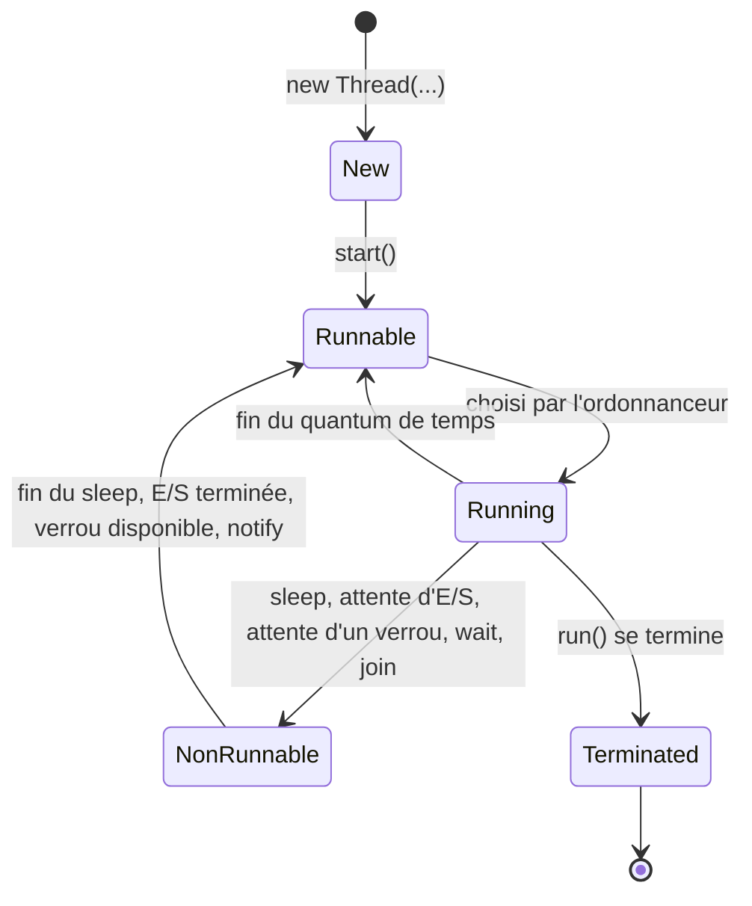

# Chapitre 5 — Programmation concurrente avec les threads

← [[Fiche_PG220_07_Imbriquees_Packages_Utilitaires|Classes imbriquées, packages]] · [[PG220_00_Sommaire|Sommaire]] · Suivant → [[Exercices_PG220_QCM|QCM d'entraînement]]

> [!abstract] Ce que tu dois retenir
> - Un **thread** = un fil d'exécution *léger* : il a sa **propre pile** et son **propre compteur de programme**, mais **partage** le code et les données (le tas) avec les autres threads du processus.
> - Deux façons de créer : `extends Thread` ou `implements Runnable` (préférée : on garde la possibilité d'hériter d'autre chose).
> - **`start()`** crée un nouveau thread qui exécutera `run()`. Appeler **`run()`** directement exécute le code dans le thread **courant**, sans parallélisme.
> - `sleep` met en pause, `join` attend la fin d'un autre thread, `interrupt` **demande** poliment l'arrêt.
> - `x++` n'est **pas atomique** → *race condition*. Solutions : `synchronized` ou `AtomicInteger`.
> - Deux threads qui prennent deux verrous dans l'ordre inverse → **interblocage** (*deadlock*).

---

## 1. Qu'est-ce qu'un thread ?

### Vu du système d'exploitation

Un thread est un **processus léger** :
- il s'exécute **dans l'espace d'adressage** d'un processus ;
- il possède **son propre compteur de programme (PC)** et **sa propre pile** ;
- il **partage le code et les données** (le tas) avec les autres threads du même processus.

```text
┌──────────────────────── Processus (la JVM) ────────────────────────┐
│   Code partagé          Tas partagé (tous les objets)              │
│  ┌──────────┐   ┌─────────────────────────────────────────┐        │
│  │ .class   │   │  counter   liste   ressource1 ...       │        │
│  └──────────┘   └─────────────────────────────────────────┘        │
│        ▲                ▲              ▲              ▲             │
│   ┌────┴───┐       ┌────┴───┐     ┌────┴───┐     ┌────┴───┐        │
│   │ main   │       │ Thread │     │ Thread │     │ Thread │        │
│   │ PC     │       │ PC     │     │ PC     │     │ PC     │        │
│   │ pile   │       │ pile   │     │ pile   │     │ pile   │        │
│   └────────┘       └────────┘     └────────┘     └────────┘        │
└────────────────────────────────────────────────────────────────────┘
```

| | Processus | Thread |
|---|---|---|
| Mémoire | séparée des autres processus | **partagée** avec les threads du même processus |
| Création | coûteuse | légère |
| Communication | compliquée (tubes, sockets…) | directe (mêmes objets)… mais **dangereuse** sans synchronisation |

### Vu de la POO

En Java, un thread est **un objet** : une instance de la classe `Thread`. Ton programme a déjà un thread dès le départ : celui qui exécute `main`.

---

## 2. Créer un thread

### Façon 1 : implémenter `Runnable` (recommandée)

On décrit la **tâche** dans une classe qui implémente `Runnable` (une seule méthode : `run()`), puis on la confie à un objet `Thread`.

```java
public class MyRunnable implements Runnable {
    private int id;

    public MyRunnable(int id) { this.id = id; }

    @Override
    public void run() {
        for (int i = 0; i < 10; ++i) {
            System.out.println("Hello" + id + " " + i);
        }
    }
}
```

```java
MyRunnable r = new MyRunnable(1);   // la tâche
Thread t = new Thread(r);           // l'ouvrier à qui on confie la tâche
t.start();                          // l'ouvrier commence
```

### Façon 2 : hériter de `Thread`

On redéfinit directement `run()` dans une sous-classe de `Thread`.

```java
class MyThread extends Thread {
    private int id;

    public MyThread(int id) { this.id = id; }

    @Override
    public void run() {
        for (int i = 0; i < 10; ++i) {
            System.out.println("Hello" + id + " " + i);
        }
    }
}

public class Test {
    public static void main(String[] args) {
        Thread t1 = new MyThread(1);
        Thread t2 = new MyThread(2);
        t1.start();
        t2.start();       // les "Hello1 ..." et "Hello2 ..." s'entremêlent
    }
}
```

### Façon 3 (bonus) : une lambda

`Runnable` n'a qu'une méthode : c'est une interface fonctionnelle.

```java
Thread t = new Thread(() -> System.out.println("In a thread"));
t.start();
```

### Laquelle choisir ?

| | `extends Thread` | `implements Runnable` |
|---|---|---|
| Héritage | ❌ ta classe ne peut plus hériter d'autre chose (héritage simple) | ✅ tu peux encore hériter d'une autre classe |
| Séparation | tâche et ouvrier mélangés | la **tâche** (`Runnable`) est séparée de l'**ouvrier** (`Thread`) |
| Réutilisation | un objet = un thread | la même tâche peut être donnée à plusieurs threads |

```java
class A { /* classe avec des méthodes utiles */ }

class MaClasse extends A implements Runnable {   // impossible avec extends Thread
    public void run() {
        System.out.println("Exécution du thread");
    }
}

Thread t = new Thread(new MaClasse());
t.start();
```

---

## 3. `start()` vs `run()` : LE piège

```java
Thread thread = new Thread(new MyFirstRunnable());   // run() affiche "In a thread"
thread.start();
System.out.println("In the main Thread");
```

> [!question]- Dans quel ordre s'affichent les deux lignes ?
> **Impossible à prévoir.** `start()` crée un nouveau thread et rend la main **immédiatement**. Les deux threads avancent ensuite en parallèle, et c'est l'ordonnanceur (*scheduler*) du système qui décide. Les deux ordres sont possibles, et peuvent changer d'une exécution à l'autre.

```java
Thread thread = new Thread(new MyFirstRunnable());
thread.run();                                        // ⚠️ run, pas start
System.out.println("In the main Thread");
```

> [!question]- Et maintenant ?
> ```text
> In a thread
> In the main Thread
> ```
> **Toujours** dans cet ordre. `run()` est un simple appel de méthode : il s'exécute **dans le thread `main`**, du début à la fin, avant de passer à la ligne suivante. Aucun nouveau thread n'est créé.

| Appel | Nouveau thread ? | Parallélisme ? |
|---|:-:|:-:|
| `t.start()` | ✅ | ✅ |
| `t.run()` | ❌ | ❌ (appel de méthode ordinaire) |

> [!warning] Un thread ne démarre qu'une fois
> Appeler `start()` deux fois sur le même objet `Thread` lève `IllegalThreadStateException`. En revanche, **un même `Runnable`** peut être confié à plusieurs threads :
> ```java
> Runnable runnable = new MyFirstRunnable();
> for (int i = 0; i < 25; i++) {
>     new Thread(runnable).start();   // 25 threads, une seule tâche
> }
> ```

---

## 4. Opérations sur les threads

### `sleep` : mettre en pause

```java
try {
    Thread.sleep(1000);        // pause d'environ 1000 ms
} catch (InterruptedException e) {
    e.printStackTrace();
}
```

- `sleep` est **statique** et met toujours en pause **le thread courant** (celui qui exécute cette ligne), jamais un autre.
- La durée réelle est **au moins** celle demandée, un peu plus si le système est chargé (elle dépend des minuteries et de l'ordonnanceur).
- Elle lève `InterruptedException` (vérifiée) → `try/catch` obligatoire.

### `join` : attendre la fin d'un autre thread

Le thread qui appelle `t2.join()` **se bloque** jusqu'à ce que `t2` ait terminé.

```java
Thread t2 = new Thread(new R());
t2.start();
try {
    t2.join();                 // main attend ici que t2 finisse
} catch (InterruptedException e) {
    e.printStackTrace();
}
// ici, t2 est forcément terminé
```

> [!tip] Image mentale
> `join` = « je t'attends au point de rendez-vous ». Indispensable quand tu as besoin du **résultat** d'un thread.

### `setPriority` / `getPriority` : priorités

```java
System.out.println(Thread.MIN_PRIORITY);    // 1
System.out.println(Thread.NORM_PRIORITY);   // 5 (par défaut)
System.out.println(Thread.MAX_PRIORITY);    // 10
t.setPriority(Thread.MAX_PRIORITY);
```

Une priorité est une **indication** pour l'ordonnanceur, **pas une garantie** : le comportement dépend de la plateforme, qui peut l'ignorer. Ne jamais bâtir la correction d'un programme sur les priorités.

### `interrupt` : demander l'arrêt

`t.interrupt()` **ne tue pas** le thread. Il positionne un **drapeau d'interruption**. Si le thread est bloqué dans `sleep()`, `wait()` ou `join()`, il est réveillé par une `InterruptedException`. C'est ensuite au thread de **décider** de s'arrêter.

```java
private static class ForeverRunnable implements Runnable {
    public void run() {
        while (true) {
            System.out.println(Thread.currentThread().getName() + ": " + System.currentTimeMillis());
            try {
                Thread.sleep(5000);
            } catch (InterruptedException e) {
                System.out.println(Thread.currentThread().getName() + " has been interrupted");
            }
        }
    }
}

public static void main(String[] args) {
    Thread t2 = new Thread(new ForeverRunnable());
    t2.start();
    t2.interrupt();
}
```

> [!question]- Le thread `t2` s'arrête-t-il ?
> **Non !** L'interruption réveille le `sleep` → le `catch` affiche le message… puis la boucle `while (true)` **continue**. Pire : quand `InterruptedException` est levée, le drapeau d'interruption est **remis à `false`**, donc plus aucune trace de la demande. Ce thread tourne pour toujours.

La bonne façon de réagir :

```java
public void run() {
    while (!Thread.currentThread().isInterrupted()) {   // on vérifie le drapeau
        // ... travail ...
        try {
            Thread.sleep(5000);
        } catch (InterruptedException e) {
            Thread.currentThread().interrupt();          // on remet le drapeau...
            break;                                       // ...et on sort proprement
        }
    }
    System.out.println("Arrêt propre");
}
```

### Utiles au débogage

```java
Thread.currentThread();              // le thread qui exécute cette ligne
Thread.currentThread().getName();    // "main", "Thread-0", "Thread-1"...
new Thread(tache, "worker-1");       // donner un nom à un thread
```

---

## 5. Le cycle de vie d'un thread



| État (slide 130) | Signification |
|---|---|
| **New** | Objet `Thread` créé, `start()` pas encore appelé |
| **Runnable** | Prêt à tourner, attend que l'ordonnanceur lui donne le processeur |
| **Running** | En cours d'exécution sur un cœur |
| **Non-Runnable (Blocked)** | Ne peut pas avancer : il dort, attend une E/S, un verrou, ou un autre thread |
| **Terminated** | `run()` est terminée. Un thread terminé ne redémarre jamais |

> [!note] Les vrais noms dans l'API Java
> `t.getState()` renvoie une valeur de l'énumération `Thread.State` : `NEW`, `RUNNABLE` (regroupe « prêt » et « en cours »), `BLOCKED` (attend un verrou `synchronized`), `WAITING` (`join()`, `wait()` sans délai), `TIMED_WAITING` (`sleep(ms)`, `join(ms)`), `TERMINATED`.

---

## 6. Section critique et *race condition*

### Le problème

```java
class Counter {
    private int value;
    public int getNextValue() { return ++value; }
    public int getValue() { return value; }
}
```

```java
Counter counter = new Counter();

Runnable task = () -> {
    for (int i = 0; i < 10000; ++i) {
        counter.getNextValue();
    }
};

Thread t1 = new Thread(task);
Thread t2 = new Thread(task);
t1.start();
t2.start();
t1.join();
t2.join();
System.out.println("COUNTER: " + counter.getValue());
```

> [!question]- Qu'affiche ce programme ? (on attend 20000)
> **Pas forcément 20000.** Sur une machine multi-cœur, on obtient souvent moins (par exemple 13847), et une valeur différente à chaque exécution. Sur une machine à un seul cœur, ou avec peu d'itérations, le bug peut rester invisible… ce qui le rend d'autant plus dangereux.

### Pourquoi : `++value` n'est pas atomique

Cette seule ligne correspond en réalité à **trois** opérations :
1. **Lire** la valeur actuelle de `value` ;
2. **Ajouter** 1 ;
3. **Écrire** le résultat dans `value`.

Si deux threads s'intercalent, une incrémentation est **perdue** :

| Temps | Thread 1 | Thread 2 | `value` en mémoire |
|---|---|---|---|
| 1 | lit 41 | | 41 |
| 2 | | lit 41 | 41 |
| 3 | calcule 42 | | 41 |
| 4 | | calcule 42 | 41 |
| 5 | écrit 42 | | 42 |
| 6 | | écrit 42 | **42** ← au lieu de 43 |

> [!important] Vocabulaire
> - **Section critique** : portion de code qui accède à une ressource partagée et ne doit être exécutée que par **un thread à la fois**.
> - **Race condition** (*situation de compétition*) : le résultat dépend de l'ordre imprévisible d'exécution des threads.

---

## 7. Les solutions

### Solution 1 : méthode `synchronized`

```java
public class Counter {
    private int value = 0;

    public synchronized int getNextValue() {
        return ++value;          // un seul thread à la fois dans cette méthode (pour un même objet)
    }

    public synchronized int getValue() {
        return value;
    }
}
```

### Solution 2 : bloc `synchronized`

On ne verrouille que la partie critique, sur un objet choisi (ici `this`).

```java
public class Counter {
    private int value = 0;

    public int getNextValue() {
        synchronized (this) {
            return ++value;      // lecture ET retour DANS le bloc
        }
    }
}
```

> [!warning] Subtilité dans la slide 133
> La slide écrit :
> ```java
> synchronized (this) { value++; }
> return value;               // ← lu HORS du verrou
> ```
> L'incrémentation est bien protégée, mais la lecture de `value` pour le `return` ne l'est plus : un autre thread peut incrémenter entre les deux, et deux appels peuvent renvoyer la même valeur. Le compteur final est juste, mais la valeur **renvoyée** peut être fausse. Mets le `return` dans le bloc.

### Solution 3 : `AtomicInteger`

Une classe de `java.util.concurrent.atomic` dont les opérations sont **atomiques** (indivisibles) sans verrou explicite.

```java
import java.util.concurrent.atomic.AtomicInteger;

public class Counter {
    private AtomicInteger value = new AtomicInteger(0);

    public int getNextValue() {
        return value.incrementAndGet();   // lire + ajouter + écrire en une seule opération
    }

    public int getValue() {
        return value.intValue();
    }
}
```

| Solution | Avantage | Quand l'utiliser |
|---|---|---|
| méthode `synchronized` | simple | la méthode entière est critique |
| bloc `synchronized` | verrouille le strict nécessaire | seule une partie est critique |
| `AtomicInteger` | rapide, pas de verrou | un simple compteur ou une variable isolée |

---

## 8. Comment marche `synchronized` : les verrous

- **Chaque objet** Java possède **un verrou** unique (on dit aussi *moniteur*).
- Le verrou est **pris** en entrant dans une section `synchronized` sur cet objet.
- Si le verrou n'est **pas disponible**, le thread entre dans une **file d'attente** (état bloqué).
- Quand le verrou est **libéré** (sortie de la section, même par exception), un thread en attente **reprend**.

| Écriture | Verrou utilisé |
|---|---|
| `synchronized` sur une méthode d'instance | l'objet courant `this` |
| `synchronized (obj) { ... }` | l'objet `obj` |
| `synchronized` sur une méthode `static` | l'objet `Class` de la classe (`Counter.class`) |

> [!tip] Conséquence importante
> Deux threads qui appellent `getNextValue()` sur **deux objets `Counter` différents** ne se bloquent pas entre eux : ce ne sont pas les mêmes verrous. La synchronisation protège un **objet**, pas un bout de code en général.

### Thread-safe

Une classe est **thread-safe** si elle se comporte **toujours correctement** quand plusieurs threads l'utilisent en même temps.

Les objets **immuables** (dont l'état ne peut jamais changer après construction) sont **toujours** thread-safe : personne ne peut les modifier, donc aucun conflit possible. Exemples : `String`, `Long`, `Double`, `Integer`.

---

## 9. Retour sur le Singleton

Le Singleton de la [[Fiche_PG220_03_Static_Final_Relations#2. Le design pattern Singleton|fiche 03]] a une *race condition* :

```java
public static Singleton getInstance() {
    if (instance == null) {              // T1 et T2 voient tous deux null...
        instance = new Singleton();      // ...et créent chacun une instance 💥
    }
    return instance;
}
```

Deux corrections simples :

```java
// Correction A : synchroniser la méthode
public static synchronized Singleton getInstance() {
    if (instance == null) {
        instance = new Singleton();
    }
    return instance;
}

// Correction B : créer l'instance au chargement de la classe (pas de test, pas de conflit)
private static final Singleton INSTANCE = new Singleton();
public static Singleton getInstance() { return INSTANCE; }
```

---

## 10. L'interblocage (*deadlock*)

```java
class Ressource {
    private final String nom;
    public Ressource(String nom) { this.nom = nom; }
    public String getNom() { return nom; }
}

public class X {
    public static void main(String[] args) {
        Ressource ressource1 = new Ressource("Ressource 1");
        Ressource ressource2 = new Ressource("Ressource 2");

        // Thread A : verrouille ressource1 PUIS ressource2
        Thread threadA = new Thread(() -> {
            synchronized (ressource1) {
                System.out.println("Thread A a verrouillé " + ressource1.getNom());
                try { Thread.sleep(100); } catch (InterruptedException e) {}
                System.out.println("Thread A essaie de verrouiller " + ressource2.getNom());
                synchronized (ressource2) {
                    System.out.println("Thread A a verrouillé " + ressource2.getNom());
                }
            }
        });

        // Thread B : verrouille ressource2 PUIS ressource1 (ordre inverse !)
        Thread threadB = new Thread(() -> {
            synchronized (ressource2) {
                System.out.println("Thread B a verrouillé " + ressource2.getNom());
                try { Thread.sleep(100); } catch (InterruptedException e) {}
                System.out.println("Thread B essaie de verrouiller " + ressource1.getNom());
                synchronized (ressource1) {
                    System.out.println("Thread B a verrouillé " + ressource1.getNom());
                }
            }
        });

        threadA.start();
        threadB.start();
    }
}
```

> [!question]- Que se passe-t-il ?
> ```text
> Thread A a verrouillé Ressource 1
> Thread B a verrouillé Ressource 2
> Thread A essaie de verrouiller Ressource 2
> Thread B essaie de verrouiller Ressource 1
> ```
> …puis **plus rien, pour toujours**. A tient R1 et attend R2 ; B tient R2 et attend R1. Chacun attend que l'autre lâche son verrou, ce qui n'arrivera jamais. Le `sleep(100)` sert à rendre ce scénario quasi certain (chaque thread a le temps de prendre son premier verrou).

```text
      tient                     attend
  A ─────────► R1       A ─────────────► R2
  B ─────────► R2       B ─────────────► R1      → cycle d'attente = interblocage
```

> [!tip] La solution classique : toujours le même ordre
> Si **tous** les threads prennent les verrous dans le **même ordre** (R1 puis R2), le cycle devient impossible : le second thread attend simplement que le premier ait tout fini. Il suffit ici que le thread B fasse `synchronized (ressource1)` puis `synchronized (ressource2)`.

---

## 11. Exemple complet : somme parallèle d'un grand tableau

Le schéma **découper → lancer → `join` → combiner** revient dans énormément de programmes multi-threads.

```java
public class SommeParallele {

    // La tâche : sommer une tranche [debut, fin[ du tableau
    static class SommeTranche implements Runnable {
        private final int[] tab;
        private final int debut, fin;
        private long resultat;            // chaque tâche a SON résultat → rien de partagé en écriture

        SommeTranche(int[] tab, int debut, int fin) {
            this.tab = tab; this.debut = debut; this.fin = fin;
        }

        @Override
        public void run() {
            for (int i = debut; i < fin; i++) {
                resultat += tab[i];
            }
        }

        long getResultat() { return resultat; }
    }

    public static void main(String[] args) throws InterruptedException {
        int n = 10_000_000, nbThreads = 4;
        int[] tab = new int[n];
        for (int i = 0; i < n; i++) tab[i] = i % 10;

        SommeTranche[] taches = new SommeTranche[nbThreads];
        Thread[] threads = new Thread[nbThreads];
        int taille = n / nbThreads;

        // 1. Découper et lancer
        for (int k = 0; k < nbThreads; k++) {
            int debut = k * taille;
            int fin = (k == nbThreads - 1) ? n : debut + taille;   // le dernier prend le reste
            taches[k] = new SommeTranche(tab, debut, fin);
            threads[k] = new Thread(taches[k], "worker-" + k);
            threads[k].start();
        }

        // 2. Attendre que tout le monde ait fini
        for (Thread t : threads) {
            t.join();
        }

        // 3. Combiner les résultats partiels (lus APRÈS join → valeurs finales garanties)
        long total = 0;
        for (SommeTranche t : taches) {
            total += t.getResultat();
        }
        System.out.println("Somme = " + total);   // Somme = 45000000
    }
}
```

> [!note] Pourquoi il n'y a besoin d'aucun `synchronized` ici
> Chaque thread écrit dans **son propre** attribut `resultat` et ne fait que **lire** le tableau partagé. Le `main` ne lit les résultats qu'**après** `join()`, qui garantit que le travail du thread est terminé et visible. Concevoir pour **éviter le partage en écriture** est souvent plus simple que de synchroniser.

---

## 🔁 Teste-toi

> [!question]- Qu'est-ce qu'un thread partage avec les autres threads du processus ? Qu'est-ce qu'il a en propre ?
> Partagé : le **code** et les **données** (tas, donc tous les objets). En propre : sa **pile** et son **compteur de programme**.

> [!question]- Pourquoi préférer `implements Runnable` à `extends Thread` ?
> Java n'a que l'héritage simple : avec `Runnable`, la classe peut encore hériter d'une autre. En plus, on sépare la tâche de l'ouvrier.

> [!question]- Quelle différence entre `t.start()` et `t.run()` ?
> `start()` crée un nouveau thread qui exécutera `run()` en parallèle. `run()` est un simple appel de méthode exécuté dans le thread courant.

> [!question]- `Thread.sleep(1000)` dans le `main` : quel thread dort ?
> Le thread **courant**, donc `main`. `sleep` est statique et agit toujours sur le thread qui l'exécute.

> [!question]- À quoi sert `join()` ?
> À faire attendre le thread appelant jusqu'à la fin du thread cible.

> [!question]- `interrupt()` arrête-t-il le thread immédiatement ?
> Non. Il positionne un drapeau et réveille le thread s'il est dans `sleep`/`wait`/`join` (via `InterruptedException`). C'est au thread de s'arrêter.

> [!question]- Pourquoi `count++` partagé entre deux threads donne-t-il un résultat faux ?
> Parce que c'est lire + ajouter + écrire : deux threads peuvent lire la même valeur et écrire le même résultat, une incrémentation est perdue.

> [!question]- Trois façons de corriger ce compteur ?
> Méthode `synchronized`, bloc `synchronized`, `AtomicInteger`.

> [!question]- Pourquoi `String` est-elle thread-safe ?
> Elle est **immuable** : personne ne peut modifier un objet `String`, donc aucun conflit d'écriture.

> [!question]- Quelle est la cause de l'interblocage de la slide 135 ? Comment l'éviter ?
> Les deux threads prennent les deux mêmes verrous dans l'**ordre inverse**, ce qui crée un cycle d'attente. On l'évite en imposant un **ordre unique** de prise des verrous.
