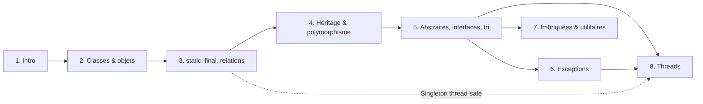

# PG220 — Programmation orientée objet en Java

> [!info] Organisation du module
> - 5 séances de cours, avec manipulation en fin de séance
> - 2 TPs à finir à la maison (tests et corrections fournis)
> - 1 projet en binôme, avec séances de suivi
> - **Note finale = 0,7 × QCM + 0,3 × Projet**
>
> Le QCM pèse lourd : le vocabulaire exact (surcharge ≠ redéfinition…) et les questions « ça compile ? » / « qu'affiche ce code ? » sont à travailler en priorité.

---

## 🗺️ Parcours

| # | Fiche | Slides | Notions clés |
|---|---|---|---|
| 1 | [[Fiche_PG220_01_Intro_POO_Java\|Introduction à la POO et à Java]] | 1–9 | paradigmes, classe/objet, JVM et bytecode, `main`, types primitifs |
| 2 | [[Fiche_PG220_02_Classes_Objets\|Classes et objets]] | 10–41 | encapsulation, UML, constructeurs, pile/tas, passage par valeur, `this`, tableaux |
| 3 | [[Fiche_PG220_03_Static_Final_Relations\|static, final et relations]] | 42–52 | membres statiques, Singleton, `final`, composition/agrégation, `ArrayList` |
| 4 | [[Fiche_PG220_04_Heritage_Polymorphisme\|Héritage et polymorphisme]] | 53–69 | `extends`, `super`, visibilité, surcharge/redéfinition, types statique/dynamique, Liskov |
| 5 | [[Fiche_PG220_05_Interfaces_Abstraites_Tri\|Classes abstraites, interfaces et tri]] | 70–94 | `abstract`, `interface`, `default`, `Iterator`, `Comparable`, `Comparator`, `equals` |
| 6 | [[Fiche_PG220_06_Exceptions\|Exceptions]] | 95–111 | `try/catch/finally`, try-with-resources, vérifiées/non vérifiées, `throw`/`throws` |
| 7 | [[Fiche_PG220_07_Imbriquees_Packages_Utilitaires\|Classes imbriquées, packages, utilitaires]] | 26, 112–116 | classes internes/statiques/locales/anonymes, `import`, `String`, `Math`, wrappers |
| 8 | [[Fiche_PG220_08_Threads\|Threads]] | 117–135 | `Runnable`, `start`/`run`, `sleep`/`join`/`interrupt`, `synchronized`, interblocage |
| ✅ | [[Exercices_PG220_QCM\|QCM d'entraînement]] | — | 34 questions mélangées, réponses vérifiées |
| ⚡ | [[Fiche_PG220_99_Aide_Memoire\|Aide-mémoire]] | — | tableaux récapitulatifs, 15 pièges, erreurs des slides |

---

## 🧠 Comment utiliser ces fiches

1. **Lis une fiche** en commençant par l'encadré « Ce que tu dois retenir » pour savoir où tu vas.
2. **Tape et exécute les exemples** plutôt que de seulement les lire (`java Fichier.java` suffit pour un fichier unique).
3. Devant chaque encadré replié **« Qu'affiche… ? »**, **prédis la réponse avant de l'ouvrir**. Se tromper puis comprendre pourquoi fixe bien mieux la notion que lire la réponse directement.
4. Termine chaque fiche par sa section **🔁 Teste-toi**.
5. Quand tout est lu, fais le **[[Exercices_PG220_QCM|QCM]]** (chapitres mélangés), puis refais-le quelques jours plus tard.
6. La veille : **[[Fiche_PG220_99_Aide_Memoire|aide-mémoire]]**.

### Légende des encadrés

> [!abstract] Résumé
> L'essentiel du chapitre.

> [!tip] Astuce
> Moyen mnémotechnique ou bonne pratique.

> [!warning] Attention
> Piège fréquent ou imprécision dans les slides.

> [!danger] Piège de QCM
> Erreur de compilation ou comportement contre-intuitif à connaître absolument.

> [!question]- Question (clique pour déplier)
> La réponse est cachée ici : réfléchis avant d'ouvrir.

---

## ⚠️ Corrections des slides

Quelques exemples des slides contiennent des erreurs (code qui ne compile pas, exception à l'exécution, vocabulaire inversé). Elles sont signalées dans chaque fiche et regroupées dans [[Fiche_PG220_99_Aide_Memoire|l'aide-mémoire]]. Si une question du QCM reprend un de ces exemples, fie-toi au comportement réel de Java.
