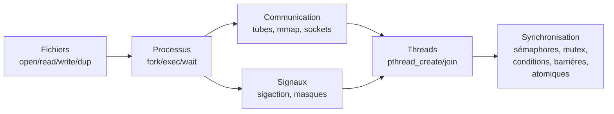
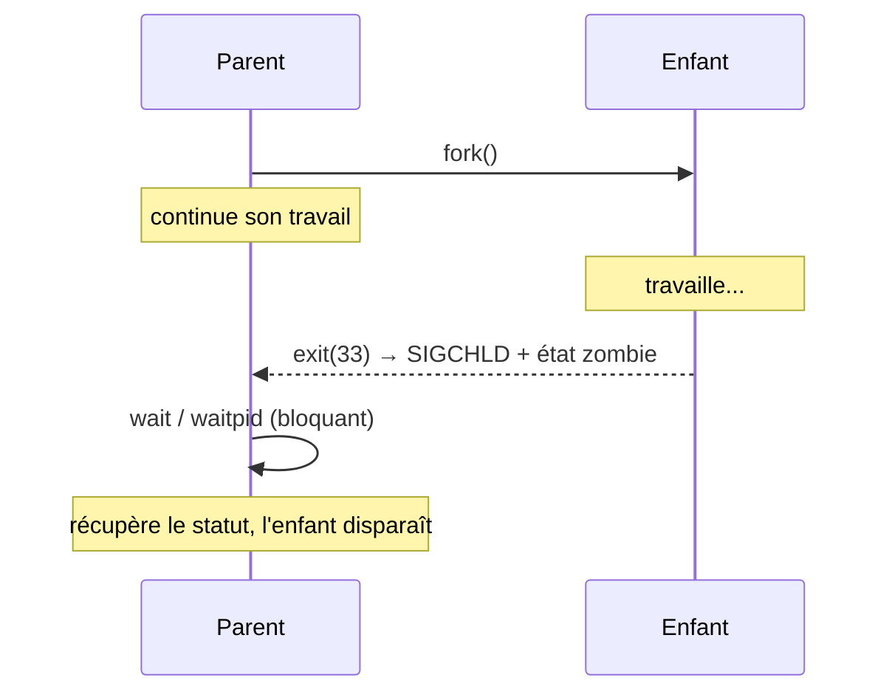
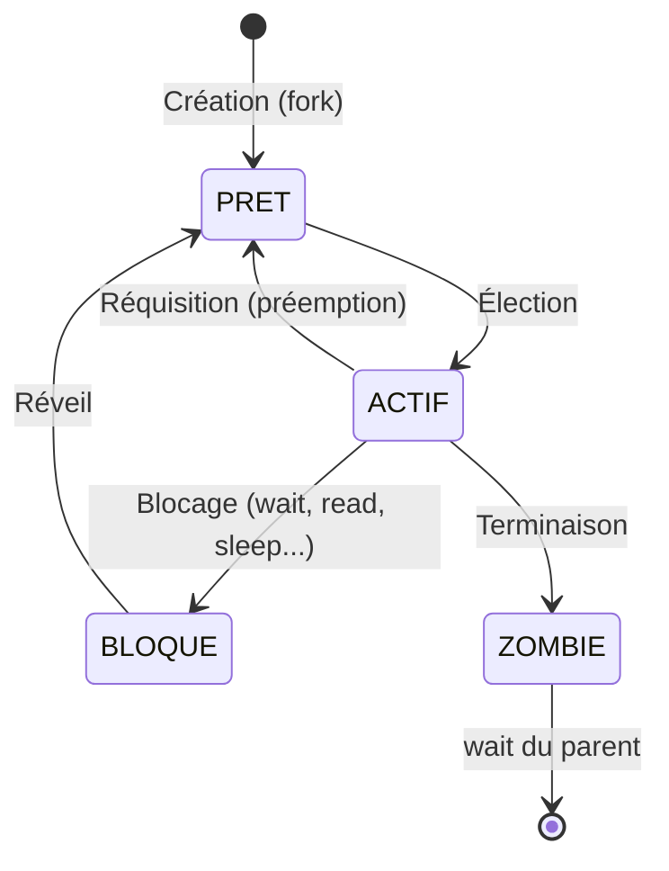
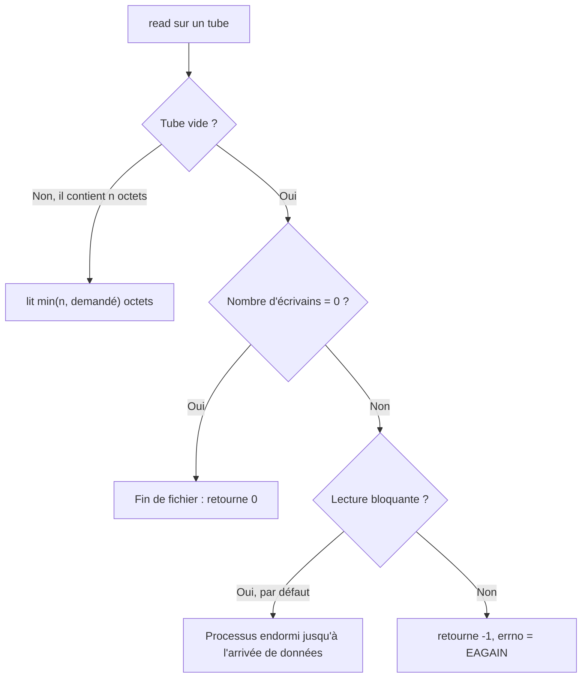
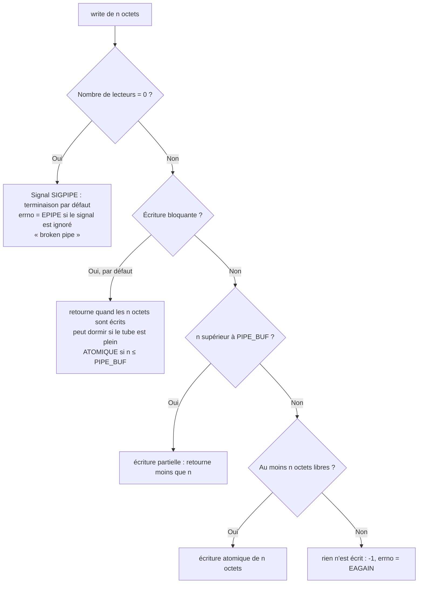
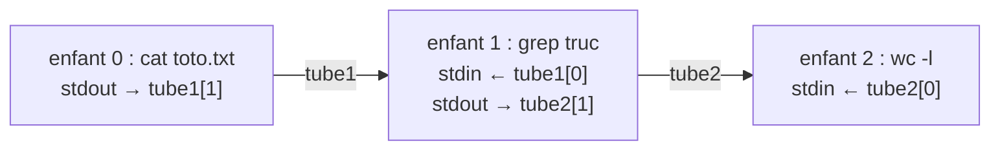
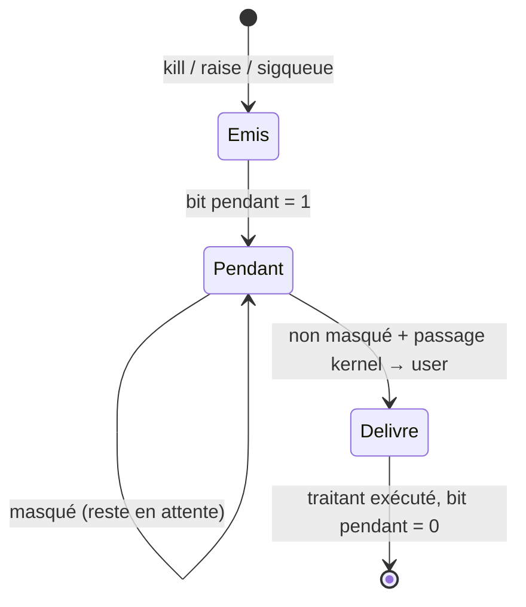
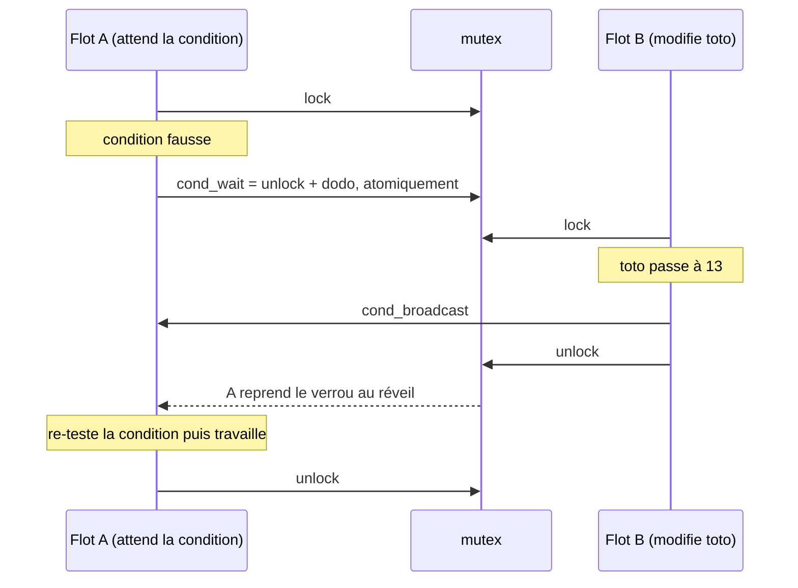

---
tags:
  - systeme
  - C
  - POSIX
  - fichiers
  - processus
  - tubes
  - memoire-partagee
  - signaux
  - threads
  - synchronisation
module: Programmation système (ETE7-IFON1)
type: Cours
source: Polycopié « Éléments de programmation système » — G. Mercier (2026-2027), parties 1 et 2
---

# Programmation Système — Cours complet

> [!abstract] Objectif du cours
> Écrire des programmes **C** qui utilisent **explicitement** les services du système d'exploitation (UNIX/POSIX) :
> lire/écrire des fichiers, créer des processus et des threads, les faire **communiquer** (tubes, mémoire partagée, signaux) et les **synchroniser** (sémaphores, verrous, conditions, barrières, atomiques).

> [!tip] Réflexe n°1 : le manuel
> Dès qu'un nom de fonction apparaît : `man 2 open` (appels-système), `man 3 fopen` (libc), `man 7 signal`, `man 7 signal-safety`, `man 7 pthreads`.
> Le manuel correspond **à ton système** (ce qui n'est pas garanti avec Internet) et fonctionne hors-ligne.

Voir aussi : [[Notes Cours]] · [[Fiche_Sockets_TCP_C]] · corrections dans `Corrections_Exercices/`

---

## Sommaire

1. [[#1. Premier programme]]
2. [[#2. Utilisation des fichiers]]
3. [[#3. Du programme au processus]]
4. [[#4. Communication inter-flots]]
5. [[#5. Interlude non-déterministe]]
6. [[#6. Les signaux]]
7. [[#7. Le multithreading (pthreads)]]
8. [[#8. Synchronisation inter-flots]]
9. [[#9. Annexes et fiches de révision]]



---

## 0. Conventions et outils

| Élément | Rôle |
|---|---|
| **POSIX** | *Portable Operating System Interface for UniX* : norme que l'on essaie de respecter pour que le code soit portable. Ce qui est « spécifique Linux » est signalé. |
| **Appel-système** | Fonction implémentée **dans le noyau** (`open`, `read`, `fork`…). Section 2 du manuel. |
| **Fonction libc** | Fonction de **niveau utilisateur** (souvent construite au-dessus des appels-système) : `fopen`, `printf`… Section 3 du manuel. |
| **Pseudo-types** | `size_t`, `ssize_t`, `off_t`, `pid_t`, `mode_t`… rendent les prototypes lisibles (`size_t` = nombre d'octets, `off_t` = décalage dans un fichier…). |

### Conventions de retour d'erreur (à connaître par cœur)

| Famille | Succès | Échec |
|---|---|---|
| Appels-système (`open`, `read`, `fork`, `pipe`, `kill`…) | valeur ≥ 0 | **`-1`** et `errno` positionné |
| `fopen`, `fdopen` | `FILE *` | **`NULL`** + `errno` |
| `mmap` | adresse | **`MAP_FAILED`** (et **pas** `NULL` !) |
| `sem_open` | `sem_t *` | **`SEM_FAILED`** |
| `pthread_*` (create, join, mutex…) | `0` | **la valeur d'`errno` est retournée** (pas `-1`) |
| `sigwait` | `0` | valeur d'`errno` retournée |

### Options de compilation utiles

| Option | Quand ? |
|---|---|
| `-lpthread` | threads, mutex, conditions, barrières, sémaphores POSIX |
| `-lrt` | `shm_open` / `shm_unlink`, sémaphores POSIX (selon système) |
| `-latomic` | éventuellement pour `_Atomic` |
| `-D_GNU_SOURCE` | `MAP_ANONYMOUS`, `gettid`, fonctions GNU |
| `-D_POSIX_C_SOURCE` | si `struct sigaction` n'est pas connue |
| `-fopenmp` | parallélisation OpenMP (pour aller plus loin) |

---

# 1. Premier programme

```c
#include <stdio.h>
#include <stdlib.h>

int main(int argc, char *argv[])
{
    printf("Hello World !\n");
    exit(EXIT_SUCCESS);
}
```

> [!info] Tu fais déjà de la programmation système
> Afficher une chaîne, c'est déjà utiliser le système : **toute entrée/sortie passe par le système d'exploitation**. Un programme qui ne fait aucun appel au système ne peut que calculer en mémoire… sans jamais montrer son résultat.

Rappel : le C est un langage **typé et compilé** → un compilateur (`gcc`) transforme le code source (fichier texte) en programme exécutable.

---

# 2. Utilisation des fichiers

## 2.1 Le système de gestion de fichiers (SGF) UNIX

- Les **noms** de fichiers forment une **arborescence** (pas de cycle), de racine **`/`**.
- Chaque répertoire contient toujours **`.`** (lui-même) et **`..`** (son parent) — sauf la racine pour `..`.

> [!important] « Dans UNIX, tout est fichier »
> Tout est accessible via le SGF. Il faut distinguer :
> - **fichier régulier** = des données (le sens courant) ;
> - **fichier** = n'importe quel élément du SGF : fichiers réguliers, **répertoires**, **sockets**, **tubes**, **liens symboliques**, **périphériques**…
>
> Conséquence majeure : fichiers réguliers, tubes et sockets se manipulent **de la même façon**, via des **descripteurs de fichiers** (`read`, `write`, `close`, `poll`…). On peut par exemple surveiller avec `poll` en même temps des sockets, des tubes et des fichiers.

## 2.2 Les trois structures du noyau pour gérer les fichiers

C'est **LE** schéma à maîtriser : il explique `open`, `dup`, `fork`, les redirections et le partage de la position courante.

```
   Table des descripteurs        Structures de fichier          Table des I-Nœuds
   de fichiers (LOCALE,          ouvert (GLOBALES)              (GLOBALE, en RAM)
   une par processus)
  ┌───┬──────────────┐
  │ 0 │ ──► entrée standard (stdin)
  │ 1 │ ──► sortie standard (stdout)
  │ 2 │ ──► sortie d'erreur (stderr)
  ├───┼──────────────┤        ┌──────────────────────┐        ┌──────────────────────┐
  │ i │ ─────────────┼──────► │ compte de référence  │        │ type                 │
  ├───┼──────────────┤        │ droits d'ouverture   │        │ permissions          │
  │...│              │        │ position courante    │        │ nombre de liens      │
  │   │  (libre =    │        │ (offset)             │        │ taille               │
  │   │  ne pointe   │        │ pointeur vers I-Nœud ├──────► │ pointeur vers data ──┼──► Données
  │   │  sur rien)   │        └──────────────────────┘        │ compte de référence  │    sur disque
  └───┴──────────────┘                                        └──────────────────────┘
```

### a) L'I-Nœud (I-Node)

> [!note] Définition
> L'**I-Nœud** est la structure qui **représente un fichier** dans le système. Chaque I-Nœud a un **numéro unique**.

Il contient : **type** de fichier, **permissions**, **nombre de liens** (= nombre de noms du fichier), **taille**, **tableau des adresses des blocs de données** sur le disque.

- **I-Nœuds statiques** : stockés **sur le disque** (une table par disque/SGF).
- **I-Nœuds dynamiques** : copie chargée **en RAM** quand le fichier est utilisé, dans une table **globale** (la « Table des I-Nœuds »). Ils ont en plus un **compte de référence** = nombre de structures de fichier ouvert qui pointent dessus.

> [!question]- Exercice 1 — Le tableau des blocs grossit avec le fichier : comment garder une taille d'I-Nœud fixe ?
> En utilisant des **indirections** : certaines entrées pointent vers des blocs qui contiennent eux-mêmes des adresses de blocs (simple, double, triple indirection).

### b) La table des descripteurs de fichiers

- Tableau **linéaire**, **local à chaque processus** (jamais partagé, quelles que soient les circonstances).
- Taille max (limite *hard*) : 1 048 576 = 1024×1024 ; limite *soft* par défaut ≈ **1024** (`ulimit -n`).
- Trois entrées réservées :

| Index | Constante | Flux libc |
|---|---|---|
| 0 | `STDIN_FILENO` | `stdin` |
| 1 | `STDOUT_FILENO` | `stdout` |
| 2 | `STDERR_FILENO` | `stderr` |

> [!tip] Utilise toujours les constantes `STDIN_FILENO`… plutôt que 0, 1, 2 (lisibilité, portabilité).

> [!warning] Abus de langage
> On dit « `open` renvoie un descripteur » alors qu'il renvoie **l'index** d'un descripteur dans la table. À garder en tête.

### c) La structure de fichier ouvert

Un descripteur utilisé pointe **toujours** sur une structure de fichier ouvert (un descripteur libre ne pointe sur rien). Ces structures sont **globales** (partageables entre processus). Elles contiennent :
- un **compte de référence** = nombre de descripteurs qui pointent dessus ;
- les **droits** d'ouverture (lecture / écriture…) ;
- la **position courante** (*offset*, en octets depuis le début du fichier) = où aura lieu la prochaine lecture/écriture ;
- un **pointeur vers l'I-Nœud**.

> [!danger] Trois compteurs à NE PAS confondre
> | Compteur | Où ? | Compte quoi ? |
> |---|---|---|
> | **Nombre de liens** | I-Nœud **statique** (disque) | nombre de **noms** du fichier dans l'arborescence |
> | **Compte de réf. de l'I-Nœud** | I-Nœud **dynamique** (RAM) | nombre de **structures de fichier ouvert** pointant sur lui |
> | **Compte de réf. du fichier ouvert** | structure de fichier ouvert | nombre de **descripteurs** pointant sur elle |

> [!question]- Exercice 3 — À quoi sert le compte de référence de la structure de fichier ouvert s'il semble toujours valoir 1 ?
> Il peut valoir **plus que 1** : après un **`dup`** (deux descripteurs du même processus) ou après un **`fork`** (le descripteur de l'enfant pointe sur la même structure que celui du parent). C'est aussi pour cela que cette structure intermédiaire existe : elle permet de **partager la position courante**.

## 2.3 Nommage et liens

- **Nom absolu** : chemin complet depuis `/` (ex. `/tutu/titi/toto.txt`).
- **Nom relatif** : relatif au répertoire courant (ex. `toto.txt` depuis `titi`, ou `titi/toto.txt` depuis `tutu`).

| | Commande | Principe | Fichier cible inexistant ? |
|---|---|---|---|
| **Lien physique** (*hard link*) | `ln cible nom` | nouveau **nom** vers le **même I-Nœud** ; nombre de liens +1 | **Impossible** |
| **Lien symbolique** (*symlink*) | `ln -s cible nom` | **nouveau fichier** (son propre I-Nœud) dont le contenu est **le nom de la cible** ; tout accès est résolu vers ce nom | **Possible** |

Usages : les liens physiques permettent à une commande de changer de comportement selon son nom (`bzip2` / `bunzip2`) ; les liens symboliques servent à gérer les noms/versions de bibliothèques.

> [!question]- Exercice 2 — Copie, lien physique, lien symbolique : quelles différences de structures ?
> ```
> COPIE                     LIEN PHYSIQUE               LIEN SYMBOLIQUE
> I-Nœud toto ──► données   I-Nœud toto ──► données     I-Nœud toto ──► données
> I-Nœud copie ──► copie    (nombre de liens + 1,       I-Nœud du lien ──► "toto"
>   des données              aucun nouvel I-Nœud)        (données = le nom de la cible)
> ```
> - **Copie** : nouvel I-Nœud + nouvelle copie des données.
> - **Lien physique** : juste un nom de plus, nombre de liens incrémenté.
> - **Lien symbolique** : nouvel I-Nœud d'un type spécial, ses données = la chaîne `"toto"`.

## 2.4 Interface appels-système

### `open` — ouvrir (et éventuellement créer)

```c
int open(const char *pathname, int flags);
int open(const char *pathname, int flags, mode_t mode); // si O_CREAT
```

| Flag | Effet |
|---|---|
| `O_RDONLY` / `O_WRONLY` / `O_RDWR` | lecture seule / écriture seule / les deux (**obligatoire**, un des trois) |
| `O_CREAT` | crée le fichier s'il n'existe pas → **3ᵉ argument `mode`** (ex. `S_IRWXU`, `S_IRUSR`, `S_IWUSR`, `S_IXUSR`) |
| `O_EXCL` | avec `O_CREAT` : **erreur si le fichier existe déjà** (test + création atomiques) |
| `O_TRUNC` | vide le fichier à l'ouverture |
| `O_APPEND` | toutes les écritures se font **en fin de fichier** (sinon la position initiale est 0) |
| `O_CLOEXEC` | le descripteur sera **fermé automatiquement lors d'un `exec`** |
| `O_NONBLOCK` | mode non-bloquant |
| `O_TMPFILE` | fichier temporaire **sans nom** (nombre de liens = 0) créé dans le répertoire `pathname` ; perdu à la fermeture du dernier descripteur, sauf si on lui donne un nom avec `link` |

**Retour :** `-1` (+ `errno`) ou l'index du nouveau descripteur.

> [!important] Règles d'`open`
> - Les options se combinent avec le **OU bit-à-bit** : `O_RDWR | O_CREAT | O_EXCL`.
> - Chaque `open` crée **un nouveau descripteur ET une nouvelle structure de fichier ouvert**.
> - Le descripteur retourné est **toujours le plus petit index libre** de la table.
> - Ouvrir en lecture+écriture ne crée qu'**une seule** structure de fichier ouvert.
> - Un processus peut accéder au même fichier via plusieurs descripteurs / structures distinctes.

**Exemple (Figure 2.2 du poly)** : deux `open` du même fichier.

```c
fd1 = open("truc.txt", O_RDONLY);   // index i
fd2 = open("truc.txt", O_RDWR);     // index i+1 (si aucun close avant)
```

```
 Table des descripteurs       Structures de fichier ouvert          Table des I-Nœuds
  ┌─────┐                    ┌──────────────────────────┐
  │  i  │ ─────────────────► │ réf = 1, offset = 0      │ ─┐      ┌────────────────────┐
  ├─────┤                    │ droits = lecture seule   │  ├────► │ I-Nœud de truc.txt │
  │ i+1 │ ──┐                └──────────────────────────┘  │      │ réf = 2            │──► données
  └─────┘   │                ┌──────────────────────────┐  │      └────────────────────┘
            └──────────────► │ réf = 1, offset = 0      │ ─┘
                             │ droits = lecture+écriture│
                             └──────────────────────────┘
```
→ **deux positions courantes indépendantes**, et l'I-Nœud a un compte de référence de 2.

```c
// Exercice 5 : ouvrir en lecture seule, en créant le fichier (rwx pour le propriétaire)
int fd = open("toto.txt", O_RDONLY | O_CREAT, S_IRWXU);
```

### `close` — fermer un descripteur

```c
int close(int fd);   // 0 si succès, -1 sinon
```
Libère l'entrée `fd` de la table (réutilisable par un futur `open`/`dup`). La fermeture est **définitive**.

> [!warning] `close` ≠ effacement
> `close` ferme un **descripteur**, il n'efface pas le fichier. Pour supprimer, c'est **`unlink`**.

### `unlink` — supprimer un nom

```c
int unlink(const char *pathname);
```
Supprime **un nom** (un lien). Le fichier n'est réellement effacé que si c'était le **dernier lien** **et** qu'**aucun programme ne l'utilise** encore.

### `fcntl` — modifier un descripteur après coup (pour aller plus loin)

```c
int fcntl(int fd, int cmd, ... /* arg */);
```
Ex. : passer un tube/une socket en non-bloquant, positionner `FD_CLOEXEC`, lire/modifier la taille d'un tube (`F_GETPIPE_SZ` / `F_SETPIPE_SZ`), poser des verrous sur des portions de fichier. Nombre variable d'arguments → **lire le manuel**.

### `read` / `write` — lire et écrire

```c
ssize_t read (int fd,       void *buf, size_t count);
ssize_t write(int fd, const void *buf, size_t count);
```
- Retour : `-1` (erreur) ou **nombre d'octets effectivement lus/écrits**.
- Chaque appel **fait avancer la position courante** de la structure de fichier ouvert (si elle existe pour ce type de fichier).
- Fonctionnent sur **tout** ce qui a un descripteur : fichiers, **tubes**, **sockets**.

> [!important] Valeurs de retour de `read`
> - **`0` = fin de fichier** (pour une socket : l'autre côté a fait `shutdown` en écriture ; pour un tube : plus aucun écrivain).
> - Lire **moins** que demandé **n'est pas une erreur** (fin de fichier proche, tube, socket, interruption par un signal…).

> [!danger] Toujours boucler sur `write`/`read` (indispensable avec les sockets)
> ```c
> size_t  sent = 0;      // taille déjà émise
> ssize_t ret  = 0;
> do {
>     ret = write(fd, data_ptr + sent, to_send - sent);
>     if (ret != -1) {
>         sent += ret;
>     } else {
>         /* gestion des erreurs (EINTR, EAGAIN en non-bloquant…) */
>     }
> } while (sent != to_send);
> ```
> Même chose pour `read`. « Ça marchait sans » = la chance du débutant.

> [!warning] Piège classique (exercices 6-7)
> Après `write(fd, &valeur, sizeof(valeur))`, la position courante est **à la fin** : un `read` sur le **même** descripteur lit 0 octet. Solutions : `lseek(fd, 0, SEEK_SET)`, `pread`, ou rouvrir le fichier.
> Et bien sûr, **jamais de `read` sur un descripteur après l'avoir fermé** (`EBADF`).
> Écrire un `int` « brut » (pas une chaîne) puis faire `cat fichier` affiche des caractères illisibles : ce sont les **octets binaires** de l'entier.

### `pread` / `pwrite` — lire/écrire à une position donnée

```c
ssize_t pread (int fd,       void *buf, size_t count, off_t offset);
ssize_t pwrite(int fd, const void *buf, size_t count, off_t offset);
```
- `offset` = position depuis le début du fichier.
- **Ne modifient PAS la position courante** → règlent les accès concurrents (processus après `fork`, threads) qui partagent l'offset.
- Uniquement sur des fichiers où la position existe et est modifiable (**pas** les tubes ni les sockets).

### `dprintf` — un `printf` sur un descripteur

```c
int dprintf(int fd, const char *restrict format, ...);
```
Fonction **libc** (pas un appel-système) ; retour < 0 en cas de problème.

### `lseek` — se déplacer sans lire/écrire

```c
off_t lseek(int fd, off_t offset, int whence);   // retourne la nouvelle position
```

| `whence` | Nouvelle position |
|---|---|
| `SEEK_SET` | `offset` (depuis le début) |
| `SEEK_CUR` | position courante + `offset` |
| `SEEK_END` | fin du fichier + `offset` |

(Linux, non portable : `SEEK_DATA` / `SEEK_HOLE` pour trouver données/trous.)

```c
// Exercice 8 : écrire le i-ème caractère à la position 2^i
int   fd  = open(argv[1], O_WRONLY | O_CREAT | O_TRUNC, S_IRWXU);
off_t pos = 2;
for (int i = 1; i <= atoi(argv[2]); i++, pos *= 2) {
    char c = 'a';
    lseek(fd, pos, SEEK_SET);   // (ou directement pwrite(fd, &c, 1, pos))
    write(fd, &c, sizeof(c));
}
close(fd);
```
→ crée un **fichier à trous** (les zones jamais écrites).

### `dup` / `dup2` / `dup3` — dupliquer un descripteur

Dupliquer = créer un **nouveau descripteur synonyme** qui pointe sur **la même structure de fichier ouvert** → **position courante partagée**. C'est la base des **redirections** (`>` et `<` du shell).

```c
int dup (int oldfd);                       // nouveau = plus petit index libre
int dup2(int oldfd, int newfd);            // nouveau = newfd (fermé avant si utilisé, ATOMIQUEMENT)
int dup3(int oldfd, int newfd, int flags); // Linux : + flags (ex. O_CLOEXEC)
```

**Exemple (Figure 2.3)** :
```c
fd1 = open("truc.txt", O_RDONLY);   // index i
fd2 = dup(fd1);                     // index i+1
```
```
  ┌─────┐                ┌──────────────────────────┐        ┌────────────────────┐
  │  i  │ ─────────────► │ réf = 2   offset = 0     │ ─────► │ I-Nœud truc.txt    │──► données
  ├─────┤       ┌──────► │ (position PARTAGÉE)      │        │ réf = 1            │
  │ i+1 │ ──────┘        └──────────────────────────┘        └────────────────────┘
  └─────┘
```

> [!danger] Le sens de `dup2`
> `dup2(oldfd, newfd)` : c'est **`newfd` qui devient synonyme de `oldfd`**. (On se trompe de sens dans 80 % des cas !)
> Rediriger `stdout` vers `fd` : **`dup2(fd, STDOUT_FILENO);`**

#### Redirection de `printf` vers un fichier (exercices 9-10, pas-à-pas)

```c
int fd = open("output.txt", O_RDWR | O_CREAT, S_IRWXU);  // fd = 3
close(STDOUT_FILENO);   // crée un « trou » à l'index 1
dup(fd);                // plus petit index libre = 1 → 1 pointe sur output.txt
close(fd);              // on n'a plus besoin de l'index 3
printf("Hello World !\n");   // part dans output.txt !
```
```
 index │ après open        │ après close(1)    │ après dup(3)             │ après close(3)
 ──────┼───────────────────┼───────────────────┼──────────────────────────┼──────────────────
   0   │ stdin             │ stdin             │ stdin                    │ stdin
   1   │ stdout (terminal) │ (libre)           │ output.txt ┐ réf = 2     │ output.txt (réf=1)
   2   │ stderr            │ stderr            │ stderr     │             │ stderr
   3   │ output.txt (réf=1)│ output.txt        │ output.txt ┘             │ (libre)
```
De même, `close(STDOUT_FILENO); open("toto.txt", O_RDWR);` redirige la sortie standard vers `toto.txt` (le « trou » est réutilisé par `open`).
Version propre et atomique : `dup2(fd, STDOUT_FILENO); close(fd);`.

> [!tip] Sauvegarder pour revenir en arrière
> `int sauvegarde = dup(STDOUT_FILENO);` avant la redirection, puis `dup2(sauvegarde, STDOUT_FILENO);` pour restaurer. Impossible avec `freopen` (voir plus bas).

## 2.5 Interface libc (flux `FILE *`)

La libc travaille avec des pointeurs sur des objets **opaques** `FILE` (boîte noire). Elle est construite **au-dessus** des appels-système mais ajoute un **tampon (buffer)** qui limite le nombre d'appels-système → **meilleures performances**.

| Fonction | Rôle | Retour en erreur |
|---|---|---|
| `FILE *fopen(const char *path, const char *mode)` | ouvrir | `NULL` |
| `int fclose(FILE *fp)` | fermer | `EOF` |
| `size_t fread(void *ptr, size_t size, size_t nmemb, FILE *f)` | lire `nmemb` éléments de `size` octets | nb d'éléments < demandé |
| `size_t fwrite(const void *ptr, size_t size, size_t nmemb, FILE *f)` | écrire | idem |
| `int feof(FILE *f)` / `int ferror(FILE *f)` | distinguer fin de fichier / erreur | — |
| `int fseek(FILE *f, long offset, int whence)` | se déplacer (mêmes `whence`) | `-1` |
| `FILE *freopen(const char *path, const char *mode, FILE *f)` | réassocier un flux à un autre fichier | `NULL` |

**Correspondance des modes `fopen` ↔ flags `open`** :

| `fopen` | `open` |
|---|---|
| `"r"` | `O_RDONLY` |
| `"w"` | `O_WRONLY \| O_CREAT \| O_TRUNC` |
| `"a"` | `O_WRONLY \| O_CREAT \| O_APPEND` |
| `"r+"` | `O_RDWR` |
| `"w+"` | `O_RDWR \| O_CREAT \| O_TRUNC` |
| `"a+"` | `O_RDWR \| O_CREAT \| O_APPEND` |

> [!info] `fread` ne distingue pas fin de fichier et erreur → utiliser `feof` / `ferror`.

### `freopen` — la « redirection » côté libc

Deux usages : changer le mode d'un flux (`pathname = NULL`) ou **changer le fichier associé à `stdin`/`stdout`/`stderr`**.
```c
// Exercice 12 : rediriger fprintf(stdout, ...) sans descripteurs ni dup
fprintf(stdout, "Coucou 1\n");                      // terminal
FILE *f = freopen("output.txt", "w+", stdout);
fprintf(stdout, "Coucou 2\n");                      // output.txt
```
> [!warning] Avec `freopen`, **pas de retour arrière possible** (contrairement à `dup` où l'on peut sauvegarder le descripteur d'origine).

### Passer d'un monde à l'autre

```c
int   fileno(FILE *stream);              // FILE*  → index de descripteur
FILE *fdopen(int fd, const char *mode);  // descripteur → FILE*  (mode compatible avec fd)
```

> [!question]- Exercice 11 — `fopen` puis `open` : quel index renvoie `open` ? Pourquoi ?
> **4** (et pas 3) : `fopen` a lui-même alloué un descripteur (3) en interne. Un `FILE *` repose toujours sur un descripteur.

### Performances et buffers (exercices 15 → 18)

- `cat` maison avec **`read`/`write` d'1 octet** : **1 appel-système par octet** → beaucoup de temps `sys` (passage en mode noyau à chaque fois) → **lent**.
- Avec **`fread`/`fwrite` d'1 octet** : les données s'accumulent dans le **buffer** de la libc et ne déclenchent un `write` que lorsqu'il est plein → **beaucoup plus rapide**.
- Les fonctions **de plus bas niveau** sont donc **`read`/`write`** (la libc les appelle).

> [!example] Exercice 18 — ordre d'affichage surprenant
> ```c
> fwrite("Hello", sizeof(char), 6, stdout);   // va dans le BUFFER de stdout (pas de '\n')
> write(STDOUT_FILENO, "World !", 7);         // écrit IMMÉDIATEMENT
> exit(EXIT_SUCCESS);                         // vide le buffer
> ```
> Affiche **`World !Hello`** : le buffer libc n'est vidé qu'à la sortie (ou au `\n` sur un terminal, ou avec `fflush`).

## 2.6 Pour aller plus loin : caractéristiques d'un fichier

```c
int stat (const char *pathname, struct stat *buf);
int lstat(const char *pathname, struct stat *buf); // si lien symbolique : infos du LIEN
int fstat(int fd,               struct stat *buf); // à partir d'un descripteur
```
Champs utiles de `struct stat` : `st_ino` (n° d'I-Nœud), `st_mode` (type + droits), `st_nlink` (nb de liens physiques), `st_uid`/`st_gid`, `st_size` (taille en octets), `st_blksize`, `st_blocks` (blocs de 512 o alloués).

> [!warning] Taille ≠ occupation disque
> La taille (`off_t`) est un décalage depuis le début ; un **fichier à trous** peut avoir une grande taille et occuper peu de blocs.

> [!example] Exercice 13 — lire un fichier octet par octet jusqu'à la fin (3 méthodes)
> ```c
> // V1 : read renvoie 0 en fin de fichier
> while (read(fd, &c, 1) > 0) fprintf(stderr, "%c", c);
> // V2 : getc renvoie EOF (attention : c doit être un int !)
> int c; while ((c = getc(f)) != EOF) fprintf(stderr, "%c", c);
> // V3 : feof
> c = getc(f); while (!feof(f)) { fprintf(stderr, "%c", c); c = getc(f); }
> ```

---

# 3. Du programme au processus

## 3.1 Processus, PCB, table des processus

> [!note] Définition — Processus
> Un **processus** est un **programme en cours d'exécution**. Il mobilise notamment :
> - une entrée dans la **table des processus** du système (son **PCB**, *Process Control Block*) ;
> - un **espace d'adressage virtuel** ;
> - une **table de descripteurs de fichiers** ;
> - au moins un **flot d'exécution** (celui qui exécute `main`).

```
        Processus X
 ┌──────────────────────────┐
 │  PCB          Table des  │
 │  ┌─────┐      descr.     │
 │  │     │      ┌──┐       │
 │  └─────┘      ├──┤       │
 │               ├──┤       │
 │   ~~~~~~      └──┘       │
 │   flot d'exécution (main)│
 └──────────────────────────┘
```

- La table des processus a une **taille finie** : quand tous les PCB sont pris, on **ne peut plus créer** de processus (mais ceux qui existent continuent : le système n'est pas bloqué).
- Un PCB n'est libéré que lorsque le processus est terminé **et que son code de retour a été récupéré** (→ zombies, §3.7).

> [!warning] Programme ≠ processus ≠ application
> - **Programme exécutable** : fichier **statique** sur le disque.
> - **Processus** : entité **dynamique** (le programme en train de s'exécuter).
> - **Application** : peut reposer sur **plusieurs processus** (ex. serveur multi-processus : un processus par requête).

Un processus commence **toujours** par `main` (un exécutable a exactement un `main` ; une bibliothèque n'en a pas).

## 3.2 Identification : le PID

Chaque processus a un **PID** (*Process IDentifier*) unique dans le système.

```c
pid_t getpid(void);    // mon PID
pid_t getppid(void);   // le PID de mon parent
```

> [!warning] Les PID sont recyclés
> Attribués de façon **cyclique** : le PID 3456 d'aujourd'hui peut désigner un tout autre processus plus tard. Il n'existe **pas** de fonction pour connaître ses enfants : **c'est à toi de conserver** les PID retournés par `fork`.

> [!info]- Pour aller plus loin : `pidfd` (Linux ≥ 5, non POSIX)
> Pour éviter les problèmes de recyclage, un processus peut être désigné par un **descripteur de fichier** (cohérent avec « tout est fichier ») :
> ```c
> int pidfd = syscall(SYS_pidfd_open, pid, 0);            // pas de wrapper libc
> int fd2   = syscall(SYS_pidfd_getfd, pidfd, targetfd, 0); // dupliquer un fd d'un AUTRE processus
> syscall(SYS_pidfd_send_signal, pidfd, sig, NULL, 0);     // envoyer un signal
> ```
> Autre méthode : `opendir("/proc/<pid>")` puis `dirfd()`. Attention : un descripteur est une info **locale**, le PID une info **globale**.

## 3.3 Création de processus : `fork`

```c
pid_t fork(void);
```

`fork` ne crée pas un processus « vide » : le processus appelant **se duplique**. L'enfant exécute **le même code** et démarre **comme s'il sortait de `fork`** (pas depuis le début du `main`).

```
             FORK
 Processus X ────────► Processus X'
 ┌───────────────┐     ┌───────────────┐
 │ PCB  TDF      │     │ PCB' TDF'     │   ← copies des structures
 │ ~~~ main ~~~  │     │ ~~~ main ~~~  │   ← même code, même point d'exécution
 └───────────────┘     └───────────────┘
```

> [!important] Valeur de retour de `fork` — LA chose à retenir
> | Retour | Signification |
> |---|---|
> | **`-1`** | échec (pas de processus créé) |
> | **`0`** | on est dans l'**enfant** |
> | **`> 0`** (PID de l'enfant) | on est dans le **parent** |

```c
pid_t child = fork();
if (child == -1) {
    perror("fork"); exit(EXIT_FAILURE);
} else if (child == 0) {          /* ===== code de l'ENFANT ===== */
    printf("Enfant : mon parent est %d\n", getppid());
    exit(EXIT_SUCCESS);
} else {                          /* ===== code du PARENT ====== */
    printf("Parent : j'ai créé %d\n", child);
    waitpid(child, NULL, 0);
}
```

**Généalogie des processus**
1. Un processus peut avoir **plusieurs enfants** ; il a **un seul parent**.
2. Un enfant peut lui-même créer des processus.
3. Les processus s'exécutent **concurremment** (en parallèle sur multicœur).
4. **Aucune hypothèse** sur l'ordonnancement : ne suppose jamais que l'enfant (ou le parent) s'exécute en premier.

> [!important] Indépendance
> Après `fork`, parent et enfant **ne partagent aucune variable** : chacun a sa **copie**. Modifier `x` dans l'enfant ne change pas `x` dans le parent.

> [!example] Exercice 22 — créer exactement 10 enfants
> ```c
> for (int i = 0; i < 10; i++) {
>     pid_t child = fork();
>     if (child == 0) break;        // ← INDISPENSABLE : l'enfant sort de la boucle
>     printf("création enfant %d\n", child);
> }
> ```
> Sans le `break`, chaque enfant continue la boucle et fork à son tour → 2¹⁰ − 1 = 1023 processus !

> [!example] Exercices 20-21 — `fork` et le buffer de `printf`
> ```c
> printf("Hello World");   // PAS de '\n' → reste dans le buffer
> fork();
> printf("Hello World\n");
> ```
> Affiche `Hello WorldHello World` **deux fois** : le buffer non vidé est **dupliqué** dans l'enfant.
> Avec `\n` au premier `printf` : 3 lignes (1 par le parent avant le fork, puis 1 chacun).
> **Règle** : faire `fflush(stdout)` avant `fork`.

> [!info]- Pour aller plus loin : les démons
> Un **démon** est un processus serveur détaché de son terminal (`sshd`, `httpd`…).
> - `int daemon(int nochdir, int noclose);` (non POSIX) : `nochdir == 0` → répertoire de travail `/` ; `noclose == 0` → E/S redirigées vers `/dev/null`.
> - Version POSIX : technique **fork – `setsid()` – fork** (le futur démon ne doit pas être leader de session, d'où le second fork).

## 3.4 Héritage parent → enfant

| Élément | Hérité par l'enfant au `fork` ? |
|---|---|
| Structure de l'espace d'adressage (variables, `malloc` faits avant, valeurs initialisées) | **Oui (copie)** |
| Projections mémoire `mmap` | **Oui** (privées = copiées ; partagées = partagées, cf. §4.2) |
| Table des descripteurs | **Oui, copie exacte** → mêmes structures de fichier ouvert |
| Traitants de signaux et masque de signaux | **Oui** |
| Signaux **pendants** | **Non** |
| Répertoire de travail | **Oui** |
| Temps d'exécution | **Remis à zéro** |
| Callbacks de fin (`atexit`, `on_exit`) | **Oui** |
| Buffer de `printf` non vidé | **Oui** (d'où les doubles affichages) |

**Organisation mémoire d'un processus** (Figure 3.3) :
```
 adresses hautes  0xffffffffffff ┌───────────────────┐
                                 │   Pile (stack)    │  ↓ grandit vers le bas
                                 ├───────────────────┤
                                 │    Zone libre     │
                                 ├───────────────────┤
                                 │   Tas (heap)      │  ↑ malloc
                                 ├───────────────────┤
                                 │   Données         │  variables globales/statiques
                                 ├───────────────────┤
 adresses basses  0x000000000000 │   Code            │
                                 └───────────────────┘
```

> [!danger] Fichier ouvert avant `fork` → position courante PARTAGÉE
> Les descripteurs du parent et de l'enfant pointent sur **la même structure de fichier ouvert** (compte de réf. = 2). Si l'un lit/écrit, **l'offset bouge aussi pour l'autre**. C'est le **2ᵉ cas** (après `dup`) où le compte de référence dépasse 1.
> ```
>  Parent  TDF                Structure de fichier ouvert      I-Nœud toto.txt
>  ┌───┐                     ┌─────────────────────────┐      ┌──────────────┐
>  │ 3 │ ──────────────────► │ réf = 2   offset = 0    │ ───► │ réf = 1      │
>  └───┘           ┌───────► │ droits RW               │      └──────────────┘
>  Enfant TDF      │         └─────────────────────────┘
>  ┌───┐           │
>  │ 3 │ ──────────┘
>  └───┘
> ```

## 3.5 Le modèle fork/join : `wait` et `waitpid`

Les processus UNIX sont des **processus lourds** (création, terminaison, synchronisation coûteuses). Leur modèle est **fork/join** : `fork` crée, puis le parent fait un **join** (`wait`) pour **attendre la fin d'un enfant et récupérer son code de retour**.



Le **code de retour** = valeur passée à `exit(...)` (n'importe où) ou au `return` du `main`.

```c
pid_t wait(int *status);                              // attend N'IMPORTE QUEL enfant (bloquant)
pid_t waitpid(pid_t pid, int *status, int options);   // attend un enfant PRÉCIS
```

| Macro sur `status` | Signification |
|---|---|
| `WIFEXITED(status)` | vrai si terminaison normale (`exit`, `_exit`, `return` du main) |
| `WEXITSTATUS(status)` | les **8 bits de poids faible** du code de retour |
| `WIFSIGNALED(status)` | vrai si tué par un signal |
| `WTERMSIG(status)` | numéro du signal responsable |
| `WIFSTOPPED` / `WIFCONTINUED` | l'enfant a été stoppé / relancé (`SIGSTOP`/`SIGCONT`) |

> [!warning] Ne jamais lire `status` directement : toujours passer par ces macros.

- `wait` : **bloquant** et **impossible de choisir** l'enfant.
- `waitpid(pid, &status, 0)` : attend l'enfant `pid` ; `pid = -1` → n'importe lequel.
- Option **`WNOHANG`** : **non bloquant**, retourne `0` immédiatement si aucun enfant n'est terminé.
  → « `wait` non bloquant » : `waitpid(-1, &status, WNOHANG);`

> [!tip] Recommandation POSIX
> Préférer `waitpid` avec un **PID explicite** (pas `wait` ni `waitpid(-1, ...)`) : sinon interactions indésirables avec `system`, `popen`/`pclose` qui créent aussi des enfants.

```c
// Exercice 27 : récupérer le code de retour
pid_t child = fork();
if (child == 0) {
    exit(33);                                  // valeur bien identifiable
} else if (child > 0) {
    int status;
    pid_t fini = wait(&status);
    if (WIFEXITED(status))
        printf("%d terminé, retour = %d\n", fini, WEXITSTATUS(status)); // 33
}
```

```c
// Exercice 28 : attendre ses enfants dans l'ordre décroissant de PID
for (int i = N - 1; i >= 0; i--)
    waitpid(child[i], NULL, 0);
```

## 3.6 Terminaison : zombies et orphelins

Un processus se termine par `exit` / `_exit` / `return` dans `main`. Il envoie alors **`SIGCHLD`** à son parent et passe dans l'état **zombie**.

> [!note] Définition — Zombie
> Processus **terminé** mais **encore présent** : il n'utilise plus le processeur ni d'espace d'adressage, mais **occupe toujours un PCB** dans la table des processus, en attendant que son parent récupère sa terminaison.

> [!danger] Toujours `wait`er ses enfants
> Il faut un `wait`/`waitpid` **pour chaque enfant créé**, sinon les zombies remplissent la table des processus et **plus aucun processus ne peut être créé**. `wait(NULL)` suffit si le code de retour ne t'intéresse pas.
> Exemple typique de programme cassé par les zombies : un **serveur** qui crée un processus par client et ne récupère jamais leur terminaison.

**Orphelins** : si le parent meurt avant ses enfants, ceux-ci sont **adoptés** par le premier processus du système, **`systemd`** (anciennement `init`, PID 1) — ou un autre processus « subreaper » — qui se charge de les éliminer.

> [!example] Exercice 30
> Le parent se termine tout de suite, l'enfant dort 3 s puis affiche `getppid()` : on obtient **le PID du processus adoptant** (1 ou celui d'un `systemd --user`), plus celui du parent d'origine.

> [!info] `SIGCHLD` est envoyé non seulement à la terminaison mais aussi quand l'enfant est **stoppé** ou **relancé**. D'où `WIFSTOPPED` / `WIFCONTINUED` pour savoir si c'est une vraie terminaison.

## 3.7 États d'un processus



| État | Description |
|---|---|
| **Prêt** | peut s'exécuter, attend qu'on lui attribue un processeur (état initial après `fork`) |
| **Actif** | s'exécute sur un processeur ; deux sous-états : **actif user** et **actif kernel** (passer de l'un à l'autre = changement de contexte intra-processus) |
| **Bloqué / endormi** | n'utilise pas le processeur, attend un événement (fin d'un enfant pour `wait`, données pour `read`…) ; une fois réveillé → **Prêt** |
| **Zombie** | terminé, mais occupe encore un PCB |

```c
unsigned int sleep(unsigned int seconds);   // attente PASSIVE (état bloqué)
int sched_yield(void);                       // rendre volontairement le processeur
```

> [!tip] Attente passive > attente active
> - **Active** : `do { int toto = 0; while (++toto); } while (0);` → occupe le CPU pour rien.
> - **Passive** : `sleep`, `wait`, `pause`… → le processus est **bloqué**, le CPU sert à d'autres. **À préférer.**

## 3.8 Recouvrement : la famille `exec`

`fork` duplique le **même** code. Pour exécuter **un autre programme**, on fait un **recouvrement** : l'espace d'adressage (code + données) est **remplacé** par celui d'un nouvel exécutable, dont le `main` est lancé.

Rappel du `main` complet :
```c
int main(int argc, char *argv[], char *envp[]);  // envp = variables d'environnement "CLE=valeur"
```

```c
int execv  (const char *path, char *const argv[]);
int execvp (const char *file, char *const argv[]);                    // cherche dans le PATH
int execve (const char *path, char *const argv[], char *const envp[]);// + environnement
int execvpe(const char *file, char *const argv[], char *const envp[]);
int execl  (const char *path, const char *arg, ... /*, (char *)NULL */);
int execlp (const char *file, const char *arg, ... /*, (char *)NULL */);
int execle (const char *path, const char *arg, ... /*, (char *)NULL, char *const envp[] */);
```

| Lettre | Sens |
|---|---|
| **`v`** (*vector*) | arguments dans un **tableau** `argv[]` |
| **`l`** (*list*) | arguments **listés** un par un en paramètres |
| **`p`** (*path*) | l'exécutable est cherché dans le **`PATH`** (sinon : chemin/répertoire courant) |
| **`e`** (*environment*) | on fournit un nouvel **environnement** `envp[]` |

> [!danger] Les deux règles de construction des arguments
> 1. Le **premier argument = le nom du programme** (`argv[0]`).
> 2. Le **dernier = `NULL`** (c'est ainsi que le nouveau `main` calcule `argc`).
> ```c
> execl("./toto", "toto", NULL);                     // toto sans argument
> char *my_argv[] = {"somme", "1", "2", "3", NULL};
> execv("./somme", my_argv);                         // affiche "Somme = 6"
> execlp("ls", "ls", "-l", NULL);                    // ls trouvé via le PATH
> ```

> [!danger] `exec` ne retourne **qu'en cas d'échec**
> Si l'appel réussit, l'ancien code **n'existe plus** : tout ce qui suit `exec` n'est exécuté **que si `exec` a échoué**. Inutile d'y mettre un `printf("ça a marché")` ; mets-y plutôt `perror("exec"); exit(EXIT_FAILURE);`.

Schéma classique **fork + exec + wait** :
```c
pid_t child = fork();
if (child == 0) {
    char *my_argv[] = {"hello_world", NULL};
    execv("./hello_world", my_argv);
    perror("execv");  exit(EXIT_FAILURE);   // seulement si échec
} else if (child > 0) {
    waitpid(child, NULL, 0);
}
```

### Ce qui survit (ou non) à un `exec`

Un `exec` n'est **pas** une remise à zéro du processus :

| Élément | Après `exec` |
|---|---|
| **Descripteurs de fichiers** | **CONSERVÉS** (sauf si `O_CLOEXEC` / `FD_CLOEXEC`) ⚠️ point fondamental |
| PID, **PPID** | conservés |
| Masque de signaux | **conservé** |
| Traitants de signaux | **réinitialisés** (le code des traitants n'existe plus !) |
| Piles alternatives de traitants | non conservées |
| Projections `mmap` (dont mémoire partagée POSIX) | **non conservées** |
| Segments de mémoire partagée System V | détachés |
| Sémaphores POSIX | fermés |
| `atexit` / `on_exit` | non conservés |
| Verrous sur fichiers (`flock`) | **conservés** |
| Valeur de `nice` | conservée |

> [!example] Exercices 35-36 — descripteurs et `exec`
> L'enfant ouvre `toto.txt` (index **3**) puis fait `exec` d'un programme qui ouvre un fichier et affiche son index :
> - sans option → le nouveau programme obtient **4** (le 3 est **toujours ouvert** après l'`exec`) ;
> - avec `open(..., O_RDONLY | O_CLOEXEC)` → il obtient **3** (le descripteur a été fermé par l'`exec`).

## 3.9 Pour aller plus loin : `system`

```c
int system(const char *command);
```
Fait en une seule fonction : **`fork`** + dans l'enfant `execl("/bin/sh", "sh", "-c", command, NULL)` + **`waitpid`** dans le parent. Pendant ce temps `SIGINT`/`SIGQUIT` sont ignorés et `SIGCHLD` bloqué.

Retour : `-1` si l'enfant n'a pas pu être créé ; statut « `_exit(127)` » si le shell n'a pas pu être lancé ; sinon le **statut** de la dernière commande (à décoder avec `WEXITSTATUS`…). `system(NULL)` teste si un shell est disponible.

Pour **dialoguer** avec la commande (lire sa sortie / écrire son entrée) → `popen` (§4.1).

---

# 4. Communication inter-flots

Trois grands mécanismes (+ sockets et signaux) :

| Mécanisme | Entre qui ? | Nature | Synchronisation incluse ? |
|---|---|---|---|
| **Tube anonyme** (`pipe`) | processus **affiliés** | flux unidirectionnel FIFO | oui (lectures/écritures bloquantes) |
| **Tube nommé** (`mkfifo`) | processus **quelconques** | idem, avec un nom dans le SGF | oui (+ ouverture bloquante) |
| **Mémoire partagée** (`mmap`, `shm_open`) | affiliés (anonyme) ou quelconques (fichier/shm) | zone mémoire commune | **non** → à ajouter soi-même |
| **Sockets** | même machine (`AF_UNIX`) ou réseau (`AF_INET`) | full-duplex | selon usage |
| **Fichiers réguliers** | quelconques | données sur disque | non (accès à synchroniser) |
| **Signaux** | même machine | simple notification (n° de signal) | — |

## 4.1 Les tubes (*pipes*)

Un tube est un **fichier** (il a un I-Nœud) d'usage particulier :
- manipulé par **descripteurs** ; lu/écrit avec **`read`/`write`** ;
- utilisable pour des **redirections** (le `|` du shell).

### Caractéristiques

1. **Unidirectionnel**.
2. Deux **extrémités** : une en **lecture**, une en **écriture** (un descripteur chacune ; au plus 2 structures de fichier ouvert).
3. Gestion **FIFO**.
4. C'est un **flux** : lire **consomme** (détruit) les données lues.
5. Lectures et écritures **décorrélées** : c'est un flux d'octets, **pas des messages** (deux `write` peuvent être récupérés par un seul `read` et inversement).
6. **Capacité finie**.

> [!note] Nombre de lecteurs / d'écrivains
> - **Nombre de lecteurs** = nombre de **descripteurs** associés à l'extrémité en lecture.
> - **Nombre d'écrivains** = nombre de **descripteurs** associés à l'extrémité en écriture.
>
> ⚠️ Ce n'est **pas** le nombre de processus ! Un `fork` duplique les descripteurs → il double les lecteurs ET les écrivains.

### Tube anonyme : `pipe`

```c
int pipe(int pipefd[2]);   // 0 ou -1
```
- **`pipefd[0]` = lecture**, **`pipefd[1]` = écriture** (moyen mnémotechnique : 0 comme stdin, 1 comme stdout).
- Inutile d'initialiser le tableau : il est écrasé.
- Bloquant par défaut (modifiable avec `fcntl`).
- Accessible **uniquement aux processus affiliés** : on l'obtient en le créant ou en **héritant** des descripteurs par `fork` → **créer le tube AVANT le `fork`**.

```c
int pipe2(int pipefd[2], int flags);   // Linux : O_CLOEXEC, O_NONBLOCK, O_DIRECT (mode « paquets »)
```

### Tube nommé : `mkfifo`

```c
int mkfifo(const char *pathname, mode_t mode);   // crée le fichier-tube, NE L'OUVRE PAS
```
Il faut ensuite `open(nom, O_RDONLY)` (lecteur) ou `open(nom, O_WRONLY)` (écrivain). `O_RDWR` n'a pas de sens.

> [!important] Ouverture d'un tube nommé
> - **Bloquante** (défaut) : `open` **bloque tant qu'il n'y a pas à la fois un lecteur et un écrivain** → c'est un **mécanisme de synchronisation** entre processus. ⚠️ Si plusieurs tubes : les **ouvrir dans le même ordre** dans tous les processus (sinon interblocage).
> - **Non bloquante** : ouvrir en lecture réussit toujours ; ouvrir en écriture **échoue s'il n'y a aucun lecteur**.

Penser à `unlink` le tube nommé à la fin.

### « Fermer les extrémités inutiles d'un tube, tu devras »

Les algorithmes de lecture/écriture reposent sur le **nombre de lecteurs/écrivains**. Une extrémité inutile laissée ouverte fausse ces nombres → **interblocages** (un `read` qui n'obtient jamais 0) ou erreurs non signalées.

- Un processus **lecteur** ferme l'extrémité **écriture** (`close(tube[1])`).
- Un processus **écrivain** ferme l'extrémité **lecture** (`close(tube[0])`).
- Pour du **bidirectionnel**, utiliser **deux tubes** (full-duplex) plutôt qu'un tube en half-duplex.

```
    Parent (écrivain)                        Enfant (lecteur)
   tube[1] ──write──►  [ ═══ TUBE (FIFO) ═══ ]  ──read──► tube[0]
   close(tube[0])                                         close(tube[1])
```

### Lecture dans un tube : `nb_lu = read(tube[0], buf, demandé)`



### Écriture dans un tube : `nb_ecrit = write(tube[1], buf, n)`



> [!important] Atomicité et `PIPE_BUF`
> Un tube garantit l'**atomicité des écritures** de taille **≤ `PIPE_BUF`** (POSIX : ≥ 512 octets ; Linux : 4096) → les données de plusieurs écrivains **ne se mélangent pas**. Aucune garantie pour les lectures.
> `PIPE_BUF` (dans `<limits.h>`) ≠ **capacité** du tube. La capacité était de 4 Ko (une page) dans les très vieux Linux ; elle est bien plus grande aujourd'hui (64 Ko par défaut, jusqu'à 1 Mo) et se consulte/modifie avec `fcntl(fd, F_GETPIPE_SZ)` / `fcntl(fd, F_SETPIPE_SZ, taille)`.

### Exemple complet — parent écrivain, enfant lecteur (exercice 37)

Protocole classique : **envoyer d'abord la taille, puis les données**.
```c
int tube[2];
pipe(tube);                         // AVANT le fork
pid_t child = fork();
if (child == 0) {                   // ENFANT = lecteur
    close(tube[1]);
    size_t taille;
    read(tube[0], &taille, sizeof(size_t));
    char *buffer = malloc(taille);
    read(tube[0], buffer, taille);
    printf("Message reçu = %s\n", buffer);
    free(buffer);
    close(tube[0]);
} else if (child > 0) {             // PARENT = écrivain
    close(tube[0]);
    char *msg = "Coucou";
    size_t taille = strlen(msg) + 1;      // +1 pour le '\0'
    write(tube[1], &taille, sizeof(size_t));
    write(tube[1], msg, taille);
    close(tube[1]);                 // → l'enfant lira 0 (fin) ensuite
    waitpid(child, NULL, 0);
}
```
Variante tube nommé (exercice 38) : `mkfifo("/tmp/montube", S_IRUSR|S_IWUSR)`, puis chaque processus fait `open` en `O_RDONLY` ou `O_WRONLY`, et le parent fait `unlink("/tmp/montube")` à la fin.

### Exemple — recoder `cat toto.txt | grep "truc" | wc -l` (exercice 39)


```c
int tube1[2], tube2[2];
pipe(tube1); pipe(tube2);
int i;
for (i = 0; i < 3; i++)
    if (fork() == 0) break;

if (i == 0) {                       // cat
    close(tube1[0]); close(tube2[0]); close(tube2[1]);
    dup2(tube1[1], STDOUT_FILENO);  close(tube1[1]);
    execlp("cat", "cat", "toto.txt", NULL);
} else if (i == 1) {                // grep
    close(tube1[1]); close(tube2[0]);
    dup2(tube1[0], STDIN_FILENO);   close(tube1[0]);
    dup2(tube2[1], STDOUT_FILENO);  close(tube2[1]);
    execlp("grep", "grep", "truc", NULL);
} else if (i == 2) {                // wc
    close(tube1[0]); close(tube1[1]); close(tube2[1]);
    dup2(tube2[0], STDIN_FILENO);   close(tube2[0]);
    execlp("wc", "wc", "-l", NULL);
} else {                            // parent : ferme TOUT puis attend
    close(tube1[0]); close(tube1[1]); close(tube2[0]); close(tube2[1]);
    for (int k = 0; k < 3; k++) wait(NULL);
}
```
> [!warning] Si le parent oublie de fermer `tube2[1]`, `wc` ne voit **jamais** la fin de fichier (il reste un écrivain) → il bloque indéfiniment.

### `popen` / `pclose` — dialoguer avec une commande shell

```c
FILE *popen(const char *command, const char *type);  // type = "r" ou "w"
int   pclose(FILE *stream);                           // attend la fin + retourne son statut
```
`popen` = `fork` + `exec` du shell + **un tube** entre parent et enfant :
- `"r"` : le parent **lit la sortie standard** de la commande ;
- `"w"` : le parent **écrit sur l'entrée standard** de la commande.

Fermer avec **`pclose`** (et pas `fclose`) : il fait l'équivalent d'un `waitpid`.

## 4.2 Mémoire partagée

Principe : une zone mémoire est **commune** à plusieurs processus ; toute modification est **immédiatement visible** par tous.

> [!warning] Aucune synchronisation fournie
> Contrairement aux tubes, la mémoire partagée ne synchronise rien : il faut **ajouter** un mécanisme (tube, sémaphore, variable sentinelle + barrière mémoire…) pour savoir quand les données sont prêtes.

### Interface IPC System V (à connaître de nom)

Utilisable entre processus quelconques ; les segments **survivent** au processus créateur.
`ftok` (clé) · `shmget` (création) · `shmat` (attachement) · `shmctl` (contrôle, suppression).

### Projection de fichier : `mmap`

```c
void *mmap(void *addr, size_t length, int prot, int flags, int fd, off_t offset);
int   munmap(void *addr, size_t length);
```

| Paramètre | Rôle |
|---|---|
| `addr` | adresse souhaitée → **`NULL`** (le système choisit, 99,99 % des cas) |
| `length` | taille : ≤ taille du fichier et **multiple de la taille de page** (`sysconf(_SC_PAGE_SIZE)`, souvent 4 Ko) |
| `prot` | `PROT_NONE` ou `PROT_READ \| PROT_WRITE \| PROT_EXEC` |
| `flags` | **obligatoire** : `MAP_PRIVATE` (privée) **ou** `MAP_SHARED` (partagée) ; option : `MAP_ANONYMOUS` (pas de fichier, `fd = -1`, peut nécessiter `-D_GNU_SOURCE`) |
| `fd` | descripteur du fichier projeté |
| `offset` | début de la projection dans le fichier (**multiple de la taille de page**) |
| **Retour** | adresse de la zone, ou **`MAP_FAILED`** |

> [!danger] `mmap` ne renvoie **jamais `NULL`** en cas d'erreur : tester **`!= MAP_FAILED`**.
> Après `munmap`, accéder à la zone → **segmentation fault**.

**Mémoire partagée via un fichier support** (processus quelconques, même d'utilisateurs différents) : tous les processus projettent **le même fichier** avec **`MAP_SHARED`**.

```c
int fd = open("support", O_RDWR | O_CREAT, S_IRUSR | S_IWUSR);
ftruncate(fd, taille);                 // donner la bonne taille au fichier
char *zone = mmap(NULL, taille, PROT_READ | PROT_WRITE, MAP_SHARED, fd, 0);
close(fd);                             // la projection reste valide
/* ... utilisation de zone ... */
munmap(zone, taille);
```
`int ftruncate(int fd, off_t length);` ajuste la taille (sans toucher à la position courante). Un **fichier temporaire** (`O_TMPFILE`) fait un bon support.

### `MAP_PRIVATE` vs `MAP_SHARED` après un `fork` (Figure 4.1)

```
 (a) MAPPING PRIVÉ                              (b) MAPPING PARTAGÉ
 Processus A   Mém. physique   Enfant           Processus A   Mém. physique   Enfant
 ┌────────┐     ┌───────┐     ┌────────┐        ┌────────┐     ┌───────┐     ┌────────┐
 │ 0xbla..│ ──► │ @phy1 │     │ 0xbla..│        │ 0xbla..│ ──► │ @phys │ ◄── │ 0xbla..│
 │        │     │       │     │        │        │        │     │       │     │        │
 │        │     │ @phy2 │ ◄── │        │        └────────┘     └───────┘     └────────┘
 └────────┘     └───────┘     └────────┘
 même adresse virtuelle, pages physiques        même adresse virtuelle, MÊME page physique
 DIFFÉRENTES → modifications invisibles         → modifications visibles par les deux
```

### Mapping anonyme partagé (processus affiliés : le plus simple)

1. Le parent crée une projection **`MAP_SHARED | MAP_ANONYMOUS`** (pas de fichier : `fd = -1`).
2. Il fait `fork` → l'enfant **hérite** de la projection partagée.

```c
// Exercice 41 (meilleure version) : partage + synchronisation par tube
char *zone = mmap(NULL, taille, PROT_READ | PROT_WRITE,
                  MAP_SHARED | MAP_ANONYMOUS, -1, 0);
assert(zone != MAP_FAILED);
int tube[2]; pipe(tube);
pid_t child = fork();
if (child == 0) {
    char c; close(tube[1]);
    read(tube[0], &c, 1);            // attend le feu vert (bloquant)
    printf("Lecture = %s\n", zone);
    close(tube[0]);
} else {
    char c = 'a'; close(tube[0]);
    strcpy(zone, argv[1]);           // écrit dans la zone partagée
    write(tube[1], &c, 1);           // feu vert
    close(tube[1]);
    waitpid(child, NULL, 0);
}
munmap(zone, taille);
```

> [!tip] Façons de synchroniser l'accès à la zone (exercice 40)
> - ouverture bloquante d'un **tube nommé** (marche une seule fois, « one-shot ») ;
> - `read` bloquant / `write` dans un **tube** ;
> - une **variable sentinelle** en mémoire partagée (ex. `666` = « écriture terminée ») **+ barrière mémoire** entre la copie des données et l'écriture de la sentinelle : `atomic_thread_fence(memory_order_seq_cst)` (portable, C11), `__sync_synchronize()` (gcc, non portable) ou sentinelle déclarée `_Atomic` (cf. §8.5) ;
> - un **sémaphore** (cf. §8.1) — la vraie solution.

### Synchronisation fichier ↔ projection : `msync`

```c
int msync(void *addr, size_t len, int flags);   // MS_ASYNC ou MS_SYNC (+ MS_INVALIDATE)
```
Force l'écriture de la zone dans le fichier support (normalement faite lors des écritures / du `munmap`).

### Interface POSIX : `shm_open` (compiler avec `-lrt`)

Remplace le fichier régulier par un **objet « mémoire partagée »** (moins coûteux), utilisable entre processus quelconques :
```c
int fd = shm_open("/mon_shm", O_RDWR | O_CREAT, S_IRUSR | S_IWUSR); // nom "/nom"
ftruncate(fd, taille);
void *zone = mmap(NULL, taille, PROT_READ | PROT_WRITE, MAP_SHARED, fd, 0);
close(fd);
/* ... */
munmap(zone, taille);
shm_unlink("/mon_shm");   // supprime le NOM ; l'objet disparaît quand plus personne ne l'utilise
```
- Le descripteur a `FD_CLOEXEC` par défaut ; `O_CREAT | O_EXCL` → test d'existence + création **atomiques**.
- L'objet **survit** aux processus qui l'ont créé (comme System V) ; pas garanti après redémarrage ; `msync` sans effet.

### Variables partagées : `volatile`

> [!important] Variables dans une zone partagée → `volatile`
> `volatile` = « peut être modifiée par un **événement extérieur** au flot courant » → le compilateur ne la garde pas dans un registre et la relit à chaque accès.

> [!warning] `extern` ne partage **rien** entre processus
> `extern` sert seulement à organiser du code réparti dans plusieurs fichiers `.c`. Le nombre de fichiers ne dit rien sur le nombre de processus.

**Processus vs threads (Figure 4.2)** :
```
 Deux processus : chacun a SA copie,           Processus multithreadé : UNE seule zone
 il faut une zone partagée explicite (mmap)    de données partagée par tous les threads
 ┌ Processus A ┐   mém.    ┌ Processus B ┐     ┌──── Processus ────────────┐
 │ Tas: x, y ──┼─► phys ◄──┼── Tas: x, y │     │  Zone "Data" : x, y ──────┼──► mém. phys
 │   ~~~~      │   x, y    │    ~~~~     │     │  ~~~  ~~~  ~~~  ~~~        │
 └─────────────┘           └─────────────┘     │  (4 threads)              │
                                               └───────────────────────────┘
```
Pour les threads, le partage est **natif** (variables globales) : pas besoin de `mmap`.

> [!example]- Exercice 42 — minimum d'un tableau en mémoire partagée, calculé par plusieurs processus (idée de la correction)
> - Zone `mmap` partagée anonyme : `[min_global | tableau...]`.
> - Le parent remplit le tableau, puis pour chaque enfant : un **tube** pour lui envoyer `(offset, nb_elements)`.
> - Chaque enfant calcule son minimum local puis met à jour `min_global` **en section critique**. Le « verrou » est fait avec un tube contenant un seul octet : `lock()` = `read` d'1 octet (bloque si vide), `unlock()` = `write` d'1 octet.
> - Le parent fait `wait` pour chaque enfant **avant** de lire le résultat (sinon il est « probablement faux »).

## 4.3 Autres mécanismes

### Sockets

- Utilisables via un **descripteur** ; **full-duplex** ; `read`/`write` fonctionnent ; préférer **`poll`** à `select`.
- Famille **`AF_INET`** : local ou entre machines (cours de Programmation Réseau → [[Fiche_Sockets_TCP_C]]).
- Famille **`AF_UNIX`** : **communication locale** uniquement, avec `struct sockaddr_un` :

```c
int create_socket(void)
{
    struct sockaddr_un addr = {0};              // tout à zéro d'abord
    addr.sun_family = AF_UNIX;
    strcpy(addr.sun_path, "/tmp/ma_socket");    // fichier support
    int desc = socket(AF_UNIX, SOCK_STREAM, 0);
    bind(desc, (struct sockaddr *)&addr, SUN_LEN(&addr));  // SUN_LEN pour la taille
    return desc;
}
```

### Fichiers réguliers

Un processus écrit, un autre lit ensuite… à condition de **synchroniser** les accès (cf. `flock`, §8.2).

### Signaux

Notification d'événements entre processus de la même machine (chapitre 6).

---

# 5. Interlude non-déterministe

Un programme n'est **pas** une simple suite d'instructions exécutées dans l'ordre. Plusieurs facteurs échappent à ton contrôle :

1. **Préemption** : l'ordonnanceur peut interrompre un processus **à n'importe quel moment** pour en exécuter un autre (de façon totalement transparente).
2. **Le compilateur** peut **réordonner** des instructions indépendantes pour optimiser :
   ```c
   a = 2;            b = 4;
   b = 4;    ==>     a = 2;      // légal si a et b sont indépendantes
   ```
3. **Le processeur** lui-même peut exécuter **dans le désordre** (*out-of-order execution*), quelles que soient les options de compilation.

→ Le **résultat** d'un programme peut être déterministe, mais son **exécution ne l'est pas**.

> [!danger] La règle d'or
> **Un programme juste doit fonctionner correctement quels que soient son ordonnancement et son exécution.**
> S'il existe **un seul** ordonnancement pour lequel il ne marche pas, alors **le programme est faux**.

---

# 6. Les signaux

## 6.1 Analogie : les interruptions matérielles

Comment le système prend-il en compte un clic souris alors qu'un processus occupe le CPU ? Le périphérique envoie une **interruption** (signal électrique) : le processeur **suspend** sa tâche, exécute le **traitant d'interruption** associé (fixe, dans le noyau), puis **reprend** là où il en était. C'est la base des systèmes **préemptifs et multitâches**.

## 6.2 Principe des signaux

Un **signal** = même idée, mais pour notifier un **événement logiciel** (déclenché par un autre flot d'exécution) **à un processus** (et non au processeur).

```
        Flot d'exécution du processus X
                    │
                    │            Émission de SIG (par un autre processus)
                    │          ╱
                    ●  ◄──────╱   Prise en compte de SIG
       déroutement ╱│
   ┌──────────────┐ │
   │ Traitant pour│ │
   │ le signal SIG│ │
   └──────┬───────┘ │
           ╲        │
            ╲──────►●  Reprise de l'exécution
                    │
                    ▼
```

- Liste des signaux : `kill -l`. Chaque signal a un **numéro** et une **constante** (`SIGINT`…) → **utiliser les noms**, pas les numéros.
- Un signal **ne transporte aucune donnée** : juste « tel type d'événement s'est produit ».
- Chaque processus a un **traitant par signal** (éventuellement « ne rien faire ») ; on peut le **redéfinir**… sauf pour **`SIGKILL`** et **`SIGSTOP`** (utilisés par le système) : ils ne peuvent être **ni redéfinis, ni masqués, ni ignorés**.
- Le processus **ne revient dans son code** (`main`…) **qu'une fois le traitant terminé**.

### Signaux à connaître

| Signal | N° (Linux x86) | Événement | Action par défaut |
|---|---|---|---|
| `SIGINT` | 2 | Ctrl+C dans le terminal | terminaison |
| `SIGQUIT` | 3 | Ctrl+\ | terminaison + core |
| `SIGKILL` | 9 | tuer (non interceptable) | terminaison |
| `SIGSEGV` | 11 | accès mémoire interdit (*segmentation fault*) | terminaison (+ core) |
| `SIGPIPE` | 13 | écriture dans un tube/socket **sans lecteur** (`errno = EPIPE`) | terminaison (« broken pipe ») |
| `SIGTERM` | 15 | demande polie de terminaison | terminaison |
| `SIGUSR1` / `SIGUSR2` | 10 / 12 | **libres**, pour tes propres événements | terminaison |
| `SIGCHLD` | 17 | un **enfant** s'est terminé / stoppé / relancé | **ignoré** |
| `SIGSTOP` | 19 | stopper (non interceptable) | arrêt |
| `SIGCONT` | 18 | relancer un processus stoppé | reprise |
| `SIGFPE`, `SIGBUS` | 8, 7 | erreur arithmétique, erreur de bus | terminaison (+ core) |

(Un débogueur, par exemple, intercepte `SIGSEGV` pour te laisser examiner le programme.)

### États d'un signal

| État | Signification |
|---|---|
| **Émis** | un processus/thread a notifié l'événement (avec `kill`…) |
| **Pendant** (*pending*) | émis mais **pas encore pris en compte** par le destinataire |
| **Délivré** (pris en compte) | le **traitant a été exécuté** |
| **Masqué** (bloqué) | le destinataire **retarde volontairement** sa délivrance |

Un signal peut être **masqué ET pendant** à la fois ; une fois délivré, il n'est plus ni l'un ni l'autre.



### Quand un signal est-il délivré ?

> [!important] Uniquement lors d'une transition **actif kernel → actif user**
> (Et surtout pas l'inverse.) Raison : le traitant est du **code utilisateur**, non contrôlé par le noyau ; l'exécuter en mode noyau (privilégié) serait une **faille de sécurité**. Le noyau met d'abord à jour ses structures (en mode noyau), puis appelle le traitant en mode utilisateur.
> Tu n'as **aucun contrôle** sur le moment de délivrance ; tu peux seulement la **retarder** (masque).

> [!warning] Les signaux ne sont **pas** forcément délivrés dans l'ordre d'émission.

### Structures du noyau (par processus) et conséquences

Pour les `NSIG` signaux classiques, chaque processus possède :
```
                      signal n° :  1   2   3   4   5  ...  NSIG
 Vecteur des signaux PENDANTS    [ 0 | 1 | 0 | 0 | 1 | ... ]   ← 1 BIT par signal
 Vecteur des signaux MASQUÉS     [ 0 | 0 | 0 | 1 | 1 | ... ]   ← 1 BIT par signal
 Vecteur des TRAITANTS           [ f1| f2| f3| f4| f5| ... ]   ← pointeurs de fonctions
```
- Réception d'un signal non encore pris en compte → bit **pendant = 1**.
- Délivrance → traitant exécuté, bit pendant remis à **0**.
- Signal masqué → bit pendant **reste à 1** jusqu'au démasquage, puis délivrance.

> [!danger] Les rafales de signaux : mécanisme NON FIABLE
> Le bit pendant ne mémorise **qu'une seule occurrence** par type de signal. Si `SIGUSR1` est reçu 10 fois pendant que le processus est en mode noyau, le traitant ne s'exécutera **qu'une fois**.
> (Exercice 47 : 10 `kill(pid, SIGUSR1)` en boucle → nettement moins de 10 « Coucou ».)

> [!question]- Exercice 43 — Combien d'occurrences d'un signal donné peuvent être pendantes ?
> **Une seule** pour un signal classique (1 bit). Les signaux temps-réel, eux, peuvent en stocker plusieurs (jusqu'à 1024 selon la correction).

## 6.3 Émission et réception

### Émettre

```bash
kill -SIGUSR1 1234      # shell :  kill -signal pid
```
```c
int kill(pid_t pid, int signum);   // C : kill(pid, signal)  — ordre INVERSÉ par rapport au shell !
int raise(int signum);             // s'envoyer un signal à soi-même
```
- `kill(pid, 0)` n'envoie rien : **test d'existence** du processus.
- `raise(sig)` ≡ `kill(getpid(), sig)` (processus mono-flot) ≡ `pthread_kill(pthread_self(), sig)` (multi-threadé).

**Envoyer une donnée avec le signal** :
```c
int sigqueue(pid_t pid, int sig, const union sigval value);
union sigval { int sival_int; void *sival_ptr; };   // un entier OU un pointeur
```
Réception via le **traitant étendu** (`SA_SIGINFO`, champ `info->si_value`). Un pointeur n'a de sens que si on s'envoie le signal à soi-même.

### Recevoir

- **Implicite** (le cas normal) : **rien à faire**, le signal est pris en compte automatiquement (s'il n'est pas masqué).
- **Explicite** (quand on n'a rien d'autre à faire qu'attendre) :
```c
int pause(void);   // dort jusqu'à un signal qui tue le processus ou exécute un traitant
                   // retourne TOUJOURS -1 avec errno == EINTR (c'est son comportement normal)
```
`pause` ne permet pas de choisir le signal attendu. `sigsuspend` (§6.5) installe un masque + attend + restaure, **atomiquement**.

> [!warning] Inutile de mettre des `pause()` partout pour « recevoir » les signaux : ils arrivent tout seuls.

## 6.4 Traitants de signaux

### Mise en place en 3 étapes

```c
#include <signal.h>

/* ÉTAPE 1 : écrire le traitant */
void mon_traitant(int signum)
{
    const char *msg = "Signal reçu\n";
    write(STDOUT_FILENO, msg, strlen(msg));   // write est async-signal-safe (printf NON)
}

int main(void)
{
    /* ÉTAPE 2 : déclarer et initialiser une struct sigaction */
    struct sigaction action;
    memset(&action, 0, sizeof(action));        // TOUT à zéro d'abord
    action.sa_handler = mon_traitant;          // nom de fonction = pointeur sur la fonction
    sigemptyset(&action.sa_mask);              // signaux bloqués EN PLUS pendant le traitant
    action.sa_flags = 0;                       // ex. SA_RESTART, SA_SIGINFO

    /* ÉTAPE 3 : installer le traitant */
    sigaction(SIGUSR1, &action, NULL);         // NULL : on ne sauvegarde pas l'ancien

    printf("mon pid : %d\n", getpid());
    while (1) pause();                         // attente passive
}
```

```c
struct sigaction {
    void     (*sa_handler)(int);                       // traitant simple
    void     (*sa_sigaction)(int, siginfo_t *, void *); // traitant étendu (si SA_SIGINFO)
    sigset_t   sa_mask;    // signaux bloqués pendant l'exécution du traitant
    int        sa_flags;   // options
};
int sigaction(int signum, const struct sigaction *act, struct sigaction *oldact);
```
- `signum` ne peut être ni `SIGKILL` ni `SIGSTOP`.
- `oldact` permet de **sauvegarder** l'ancien comportement (pour le restaurer).
- `sa_handler` et `sa_sigaction` sont **mutuellement exclusifs**.
- Un même traitant peut servir pour plusieurs signaux (d'où le paramètre `signum`).

> [!important] Ce que `sigaction` ne fait PAS
> - Il **n'émet** ni ne **reçoit** aucun signal : il **installe** un comportement.
> - Le comportement reste en place **jusqu'à un nouvel appel** à `sigaction`.
> - `signal()` est l'interface **obsolète** : utiliser `sigaction`.

### Traitants particuliers : `SIG_DFL` et `SIG_IGN`

- **`SIG_DFL`** : comportement **par défaut**.
- **`SIG_IGN`** : **ignorer** le signal (bit pendant remis à 0) ≠ **bloquer** (bit pendant reste à 1).

> [!warning] Cas de `SIGCHLD`
> Par défaut (`SIG_DFL`) il est ignoré **mais** les enfants restent **zombies** jusqu'au `wait`.
> Avec `SIG_IGN`, les enfants terminés sont **éliminés immédiatement** (pas de zombie)… mais ce n'est **pas portable**.
> → Recommandé : un **traitant qui appelle `waitpid`** (cf. TD §6.8).

> [!question]- Exercice 48 — Pourquoi un signal est-il automatiquement bloqué pendant l'exécution de son propre traitant ?
> Sinon, une rafale de ce signal pourrait **imbriquer le même traitant indéfiniment** → **débordement de pile**. Des traitants **différents** peuvent s'imbriquer, mais leur nombre est borné (≤ nombre de signaux) → pas de débordement.

### Les 3 règles d'écriture d'un traitant

> [!danger] Règle 1 — Éviter les appels bloquants
> Tant qu'on est dans le traitant, on n'est **pas** dans le `main`. Si le traitant s'endort, le processus entier peut rester bloqué pour toujours.

> [!danger] Règle 2 — N'appeler que des fonctions *async-signal-safe*
> Liste dans `man 7 signal-safety`.
> - ❌ `printf`, `fprintf`, **`malloc`, `free`**, `pthread_mutex_lock`, `sem_wait`…
> - ✅ `write`, `read`, `_exit`, `waitpid`, `kill`, `sem_post`, `sigprocmask`…
> Une fonction non sûre n'est pas interdite mais il faut **analyser** la situation.

> [!danger] Règle 3 — Variables partagées avec le `main` : `volatile sig_atomic_t` globales
> ```c
> volatile sig_atomic_t drapeau = 0;
> ```
> 1. **Globales** : le traitant n'a pas d'autre paramètre que `signum`.
> 2. **`volatile`** : le traitant n'est jamais « appelé » dans le code ; le compilateur peut croire que la variable ne change jamais et transformer
>    `while (var > 0) { }` en `while (1) { }` ! `volatile` interdit cette optimisation.
> 3. **`sig_atomic_t`** : lecture/écriture **atomiques** vis-à-vis des traitants (mais **pas** vis-à-vis des threads, cf. §8.5 ; on peut utiliser une variable `_Atomic` **lock-free** à la place).

### Exclusion mutuelle entre `main` et traitant

Si une variable n'est pas atomique (ex. 64 bits sur système 32 bits, ou une opération `x++` = lecture + écriture), il faut garantir l'**exclusion mutuelle** :
- **bloquer le signal** (masque) pendant la **section critique** du `main` ;
- rappel : le `main` peut être interrompu **n'importe quand** par un traitant, mais **pendant** un traitant, le `main` ne s'exécute pas ;
- un traitant peut lui-même être interrompu par **un autre** traitant.

### Appels-système interrompus : `EINTR`

Beaucoup d'appels bloquants (`read`, `write`, `accept`, `connect`, `select`, `poll`, `wait`…) peuvent être **interrompus** par l'exécution d'un traitant : ils renvoient **`-1` avec `errno == EINTR`**. Ce n'est **pas une vraie erreur** (uniquement pour les signaux ayant un traitant utilisateur).

Solutions :
1. **Bloquer** le signal autour de l'appel (pas toujours possible).
2. Installer le traitant avec **`SA_RESTART`** : l'appel est **relancé automatiquement** (pas pour tous les appels, cf. `man 7 signal`).
3. **Relancer à la main** :
```c
do {
    ret = appel_systeme(...);
} while (ret == -1 && errno == EINTR);
```
> [!tip] Indispensable en programmation réseau dès qu'on gère `SIGCHLD` (serveur multi-processus) : `accept` sera régulièrement interrompu.

Un flot **bloqué** dans un appel-système peut quand même recevoir un signal : le noyau met à jour le vecteur des pendants, le passe en « prêt », et le traitant s'exécute à sa reprise en mode utilisateur.

### Traitant étendu (`SA_SIGINFO`)

```c
void traitant(int signum, siginfo_t *info, void *context);

struct sigaction act = {0};
act.sa_sigaction = traitant;     // et PAS sa_handler
act.sa_flags     = SA_SIGINFO;
sigaction(SIGCHLD, &act, NULL);
```
Champs utiles de `siginfo_t` : `si_signo`, `si_code`, **`si_pid`** (PID de l'émetteur), `si_uid`, `si_status` (code de sortie pour `SIGCHLD`), `si_addr` (adresse fautive pour `SIGSEGV`), **`si_value`** (donnée de `sigqueue`).

## 6.5 Les masques de signaux

Masquer (bloquer) un signal = **retarder sa délivrance** pendant une section de code. Un masque sert aussi à **débloquer**. Il reste en place jusqu'à la prochaine modification.

**Étape 1 — construire l'ensemble** (`sigset_t`, champ de bits opaque) :
```c
int sigemptyset(sigset_t *set);              // ensemble vide
int sigfillset (sigset_t *set);              // tous les signaux
int sigaddset  (sigset_t *set, int signum);  // ajouter
int sigdelset  (sigset_t *set, int signum);  // retirer
int sigismember(const sigset_t *set, int signum);   // 1 si présent, 0 sinon
```
**Étape 2 — l'appliquer** :
```c
int sigprocmask(int how, const sigset_t *set, sigset_t *oldset);
```

| `how` | Nouveau masque |
|---|---|
| `SIG_BLOCK` | masque actuel **∪** `set` (on bloque en plus) |
| `SIG_UNBLOCK` | masque actuel **privé de** `set` (on débloque) |
| `SIG_SETMASK` | exactement `set` |

```c
sigset_t mask, old;
sigemptyset(&mask);
sigaddset(&mask, SIGCHLD);
sigprocmask(SIG_BLOCK, &mask, &old);    // --- début section critique ---
nb_enfants++;
sigprocmask(SIG_SETMASK, &old, NULL);   // --- fin : on restaure ---
```

> [!important] Masque pendant un traitant
> Au début du traitant, le système ajoute automatiquement au masque : **le signal qui l'a déclenché** + les signaux de **`sa_mask`**. Au retour, il **restaure le masque d'origine**.
> ⚠️ Donc toute modification du masque faite **dans** le traitant avec `sigprocmask` est **perdue** au retour.

### Masque + attente atomiques : `sigsuspend`

Problème : « je débloque un signal, puis j'appelle `pause()` ». Si le signal arrive **entre les deux**, il est traité **avant** `pause`, qui attendra… pour toujours.
```c
int sigsuspend(const sigset_t *sigmask);
```
1. installe `sigmask` (remplace le masque courant) ;
2. endort le flot jusqu'à un signal (traitant ou terminaison) ;
3. après le traitant, **restaure** l'ancien masque et retourne (`-1`, `EINTR`).

Installation du masque + mise en sommeil sont **atomiques** (et traitant + restauration aussi).

### Signaux pendants et bloqués

```c
int sigpending(sigset_t *set);   // remplit set avec les signaux pendants ET bloqués
```
Puis `sigismember(&set, SIGxxx)` pour tester.

> [!example] Exercice 49 — vérifier qu'un masque fonctionne
> Traitant pour `SIGUSR1` → `pause()` (on en sort au 1ᵉʳ `SIGUSR1`) → `sigprocmask(SIG_BLOCK, {SIGUSR1})` → `pause()` : on n'en sort **plus**, les `SIGUSR1` restent pendants.

> [!example]- Exercice 50 — forcer l'ordre de prise en compte (SIGSEGV en dernier)
> ```c
> volatile sig_atomic_t signaled = 0;
> void handler(int sig) {
>     if (sig == SIGUSR1)      { write(STDOUT_FILENO, "SIGUSR1 recu\n", 13); signaled++; }
>     else if (sig == SIGUSR2) { write(STDOUT_FILENO, "SIGUSR2 recu\n", 13); signaled++; }
>     else if (sig == SIGSEGV) { write(STDOUT_FILENO, "SIGSEGV recu\n", 13); }
> }
> int main(void) {
>     sigset_t mask; sigemptyset(&mask); sigaddset(&mask, SIGSEGV);
>     sigprocmask(SIG_BLOCK, &mask, NULL);            // SIGSEGV restera pendant
>     struct sigaction a = {0}; a.sa_handler = handler;
>     sigaction(SIGSEGV, &a, NULL);
>     sigaddset(&a.sa_mask, SIGUSR2); sigaction(SIGUSR1, &a, NULL); // pas d'imbrication
>     sigaddset(&a.sa_mask, SIGUSR1); sigaction(SIGUSR2, &a, NULL); //  sur signaled++
>     while (signaled != 2) pause();
>     sigprocmask(SIG_UNBLOCK, &mask, NULL);          // SIGSEGV délivré maintenant
> }
> ```

## 6.6 Points divers

### Héritage des signaux

| | après `fork` | après `exec` |
|---|---|---|
| **Traitants** | hérités | **réinitialisés** à `SIG_DFL` (un signal en `SIG_IGN` reste ignoré) |
| **Masque** | hérité | **conservé** |
| **Signaux pendants** | **non** hérités | conservés |

### Pour aller plus loin : signaux temps-réel (`SIGRTMIN` … `SIGRTMAX`)

- Pas attachés à un événement particulier ; action par défaut : **terminaison**.
- **Plusieurs occurrences** d'un même signal peuvent être pendantes (moins sensibles aux rafales).
- **Ordre de délivrance garanti** (plus petit numéro = plus prioritaire). Mélange classique/temps-réel : non spécifié (Linux privilégie les classiques).
- Appels `rt_sigaction`, `rt_sigprocmask`, `rt_sigpending`, `rt_sigsuspend`, `rt_sigtimedwait` (le `sigset_t` passe de 32 à 64 bits).

## 6.7 Pour aller plus loin : gérer les signaux sans traitant

### `sigwait` / `sigwaitinfo` — réception explicite et sélective

```c
int sigwait(const sigset_t *set, int *sig);            // 0 si succès, sinon la valeur d'errno
int sigwaitinfo(const sigset_t *set, siginfo_t *info); // n° du signal, ou -1
```
Bloque jusqu'à ce qu'un signal **de l'ensemble `set`** soit pendant, le retire des pendants et retourne son numéro — **sans exécuter de traitant** (même si un traitant est installé). Différence : `sigwaitinfo` fournit en plus un `siginfo_t`. Les signaux attendus doivent être **bloqués**.

### `signalfd` (Linux) — les signaux comme un fichier

```c
int signalfd(int fd, const sigset_t *mask, int flags);  // fd = -1 → nouveau descripteur
```
- On **bloque** d'abord les signaux concernés (`sigprocmask`), sinon le comportement par défaut se déclencherait.
- On surveille le descripteur avec `poll`/`epoll` comme une socket, et on **lit** des `struct signalfd_siginfo` (`ssi_signo`, `ssi_pid`, `ssi_status`, `ssi_int`…).
- ⚠️ Toujours **lire** les données disponibles, sinon `poll` signale l'événement en boucle.
- Rafales : toujours une seule occurrence par signal classique. Impossible pour `SIGKILL`, `SIGSTOP` et les signaux synchrones (`SIGSEGV`, `SIGFPE`).

## 6.8 TD — gérer les zombies avec `SIGCHLD`

> [!info] Le poly pose les questions sans correction : ce qui suit est une **proposition de correction** fondée sur les règles du cours.

**Q1-Q2 : moyens de récupérer un zombie, avantages/inconvénients**

| Méthode | + | − |
|---|---|---|
| `wait`/`waitpid` bloquant dans le `main` | simple | le parent est bloqué, ne peut rien faire d'autre |
| `waitpid(..., WNOHANG)` régulièrement dans le `main` (polling) | non bloquant | zombies récupérés tardivement, attente active / code dispersé |
| **Traitant de `SIGCHLD`** qui appelle `waitpid` | « au fil de l'eau », automatique | règles des traitants, appels interrompus (`EINTR`) |
| `SIG_IGN` sur `SIGCHLD` | aucun zombie | non portable, pas de code de retour |

**Q3** : un **serveur** multi-processus (un enfant par client) qui tourne indéfiniment accumule les zombies → table des processus pleine. Il faut un **traitant de `SIGCHLD`**.

**Q4 → Q6 : le traitant**
```c
/* Version 1 (Q4) : un seul wait → FAUX en cas de rafale :
   10 enfants qui meurent "en même temps" = 1 seul SIGCHLD pendant → 9 zombies restent. */
void traitant_v1(int sig) { wait(NULL); }

/* Version finale (Q5-Q6) */
volatile sig_atomic_t num_enfants = 0;

void traitant_sigchld(int sig)
{
    int saved_errno = errno;                  // waitpid peut modifier errno :
                                              // ne pas perturber le main
    while (waitpid(-1, NULL, WNOHANG) > 0)    // BOUCLE : récupère TOUS les zombies (rafale)
        num_enfants--;                        // WNOHANG : jamais bloquant (règle 1)
    errno = saved_errno;
}
/* installation avec SA_RESTART pour que accept() soit relancé automatiquement */
```

**Côté `main` (§6.8.2 du poly)**

- **Q1** : `num_enfants` doit être **`volatile sig_atomic_t`** ; et `num_enfants++` (lecture + écriture) dans le `main` n'est **pas atomique** → un `SIGCHLD` peut arriver au milieu. De plus l'enfant peut mourir **avant** l'incrément. → **bloquer `SIGCHLD` avant le `fork`** et le débloquer **après** `num_enfants++`.
- **Q2** : `pause` n'est pas obligatoire (on pourrait faire `while (num_enfants > 0) waitpid(-1, NULL, 0);`, ou une attente active — à éviter).
- **Q3** : `while (num_enfants > 0) pause();` est **faux** : si le dernier `SIGCHLD` arrive **entre le test et `pause()`**, le processus dort pour toujours.
- **Q4** : solution avec masques et **`sigsuspend`** :
```c
sigset_t bloque, ancien;
sigemptyset(&bloque);
sigaddset(&bloque, SIGCHLD);

/* création d'un enfant */
sigprocmask(SIG_BLOCK, &bloque, &ancien);
if (fork() == 0) { /* enfant */ ... exit(0); }
num_enfants++;                               // protégé : SIGCHLD bloqué
sigprocmask(SIG_SETMASK, &ancien, NULL);

/* attente finale */
sigprocmask(SIG_BLOCK, &bloque, &ancien);
while (num_enfants > 0)
    sigsuspend(&ancien);   // débloque SIGCHLD + dort, ATOMIQUEMENT → plus de signal perdu
sigprocmask(SIG_SETMASK, &ancien, NULL);
```

---

# 7. Le multithreading (pthreads)

## 7.1 Notions

Les traitants de signaux étaient déjà une forme de programmation multi-flots (mais dépendante des événements, avec une synchronisation pauvre). Les **threads** généralisent l'idée.

> [!note] Définition — Thread (processus léger)
> Un **thread** est un **flot d'exécution** (+ son contexte : registres, pile…) créé **au sein d'un processus**. On l'appelle **processus léger** car sa création, sa destruction et sa synchronisation coûtent **beaucoup moins cher** que pour un processus UNIX (lourd).

```
          Processus Y (4 threads)
 ┌─────────────────────────────────────┐
 │  TDF   PCB          (partagés)      │
 │  ┌─┐   ┌───┐                        │
 │  ├─┤   └───┘                        │
 │  └─┘                                │
 │   ~~~     ~~~     ~~~     ~~~       │
 │   ~~~     ~~~     ~~~     ~~~       │  4 flots d'exécution
 └─────────────────────────────────────┘
```

- Un processus a **toujours au moins un thread** (en général celui qui exécute `main`).
- **Tous les threads d'un processus partagent son espace d'adressage** → toutes les **variables globales** (et le tas) sont accessibles par tous → partage de mémoire trivial (pas de `mmap`), mais **accès à synchroniser**.
- Programmation multi-flots ⇒ **concurrence** ⇒ sections critiques, synchronisation…

| Partagé par tous les threads | Propre à chaque thread |
|---|---|
| espace d'adressage : code, **variables globales**, **tas** | **pile** (variables locales) |
| **table des descripteurs** (et donc les offsets !) | registres / contexte d'exécution |
| **traitants** de signaux | **masque** de signaux |
| PID | identifiant `pthread_t`, TID |
| | `errno` et variables `_Thread_local` |

**Pourquoi des threads ?**
- Petite charge de travail : créer un processus coûterait plus cher que le travail lui-même (ex. serveur : un thread par requête).
- **Tâche de fond** (gérer le réseau pendant que `main` calcule) sans bricoler des timers/traitants.
- **Paralléliser** sur les processeurs **multicœurs** (chaque thread sur un cœur).

> [!info] Granularité
> **Processus** pour du parallélisme à **gros grain**, **threads** pour du **grain fin**. (Pour aller plus loin : **OpenMP**, parallélisation par directives de compilation, `-fopenmp`.)

## 7.2 L'interface Pthread (POSIX threads) — compiler avec `-lpthread`

### Identification

```c
pthread_t pthread_self(void);                    // mon identifiant (type OPAQUE)
int pthread_equal(pthread_t t1, pthread_t t2);   // ≠ 0 si égaux ; on n'utilise PAS ==
pid_t gettid(void);                              // Linux : TID système (PID du processus = TID du thread main)
```
> [!warning] `pthread_t` est opaque : inutile de l'afficher comme un nombre, et il **n'a de sens que dans le processus** (le TID, lui, est valable dans tout le système).

### Création : `pthread_create`

Modèle **fork+exec/join** : on donne **dès la création** la fonction à exécuter.
```c
int pthread_create(pthread_t *thread,              // identifiant du nouveau thread (sortie)
                   const pthread_attr_t *attr,     // NULL = attributs par défaut
                   void *(*start_routine)(void *), // fonction exécutée
                   void *arg);                     // son unique argument
// retour : 0 ou la valeur d'errno
```

```
 fork() : nouveau PROCESSUS                pthread_create() : nouveau FLOT
 ┌ Parent ──────┐    ┌ Enfant ──────┐       ┌ Processus ──────────────┐
 │ PCB  TDF     │ ─► │ PCB' TDF'    │       │ PCB  TDF  (partagés)    │
 │ ~~~ main     │    │ ~~~ main     │       │ ~~~ main   ~~~ thread   │
 └──────────────┘    └──────────────┘       └─────────────────────────┘
 tout est copié                              rien n'est copié, on ajoute un flot
```

> [!danger] Aucune hypothèse sur le démarrage
> Le nouveau thread ne démarre **pas forcément** dès `pthread_create` (dépend de l'implémentation). N'importe quel thread peut créer d'autres threads.

```c
#include <pthread.h>
#define NTHREADS 10

void *f(void *arg)
{
    int val = *(int *)arg;            // void* → int* → valeur
    printf("Thread %d\n", val);
    return NULL;
}

int main(void)
{
    pthread_t tids[NTHREADS];
    int args[NTHREADS];
    for (int i = 0; i < NTHREADS; i++) {
        args[i] = i;                  // UNE case par thread
        pthread_create(&tids[i], NULL, f, &args[i]);
    }
    for (int i = 0; i < NTHREADS; i++)
        pthread_join(tids[i], NULL);  // attendre la fin de chacun
    return 0;
}
```

> [!danger] Piège classique — exercice 53 : passer `&i`
> ```c
> for (int i = 0; i < 10; i++)
>     pthread_create(&tids[i], NULL, f, &i);   // ❌ tous partagent la MÊME variable i
> ```
> Le `main` modifie `i` avant que les threads ne la lisent → on voit des doublons, des valeurs sautées, **voire 10**. Solution : un **tableau** `args[i]` (une case par thread), ou une zone allouée par thread.

> [!warning] Ne pas convertir un entier en pointeur et inversement
> `(void *)i` puis `(int)arg` n'est **pas portable** (C11 §6.3.2.3) : passer l'**adresse** d'une variable puis la déréférencer.

> [!tip] Exercice 55 — passer plusieurs arguments : une **structure**
> ```c
> typedef struct { int arg1; char *arg2; int arg3; } my_args_t;
>
> void *g(void *arg) {
>     my_args_t *a = (my_args_t *)arg;
>     return f(a->arg1, a->arg2, a->arg3);   // f : la "vraie" fonction
> }
> my_args_t args = { .arg1 = 1, .arg2 = "x", .arg3 = 3 };
> pthread_create(&tid, NULL, g, &args);
> ```
> (Exercice 54 : comparé à un traitant `void h(int)`, la fonction d'un thread est bien plus générique : elle reçoit un pointeur quelconque **et peut retourner un résultat**.)

### Terminaison

1. `void pthread_exit(void *retval);` (toujours un succès)
2. `return` dans la fonction du thread (≡ `pthread_exit(valeur)`)
3. **Annulation** par `pthread_cancel`
4. **Fin du processus** : `exit` dans **n'importe quel** thread, ou **`return` dans `main`** → **tous les threads meurent**.

> [!important] Cas du `main`
> Le thread `main` n'a aucun privilège… sauf que **`return` dans `main` = `exit`** → tue tout le processus.
> Si `main` appelle **`pthread_exit`**, seul lui se termine ; le processus continue jusqu'à la fin de son **dernier** thread (code de retour du processus : 0).
> (Exercice 57 : sans `sleep` ni `pthread_join`, le `main` fait `exit` et tue les threads **avant même qu'ils aient démarré** → il faut **`pthread_join`**.)

### Synchronisation : `pthread_join`

```c
int pthread_join(pthread_t thread, void **retval);   // 0 ou valeur d'errno
```
- Bloque jusqu'à la fin du thread visé (retour immédiat s'il est déjà fini) et récupère sa valeur de retour (`PTHREAD_CANCELED` s'il a été annulé).
- **N'importe quel thread** peut attendre n'importe quel autre (pas seulement son créateur).
- Plusieurs threads qui attendent le même thread → résultat **indéterminé**.

> [!example] Exercice 58 — récupérer un résultat
> ```c
> void *thread_func(void *arg) {
>     int *res = malloc(sizeof(int));   // ⚠️ PAS l'adresse d'une variable locale :
>     *res = 42;                        //    la pile du thread disparaît à sa fin
>     pthread_exit(res);
> }
> /* dans main */
> int *r;
> pthread_join(tid, (void **)&r);
> total += *r;
> free(r);
> ```

### Mode détaché

Un thread **détaché** n'a pas besoin de `pthread_join` : ses ressources sont libérées automatiquement à sa fin (mais on ne peut plus récupérer sa valeur de retour).
```c
int pthread_detach(pthread_t thread);
// ou à la création : pthread_attr_setdetachstate(&attr, PTHREAD_CREATE_DETACHED)
```
Typique des **threads démons** en tâche de fond.

### Annulation : `pthread_cancel` (à éviter)

```c
int pthread_cancel(pthread_t thread);
```
- N'annule pas immédiatement : la requête est enregistrée, le thread meurt en atteignant un **point d'annulation** (certains appels, cf. `man 7 pthreads`). Si le thread est bloqué ailleurs, **rien ne se passe**.
- Il faut **quand même `pthread_join`** (valeur `PTHREAD_CANCELED`) pour libérer les ressources.

> [!tip] L'astuce du tube (« technique du Hokuto Shinken »)
> Un thread bloqué dans `select`/`poll` alors qu'il n'y aura plus de communications ? Plutôt que l'annuler : ajouter à l'ensemble surveillé un **tube** dont le processus est lecteur ET écrivain. Pour l'arrêter : **écrire un octet dans le tube** → le thread sort du `poll` et fait `pthread_exit` proprement.

### Pour aller plus loin : `fork` d'un processus multithreadé

```
 Processus parent (3 threads)            Processus enfant
 ┌──────────────────────────┐            ┌──────────────────────────┐
 │ TDF  PCB                 │            │ TDF  PCB                 │
 │ ~~~  ~~~(fork)  ~~~      │  ───────►  │      ~~~                 │  ← SEUL le thread
 └──────────────────────────┘            └──────────────────────────┘    qui a appelé fork
```
- L'enfant ne contient **que le thread qui a appelé `fork`** (pas forcément `main`).
- Les données en cours de modification par les autres threads peuvent être **incohérentes** ; un **verrou pris** par un autre thread est copié **pris** → l'enfant se bloque s'il essaie de le prendre (et c'est vrai aussi pour les verrous internes des fonctions de bibliothèque, ex. `malloc`).
- ⇒ Dans l'enfant, **n'appeler que des fonctions async-signal-safe** (typiquement : juste un `exec`). Solution partielle : `pthread_atfork` (§8.2).

### Accès concurrents à un fichier

La **table des descripteurs est partagée** par les threads → un `read`/`write` d'un thread **déplace l'offset pour tous**. Solutions : verrous de fichiers (`flock`, `fcntl`) ou **`pread`/`pwrite`** (recommandés en multithread).

## 7.3 Concepts avancés

### Variables propres à chaque thread (TLS)

Une variable **thread-local** est déclarée comme une globale (nom visible partout) mais chaque thread a **sa propre valeur** (stockée dans le *Thread Local Storage*). Exemple naturel : **`errno`**.
```c
#include <threads.h>
_Thread_local int compteur = 0;   // (gcc : __thread int compteur;)

void *thread_func(void *arg) {
    compteur += *(int *)arg;      // ne modifie QUE la copie de ce thread
    printf("%d\n", compteur);
    return NULL;
}
```
Remplace l'ancienne API `pthread_key_create` / `pthread_setspecific` / `pthread_getspecific`. On peut souvent s'en passer en passant les données en argument, mais pas toujours (cas d'`errno`).

### MT-safe ≠ async-signal-safe

- **MT-safe (réentrante)** : peut être appelée **simultanément par plusieurs threads** (beaucoup de variables globales ⇒ probablement pas réentrant).
- **Async-signal-safe** : peut être appelée **dans un traitant de signal**.
- Les MT-safe ne sont **pas** un sous-ensemble des async-signal-safe ! Une fonction qui prend un **verrou** (`pthread_mutex_lock`, `malloc`, `free`, toutes les synchronisations qui endorment) est MT-safe mais **pas** async-signal-safe → **interblocage** possible entre un thread et un traitant.

### Threads et signaux

- Chaque thread a **son propre masque** ; utiliser **`pthread_sigmask`** (le comportement de `sigprocmask` est **non spécifié** en multithread, même avant `pthread_create`).
- Un thread créé **hérite du masque** du thread créateur.
- Les **traitants** sont communs à **tout le processus** (pas de traitant par thread).
- Signal envoyé au processus par `kill` → le **système choisit** un thread qui ne le bloque pas. Pour choisir : **tous les threads sauf le candidat bloquent le signal**. Un thread qui ne doit pas recevoir un signal doit le bloquer (sinon, ex., un `sigwait` ailleurs pourrait ne jamais être réveillé).
- Signal **synchrone** (ex. `SIGSEGV`) → délivré au **thread fautif**.
- ⚠️ Dans un processus multithreadé, pendant qu'un thread exécute un traitant, **les autres continuent** → la garantie « si je suis dans le traitant, le `main` ne tourne pas » **n'existe plus**.

```c
int pthread_sigmask(int how, const sigset_t *set, sigset_t *oldset); // comme sigprocmask
int pthread_kill(pthread_t thread, int sig);                          // à un thread du MÊME processus
int pthread_sigqueue(pthread_t thread, int sig, const union sigval value);
// vers un thread de N'IMPORTE QUEL processus (Linux, via syscall) :
syscall(SYS_tgkill, getpid(), gettid(), SIGUSR1);   // tgkill(tgid = PID, tid, sig)
```

> [!example]- Exercice 61 — SIGUSR1 pour le thread 2, SIGUSR2 pour le thread 3
> ```c
> void traitant(int sig) {
>     if (sig == SIGUSR1) write(STDOUT_FILENO, "signal SIGUSR1\n", 15);
>     else                write(STDOUT_FILENO, "signal SIGUSR2\n", 15);
> }
> void *f2(void *arg) {                         // thread 2 : débloque SIGUSR1
>     sigset_t m; sigemptyset(&m); sigaddset(&m, SIGUSR1);
>     pthread_sigmask(SIG_UNBLOCK, &m, NULL);
>     pause(); return NULL;
> }
> /* f3 : idem avec SIGUSR2 ; f1 : ne débloque rien */
> int main(void) {
>     sigset_t m; sigemptyset(&m); sigaddset(&m, SIGUSR1); sigaddset(&m, SIGUSR2);
>     pthread_sigmask(SIG_BLOCK, &m, NULL);     // AVANT les créations → hérité par tous
>     struct sigaction a = {0}; a.sa_handler = traitant;
>     sigaction(SIGUSR1, &a, NULL); sigaction(SIGUSR2, &a, NULL);
>     /* pthread_create f1, f2, f3 puis pthread_join */
> }
> ```

---

# 8. Synchronisation inter-flots

Plusieurs flots dont tu **ne contrôles pas l'ordonnancement** accèdent à des **données partagées** : pour que les données restent **cohérentes**, ils doivent s'accorder sur un **ordre d'accès** aux **sections critiques** → ils doivent **se synchroniser**.

**Mécanismes déjà vus** (qui contrôlent l'exécution mais ne protègent pas de section critique) :
- `wait` / `waitpid` (parent ↔ enfants) ;
- `pthread_join` (threads) ;
- ouverture **bloquante** d'un tube nommé (processus quelconques).

> [!important] Le consensus
> Une synchronisation ne marche que si **TOUS** les flots concernés utilisent le mécanisme. Un seul thread « oublié » qui accède sans verrou suffit à casser la cohérence. Et une mauvaise utilisation mène vite à l'**interblocage** (*deadlock*).

Lectures conseillées : *The Little Book of Semaphores* (A. Downey) · *The Deadlock Empire* (jeu en ligne : deadlockempire.github.io).

## 8.1 Les sémaphores

### Fonctionnement théorique : une boîte de jetons

| Opération | Effet |
|---|---|
| **INIT(n)** | met `n ≥ 0` jetons dans la boîte (ce n'est **pas** un maximum) |
| **P()** (*Probeer*, « prendre ») | s'il reste un jeton : le prendre et continuer ; sinon **bloquer** jusqu'à ce qu'un jeton soit remis. Atomique. |
| **V()** (*Vrijgave*, « rendre ») | **remettre** un jeton (réveille un flot bloqué). Atomique. **N'importe quel flot** peut le faire, même sans avoir pris de jeton. |

> [!warning] Un sémaphore ne garantit PAS systématiquement l'exclusion mutuelle
> Le nombre de jetons peut dépasser 1, et n'importe qui peut remettre un jeton. Les sémaphores servent surtout à **coordonner** des flots (ordonner, compter des ressources). L'exclusion mutuelle est possible avec de la **discipline** (voir exercice 65).

### Interface POSIX (`<semaphore.h>`, `-lpthread` ou `-lrt`)

Type opaque **`sem_t`**. Deux variantes (comme les tubes) :

| | **Sémaphore nommé** | **Sémaphore anonyme** |
|---|---|---|
| Entre | processus **quelconques** | threads d'un processus, ou processus **affiliés** (si placé en mémoire partagée) |
| Création | `sem_t *sem_open(const char *name, int oflag[, mode_t mode, unsigned value]);` | déclarer un `sem_t` puis `int sem_init(sem_t *sem, int pshared, unsigned value);` |
| Nom / partage | nom `"/nom"` (≤ 251 car., pas d'autre `/`) ; `O_CREAT` (+ mode + valeur initiale), `O_EXCL` | `pshared = 0` : threads du processus ; `≠ 0` : processus → le `sem_t` doit être **en mémoire partagée** et **aligné** |
| Retour d'erreur | `SEM_FAILED` | `-1` |
| Destruction | `int sem_unlink(const char *name);` | `int sem_destroy(sem_t *sem);` |

```c
int sem_wait   (sem_t *sem);   // P() bloquant
int sem_trywait(sem_t *sem);   // P() non bloquant : -1 + errno = EAGAIN si pas de jeton
int sem_post   (sem_t *sem);   // V()
```

> [!warning] Règles
> - **Initialiser une seule fois** (réinitialiser = comportement non spécifié). Pour des processus : créer la zone partagée → `sem_init` dedans → **puis** `fork`.
> - Détruire un sémaphore sur lequel des flots attendent, ou utiliser un sémaphore détruit : **indéterminé**.
> - **`sem_post` est async-signal-safe**, `sem_wait`/`sem_trywait` **ne le sont pas** (on peut donc faire un V() depuis un traitant).

> [!example] Exercice 62 — démarrage synchronisé de 10 enfants (proposition)
> ```c
> sem_t *go = mmap(NULL, sizeof(sem_t), PROT_READ | PROT_WRITE,
>                  MAP_SHARED | MAP_ANONYMOUS, -1, 0);
> sem_init(go, 1, 0);                        // partagé entre processus, 0 jeton
> for (int i = 0; i < 10; i++) {
>     if (fork() == 0) {
>         sem_wait(go);                      // bloqué tant que le parent n'a pas fini
>         printf("Enfant %d\n", i);
>         exit(EXIT_SUCCESS);
>     }
> }
> for (int i = 0; i < 10; i++) sem_post(go); // 10 jetons : tout le monde part
> for (int i = 0; i < 10; i++) wait(NULL);
> sem_destroy(go);
> ```

> [!example] Exercice 63 — producteurs / consommateurs (schéma classique, proposition)
> ```c
> char buffer[NSLOTS]; int in = 0, out = 0;
> sem_t places;                     // sem_init(&places, 0, NSLOTS) : cases libres
> sem_t pleins;                     // sem_init(&pleins, 0, 0)      : cases remplies
> pthread_mutex_t m = PTHREAD_MUTEX_INITIALIZER;   // protège in/out/buffer
>
> void produire(char c) {
>     sem_wait(&places);            // attend une case libre
>     pthread_mutex_lock(&m);
>     buffer[in] = c;  in = (in + 1) % NSLOTS;      // gestion circulaire
>     pthread_mutex_unlock(&m);
>     sem_post(&pleins);            // une case de plus à lire
> }
> char consommer(void) {
>     sem_wait(&pleins);            // attend une case remplie
>     pthread_mutex_lock(&m);
>     char c = buffer[out];  out = (out + 1) % NSLOTS;
>     pthread_mutex_unlock(&m);
>     sem_post(&places);            // une case libérée
>     return c;
> }
> ```

## 8.2 Les verrous (mutex)

### Fonctionnement théorique

Un **verrou** (*mutex* = *MUTual EXclusion*) protège une **section critique** en garantissant l'**exclusion mutuelle**.
- **LOCK** : si libre → le flot le prend et en devient **propriétaire** ; sinon → **bloqué** jusqu'à sa libération.
- **UNLOCK** : le propriétaire le libère.

> [!warning]
> - Reprendre un verrou qu'on possède déjà → **on se bloque soi-même** (sauf verrou **récursif**).
> - Libérer un verrou dont on n'est **pas propriétaire** = erreur.

| | **Verrou** | **Sémaphore** |
|---|---|---|
| Propriétaire | **un seul** | aucun |
| Qui libère / rend ? | **seulement le propriétaire** | **n'importe quel flot** |
| Exclusion mutuelle | **garantie systématiquement** (si bien utilisé) | seulement avec une discipline supplémentaire |
| Usage typique | protéger une section critique | coordonner / compter |

> [!question]- Exercices 64-65 — Un sémaphore à 1 jeton est-il un verrou ? Quelles conditions pour l'exclusion mutuelle ?
> **Non** : il n'a pas de propriétaire, n'importe qui peut faire V() (et passer à 2 jetons).
> Conditions : initialiser à **1 jeton** ; chaque flot fait **P() avant** et **V() après** la section critique, **dans le même flot** ; **aucun V() « gratuit »** ailleurs. C'est cette discipline qui rend la garantie non systématique.

> [!question]- Exercices 66-67 — Variable partagée lue/écrite par plusieurs threads : section critique ?
> **Oui**, il faut une protection. Et même si **un seul** thread lit pendant que d'autres écrivent, **la lecture aussi** fait partie de la section critique (elle peut lire une valeur incohérente ou périmée).

### Interface pratique (`pthread_mutex_t`, opaque)

```c
pthread_mutex_t verrou = PTHREAD_MUTEX_INITIALIZER;   // init statique (à la déclaration seulement)

int pthread_mutex_init(pthread_mutex_t *m, const pthread_mutexattr_t *attr); // attr = NULL ; retourne 0
int pthread_mutex_lock   (pthread_mutex_t *m);   // bloquant
int pthread_mutex_trylock(pthread_mutex_t *m);   // non bloquant : EBUSY si déjà pris
int pthread_mutex_unlock (pthread_mutex_t *m);
int pthread_mutex_destroy(pthread_mutex_t *m);   // le verrou doit être LIBRE
```
> [!warning] Ne confonds pas `pthread_mutex_unlock` (libérer) et `pthread_mutex_destroy` (désallouer).

Variantes statiques : `PTHREAD_RECURSIVE_MUTEX_INITIALIZER_NP` (récursif), `PTHREAD_ERRORCHECK_MUTEX_INITIALIZER_NP` (vérification d'erreurs).

**Entre processus** : placer le verrou en **mémoire partagée**, **aligné** (`alignof(pthread_mutex_t)`), avec l'attribut `pthread_mutexattr_setpshared(&attr, PTHREAD_PROCESS_SHARED)`.

```c
// Exercice 68 : minimum d'un tableau global avec n threads
int tab[M]; int min_global = INT_MAX;
pthread_mutex_t m = PTHREAD_MUTEX_INITIALIZER;

void *calc(void *arg) {
    tranche_t *t = arg;
    int min_local = tab[t->debut];
    for (int i = t->debut + 1; i < t->fin; i++)
        if (tab[i] < min_local) min_local = tab[i];   // travail SANS verrou
    pthread_mutex_lock(&m);                            // section critique minimale
    if (min_local < min_global) min_global = min_local;
    pthread_mutex_unlock(&m);
    return NULL;
}
```

### Pourquoi `pthread_mutex_lock` n'est pas async-signal-safe

```c
pthread_mutex_t verrou = PTHREAD_MUTEX_INITIALIZER;
void traitant(int sig) {
    pthread_mutex_lock(&verrou);    // ② bloque : le verrou est pris par le main…
    /* section critique */
    pthread_mutex_unlock(&verrou);
}
int main(void) {
    pthread_mutex_lock(&verrou);    // ① le main prend le verrou
    /* section critique */           //   ← signal reçu ICI
    pthread_mutex_unlock(&verrou);   // ③ …qui ne reviendra jamais ici : INTERBLOCAGE
}
```
On ne revient dans le `main` qu'après la fin du traitant, qui attend le `main`.

### Verrous de fichiers : `flock`

```c
int flock(int fd, int operation);
```
| Opération | Effet |
|---|---|
| `LOCK_SH` | verrou **partagé** (plusieurs lecteurs) |
| `LOCK_EX` | verrou **exclusif** |
| `LOCK_UN` | libération |
| `\| LOCK_NB` | non bloquant |

- Posé sur la **structure de fichier ouvert** (via le descripteur), pas sur le fichier lui-même.
- **Conservé après `exec`**. Peut échouer avec `EINTR`.
- Verrous sur des **portions** de fichier : `fcntl` (voir le manuel).

### Pour aller plus loin : `fork`, verrous et `pthread_atfork`

Un thread A tient un verrou ; un thread B fait `fork` → l'enfant contient une **copie du verrou dans l'état « pris »**, mais **pas** le thread A pour le libérer → l'enfant (mono-thread) **se bloque** dès qu'il essaie de le prendre. Idem pour les verrous **internes** des fonctions de bibliothèque → n'appeler que des fonctions async-signal-safe dans l'enfant.

```c
int pthread_atfork(void (*prepare)(void),   // parent, AVANT le fork      (ordre LIFO)
                   void (*parent)(void),    // parent, avant retour de fork (ordre FIFO)
                   void (*child)(void));    // enfant, avant retour de fork (ordre FIFO)
```
Solution : un traitant `child` qui **réinitialise** le verrou avec `pthread_mutex_init` (pas un `unlock` : le thread de l'enfant n'en est pas propriétaire).

## 8.3 Les variables de condition et les moniteurs

### Fonctionnement théorique

Une **variable de condition** permet à des flots de se synchroniser sur la **réalisation d'une condition logique** (ex. `toto >= 13`) :
- **wait** : s'endormir jusqu'à ce que la condition soit (peut-être) vérifiée ;
- **signal** : un flot qui a rendu la condition vraie **réveille** un flot en attente.

> [!danger] Un `signal` n'est PAS mémorisé
> Si `signal` est appelé **avant** que l'autre flot fasse `wait`, il est **perdu** : le flot s'endormira quand même. (Différence fondamentale avec un sémaphore, qui compte les V().)
> Ne pas confondre la **variable de condition** (le moyen) et la **condition logique** (l'objectif).

### Interface pratique (`pthread_cond_t`, opaque)

```c
pthread_cond_t cond = PTHREAD_COND_INITIALIZER;
int pthread_cond_init(pthread_cond_t *cond, pthread_condattr_t *attr);  // attr = NULL
int pthread_cond_destroy(pthread_cond_t *cond);                          // EBUSY si utilisée
int pthread_cond_signal   (pthread_cond_t *cond);   // réveille UN flot (on ne choisit pas lequel)
int pthread_cond_broadcast(pthread_cond_t *cond);   // réveille TOUS les flots en attente
int pthread_cond_wait(pthread_cond_t *cond, pthread_mutex_t *mutex);
```
(Entre processus : mémoire partagée + alignement + `pthread_condattr_setpshared`.)

### `pthread_cond_wait` en deux temps

1. **Libère le verrou** `mutex` **et endort** le flot — **atomiquement**.
2. Au réveil (`signal`/`broadcast`), **reprend le verrou** avant de retourner (attend s'il est déjà pris).



> [!question]- Pourquoi un verrou ? Pourquoi l'atomicité ?
> - **Le verrou** : la condition logique porte sur des **données partagées** → **section critique** (même un simple test). Et `wait` doit **libérer** ce verrou, sinon personne ne pourrait modifier la condition pour réveiller le dormeur → **interblocage**.
> - **L'atomicité « libérer + dormir »** : sinon, entre la libération et l'endormissement, un autre flot pourrait modifier la condition et faire son `signal`… qui serait **perdu** (non mémorisé) → le flot dormirait pour toujours.

### Le moniteur = condition logique + variable de condition + verrou

```c
pthread_mutex_t mon_mutex = PTHREAD_MUTEX_INITIALIZER;
pthread_cond_t  ma_cond   = PTHREAD_COND_INITIALIZER;
int toto = 2;                         // données de la condition logique

/* --- Signalisation --- */
void *modifieur(void *arg) {
    pthread_mutex_lock(&mon_mutex);
    toto++;                                   // modification en section critique
    if (toto >= 13)
        pthread_cond_broadcast(&ma_cond);
    pthread_mutex_unlock(&mon_mutex);
    return NULL;
}

/* --- Attente (version CORRIGÉE) --- */
void *attente(void *arg) {
    pthread_mutex_lock(&mon_mutex);
    while (toto < 13)                         // ← WHILE et pas IF !
        pthread_cond_wait(&ma_cond, &mon_mutex);
    /* ici : toto >= 13 garanti, et on détient le verrou */
    pthread_mutex_unlock(&mon_mutex);
    return NULL;
}
```

> [!danger] Exercice 70 — l'erreur du poly : `if` au lieu de `while`
> Le poly écrit `if (toto < 13) pthread_cond_wait(...)`. C'est **faux** : au réveil, la condition peut ne **plus** être vraie :
> - **réveils intempestifs** (*spurious wakeups*) autorisés par POSIX ;
> - avec `broadcast`, **plusieurs** flots se réveillent : le premier qui reprend le verrou peut re-modifier `toto` avant les autres ;
> - un autre flot peut prendre le verrou entre le `signal` et le réveil.
>
> → **Toujours re-tester la condition dans une boucle `while`.**

> [!example]- Exercice 71 — implémenter un sémaphore avec un moniteur
> ```c
> typedef struct {
>     int jetons;
>     pthread_mutex_t m;
>     pthread_cond_t  c;
> } my_sem_t;
>
> void my_sem_init(my_sem_t *s, int n) {
>     s->jetons = n;
>     pthread_mutex_init(&s->m, NULL);
>     pthread_cond_init(&s->c, NULL);
> }
> void P(my_sem_t *s) {
>     pthread_mutex_lock(&s->m);
>     while (s->jetons == 0)
>         pthread_cond_wait(&s->c, &s->m);
>     s->jetons--;
>     pthread_mutex_unlock(&s->m);
> }
> void V(my_sem_t *s) {
>     pthread_mutex_lock(&s->m);
>     s->jetons++;
>     pthread_cond_signal(&s->c);
>     pthread_mutex_unlock(&s->m);
> }
> ```

## 8.4 Les barrières de synchronisation

**Principe** : un flot qui entre dans la barrière y reste **bloqué jusqu'à ce que `N` flots** (fixé à l'initialisation) y soient entrés ; alors **tous** repartent.
- **INIT(N)** ; **WAIT** : bloque, sauf pour le N-ième flot qui libère tout le monde.

```c
int pthread_barrier_init(pthread_barrier_t *barrier,
                         const pthread_barrierattr_t *attr,   // NULL = PTHREAD_PROCESS_PRIVATE
                         unsigned count);                      // N
int pthread_barrier_wait(pthread_barrier_t *barrier);
int pthread_barrier_destroy(pthread_barrier_t *barrier);
```
- `pthread_barrier_wait` retourne **`PTHREAD_BARRIER_SERIAL_THREAD`** pour **un** des flots (n'importe lequel) et **0** pour les autres (valeur d'errno en cas d'erreur, jamais `EINTR`).
- Il faut exactement **`count` appels** par « séquence » ; la barrière est **réutilisable** (avec éventuellement d'autres flots à chaque séquence).
- Comportement indéfini si on initialise une barrière déjà initialisée ou avec des flots encore bloqués dedans ; à cause de `restrict`, ne pas utiliser une **copie** du pointeur.
- Entre processus : mémoire partagée, alignement, `pthread_barrierattr_setpshared(…, PTHREAD_PROCESS_SHARED)`.

```c
// Exercice 74 : 10 threads qui n'affichent qu'une fois tous créés
pthread_barrier_t b;
void *f(void *arg) {
    pthread_barrier_wait(&b);                 // attend les 9 autres
    printf("Thread %d\n", *(int *)arg);
    return NULL;
}
/* main : pthread_barrier_init(&b, NULL, 10); créations ; joins ; pthread_barrier_destroy(&b); */
```

> [!example]- Exercices 72-73 — barrière avec un moniteur, et son piège
> Version naïve : un compteur `count` ; chaque flot fait `count++`, et `while (count < N) wait;` ; le dernier fait `broadcast`.
> **Problème (ex. 73)** : si la barrière est **réutilisée**, il faut remettre `count` à 0 ; un flot réveillé tardivement peut alors voir `count < N` et se **rendormir**, ou un flot rapide peut rentrer dans la séquence suivante et fausser le compteur.
> **Correctif** : un numéro de **génération** (le flot attend que la génération change, pas que `count` atteigne N).
> ```c
> typedef struct {
>     int n, count, generation;
>     pthread_mutex_t m;
>     pthread_cond_t  c;
> } my_barrier_t;
>
> int my_barrier_init(my_barrier_t *b, const int num_threads) {
>     b->n = num_threads; b->count = 0; b->generation = 0;
>     pthread_mutex_init(&b->m, NULL);
>     pthread_cond_init(&b->c, NULL);
>     return 0;
> }
> int my_barrier_wait(my_barrier_t *b) {
>     pthread_mutex_lock(&b->m);
>     int gen = b->generation;
>     if (++b->count == b->n) {          // dernier arrivé
>         b->generation++;
>         b->count = 0;                  // prête pour la séquence suivante
>         pthread_cond_broadcast(&b->c);
>         pthread_mutex_unlock(&b->m);
>         return 1;                      // équivalent de PTHREAD_BARRIER_SERIAL_THREAD
>     }
>     while (gen == b->generation)       // while : réveils intempestifs
>         pthread_cond_wait(&b->c, &b->m);
>     pthread_mutex_unlock(&b->m);
>     return 0;
> }
> ```

## 8.5 Pour aller (vraiment) plus loin : variables atomiques

### Atomicité

Une opération est **atomique** si elle s'exécute **entièrement ou pas du tout** (aucun état intermédiaire observable) : aucun autre flot ne peut exécuter cette même opération au milieu.
Exemples : une **écriture ≤ `PIPE_BUF`** dans un tube ; une **section critique protégée par un verrou**.

Sur un système **n bits**, une lecture **ou** une écriture d'une variable **≤ n bits correctement alignée** est atomique (un `int` sur CPU 64 bits : oui ; une variable 64 bits sur système 32 bits : non).

### Problème 1 : `x++` n'est pas atomique

```c
int x = 0;
void *thread(void *arg) {
    for (int i = 0; i < 1000; i++) ++x;   // x = x + 1 : LECTURE puis ÉCRITURE
    return NULL;
}
// 10 threads → on attend 10000, on obtient 8000, 8241, 10000, 9000…
```
Entre la lecture et l'écriture d'un thread, un autre peut lire l'ancienne valeur → des incréments sont **perdus**. `volatile` **ne change rien**.

### Problème 2 : l'optimisation casse l'attente active

```c
int x = 0;
void *thread1(void *a) { sleep(2); x = 666; return NULL; }
void *thread2(void *a) { while (x != 666) ; puts("Got 666"); return NULL; }
```
En `-O0` ça marche ; en **`-O1/-O2/-O3`**, `thread2` **bloque pour toujours** : le compilateur met `x` dans un **registre** et ne relit jamais la mémoire. `volatile` corrige ce cas précis, **mais** :

> [!danger] `volatile` ne garantit **ni l'atomicité, ni la synchronisation entre threads, ni l'ordre mémoire**.
> Il empêche seulement le compilateur de « cacher » la variable. → Depuis **C11** : le qualificateur **`_Atomic`** (`<stdatomic.h>`, éventuellement `-latomic`).

### Synchronisation inter-threads par une variable atomique

> **Quand un thread écrit dans une variable atomique, tout thread qui lit ensuite cette variable voit cette écriture ET toutes les écritures mémoire faites avant elle par le premier thread** (atomiques ou non).

```c
int x = 0;
_Atomic int y = 0;               // seule y est atomique

void thread1(void) { x = 2; y = 3; }                  // écriture de y = "release"
void thread2(void) { while (y != 3) ;                 // lecture de y  = "acquire"
                     printf("x == %d\n", x); }        // affiche FORCÉMENT 2
```
Sans `_Atomic`, le compilateur/CPU pourrait réordonner `x = 2` et `y = 3` → `0` possible.
Cette synchronisation **ne bloque personne** (d'où l'attente active) : rien à voir avec `wait`, `join`, sémaphores, mutex, moniteurs.

### Ordres mémoire

**Acquire / release** (*acquire = load = lecture*, *release = store = écriture*) :
- Quand B **lit (acquire)** une valeur **écrite (release)** par A, tout ce que **A** a écrit **avant** cette écriture devient visible pour **B**.
- **release** : aucune lecture/écriture du thread ne peut être déplacée **après** l'écriture atomique.
- **acquire** : aucune lecture/écriture du thread ne peut être déplacée **avant** la lecture atomique.
- Ne synchronise **que** les threads qui accèdent à **la même** variable atomique.

**Cohérence séquentielle** (*sequential consistency*, `memory_order_seq_cst`) — **l'ordre par défaut en C**, plus strict :
- écritures = release, lectures = acquire, lecture-modification-écriture = acquire + release ;
- **ordre total** : tous les threads voient les modifications des variables atomiques **dans le même ordre** ;
- deux opérations atomiques d'un même thread ne peuvent **pas** être réordonnées entre elles (possible en acquire/release).

> [!tip] Changer l'ordre mémoire (pour la performance) est possible, mais **déconseillé** sauf si tu sais exactement ce que tu fais.

### Ce qui est (plus ou moins) atomique

| Type | Garantie |
|---|---|
| `_Atomic T` (C11) | accès **et** opérations combinées (`+=`, `++`, `--`) atomiques + cohérence séquentielle |
| `sig_atomic_t` | atomique **seulement** entre traitants de signal et `main` ; aucune synchro inter-threads ni ordre mémoire (sur Linux c'est un `int`) |
| variable ≤ n bits alignée | lecture **ou** écriture atomique, mais `x++` **non**, et visibilité entre threads non garantie |

**Règles de `_Atomic`** : utilisable avec tous les types de base, avec `const`/`restrict`/`volatile`, avec `struct`/`union`, avec les pointeurs (le pointeur et/ou la variable pointée) ; **pas** avec les tableaux ni les fonctions (mais leurs paramètres/retour, oui).
⚠️ On ne peut pas accéder aux **champs** d'une `struct`/`union` `_Atomic` (non spécifié) : on copie atomiquement depuis/vers une structure **non atomique**.

**Implémentation** : si le matériel ne supporte pas l'atomicité pour un type, un **verrou caché** est utilisé. `atomic_is_lock_free(&var)` permet de le savoir. **`atomic_flag`** est toujours *lock-free* (opérations test-and-set / clear).
> [!warning] Une variable atomique ne remplace `volatile sig_atomic_t` dans un traitant **que si elle est lock-free** (sinon elle n'est pas async-signal-safe → interblocage possible).

### Barrières mémoire

Empêchent le compilateur **et** le processeur de réordonner les accès autour d'elles (ex. : sentinelle écrite **après** la copie des données en mémoire partagée, exercice 40) :
- `__sync_synchronize();` → built-in **gcc**, non portable ;
- `atomic_thread_fence(memory_order_seq_cst);` → **portable** (C11) ;
- ou déclarer la sentinelle **`_Atomic`** (barrière implicite).

---

# 9. Annexes et fiches de révision

## 9.1 Ce qui est conservé : `fork` vs `exec` vs `pthread_create`

| Élément | Enfant après `fork` | Après `exec` | Nouveau thread |
|---|---|---|---|
| Mémoire (variables, tas) | **copie** | **remplacée** | **partagée** |
| `mmap` partagés | partagés | supprimés | partagés |
| Descripteurs / offsets | copiés, **offsets partagés** | **conservés** (sauf `CLOEXEC`) | **partagés** |
| Traitants de signaux | hérités | **réinitialisés** | partagés (communs au processus) |
| Masque de signaux | hérité | conservé | hérité (puis propre au thread) |
| Signaux pendants | non hérités | conservés | — |
| PID | **nouveau** | conservé | identique (TID différent) |
| Threads | **seul l'appelant** est copié | — | — |
| Verrous `flock` | partagés (même structure de fichier ouvert) | conservés | partagés |

## 9.2 Récapitulatif des fonctions

| Fonction | Rôle | Erreur |
|---|---|---|
| `open`, `close`, `unlink` | ouvrir/créer, fermer un descripteur, supprimer un nom | -1 |
| `read`, `write`, `pread`, `pwrite` | E/S brutes (p… : à une position, sans bouger l'offset) | -1 (`read` : 0 = fin) |
| `lseek` | déplacer l'offset | -1 |
| `dup`, `dup2`, `dup3` | dupliquer (redirections) | -1 |
| `fcntl` | modifier un descripteur | -1 |
| `fopen`, `fclose`, `fread`, `fwrite`, `fseek`, `feof`, `freopen` | E/S bufferisées libc | `NULL` / `EOF` / -1 |
| `fileno`, `fdopen` | `FILE*` ↔ descripteur | -1 / `NULL` |
| `stat`, `lstat`, `fstat` | métadonnées | -1 |
| `getpid`, `getppid` | PID / PID du parent | — |
| `fork` | dupliquer le processus | -1 (0 enfant, PID parent) |
| `wait`, `waitpid` | attendre un enfant (`WNOHANG`) | -1 |
| `exec*` | recouvrement | -1 (sinon ne retourne pas) |
| `system`, `popen`, `pclose` | exécuter / dialoguer avec le shell | -1 |
| `sleep`, `sched_yield` | dormir / céder le CPU | — |
| `pipe`, `pipe2`, `mkfifo` | tubes anonyme / nommé | -1 |
| `mmap`, `munmap`, `msync`, `ftruncate` | projection mémoire | **`MAP_FAILED`** / -1 |
| `shm_open`, `shm_unlink` | objet mémoire partagée POSIX | -1 |
| `kill`, `raise`, `sigqueue` | émettre un signal | -1 / ≠0 |
| `sigaction` | installer un traitant | -1 |
| `sigemptyset`, `sigfillset`, `sigaddset`, `sigdelset`, `sigismember` | construire un masque | -1 |
| `sigprocmask`, `sigsuspend`, `sigpending`, `pause` | masques et attente | -1 |
| `sigwait`, `sigwaitinfo`, `signalfd` | réception sans traitant | errno / -1 |
| `pthread_create`, `pthread_join`, `pthread_exit`, `pthread_detach`, `pthread_cancel` | threads | **valeur d'errno** |
| `pthread_self`, `pthread_equal`, `gettid` | identification | — |
| `pthread_sigmask`, `pthread_kill` | signaux et threads | valeur d'errno |
| `sem_open`/`sem_unlink`, `sem_init`/`sem_destroy`, `sem_wait`/`sem_trywait`/`sem_post` | sémaphores | `SEM_FAILED` / -1 |
| `pthread_mutex_init/lock/trylock/unlock/destroy` | verrous | valeur d'errno |
| `flock` | verrou de fichier | -1 |
| `pthread_cond_init/wait/signal/broadcast/destroy` | conditions | ≠ 0 |
| `pthread_barrier_init/wait/destroy` | barrières | valeur d'errno |
| `pthread_atfork` | traitants autour de `fork` | valeur d'errno |

## 9.3 Fonctions async-signal-safe (utilisables dans un traitant)

| ✅ Sûres | ❌ Pas sûres |
|---|---|
| `write`, `read`, `open`, `close`, `_exit` | `printf`, `fprintf`, `puts` (buffers libc) |
| `waitpid`, `wait`, `fork`, `execve`, `kill`, `raise` | `malloc`, `free` |
| `sigprocmask`, `sigaction`, `sigsuspend` | `exit` (vide les buffers, appelle `atexit`) |
| `sem_post` | `sem_wait`, `pthread_mutex_lock` |
| `pthread_kill`, `pthread_sigmask`, `pthread_self` | variables atomiques **non** lock-free |

## 9.4 Les pièges classiques (checklist d'examen)

- [ ] Je teste **tous** les retours (`-1`, `NULL`, `MAP_FAILED`, `SEM_FAILED`, valeur ≠ 0 des `pthread_*`).
- [ ] Je **boucle** sur `read`/`write` (lectures/écritures partielles).
- [ ] `read` qui renvoie **0** = fin de fichier (ou plus d'écrivain sur un tube).
- [ ] `dup2(fd, STDOUT_FILENO)` : c'est le **second** qui devient la copie.
- [ ] `fflush(stdout)` avant `fork` (sinon double affichage).
- [ ] Après `fork`, je distingue **3 cas** : `-1`, `0` (enfant), `>0` (parent) ; l'enfant fait `break`/`exit` dans les boucles de création.
- [ ] Je fais un **`wait`/`waitpid` par enfant** (zombies).
- [ ] `exec` : `argv[0]` = nom du programme, dernier élément **`NULL`** ; le code après `exec` = cas d'**échec**.
- [ ] Descripteurs **conservés** après `exec` → `O_CLOEXEC` si besoin.
- [ ] Tubes : créés **avant** `fork` ; je **ferme toutes les extrémités inutiles** (y compris dans le parent).
- [ ] Tubes nommés ouverts **dans le même ordre** partout.
- [ ] Mémoire partagée : **synchronisation** ajoutée ; variables **`volatile`**.
- [ ] Traitant : pas d'appel bloquant, **fonctions async-signal-safe** (`write`, pas `printf`), variables **`volatile sig_atomic_t`** globales, sauvegarde d'`errno`.
- [ ] Signaux **non fiables** (rafales) → boucle `while (waitpid(-1, NULL, WNOHANG) > 0)`.
- [ ] `EINTR` : `SA_RESTART` ou boucle `do { } while (ret == -1 && errno == EINTR);`.
- [ ] Débloquer + attendre un signal → **`sigsuspend`**, jamais `sigprocmask` puis `pause`.
- [ ] Threads : pas de `&i` partagé ; `pthread_join` avant la fin du `main` ; résultat **alloué** (pas une variable locale).
- [ ] Multithread : `pthread_sigmask` (pas `sigprocmask`) ; `pread`/`pwrite` pour les fichiers partagés.
- [ ] Conditions : **`while`** autour de `pthread_cond_wait`, verrou pris autour du test **et** du `signal`.
- [ ] `volatile` ≠ atomique : `x++` partagé → mutex ou `_Atomic`.

## 9.5 Exercices du poly ↔ fichiers de corrections

| Chapitre | Exercices | Notions | Fichiers |
|---|---|---|---|
| Fichiers | 4-13 | `open`, `write`/`read`, `lseek`, redirection `dup`, `freopen`, lecture jusqu'à EOF | `Corrections_Exercices/Chapitre2/` |
| Processus | 19-36 | `getpid`, `fork`, buffer et `fork`, 10 enfants, `wait`/`WEXITSTATUS`, `waitpid`, orphelins, `execv`, `O_CLOEXEC` | `Corrections_Exercices/Chapitre3/` |
| Communication | 37-42 | tube anonyme/nommé, `cat \| grep \| wc`, `mmap` fichier/anonyme, min en mémoire partagée | `Corrections_Exercices/Chapitre4/` |
| Signaux | 44-50 | `kill`, `sigaction`, rafales, masques, ordre de délivrance | `Corrections_Exercices/Chapitre6/` |
| Threads | 51-61 | `pthread_create`, arguments, `pthread_exit`, `pthread_join`, min parallèle, TLS, signaux + threads | `Corrections_Exercices/Chapitre7/` |
| Synchronisation | 62-74 | sémaphores, producteurs/consommateurs, mutex, moniteur, barrières | (pas encore de fichiers — propositions dans ce cours) |

## 9.6 Bibliographie

- A. Braquelaire, *Méthodologie de la programmation en C* (Dunod) — partie programmation système.
- J.-M. Rifflet & J.-B. Yunes, *UNIX : programmation et communication* (Dunod) — système **et** réseau.
- A. B. Downey, *The Little Book of Semaphores* — greenteapress.com/wp/semaphores
- *The Deadlock Empire* — deadlockempire.github.io (exercices ludiques sur la concurrence)
- R. Namyst, cours de systèmes d'exploitation : synchronisations.
